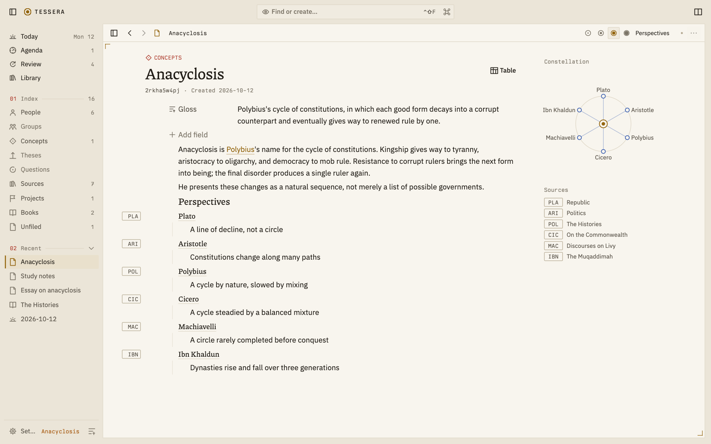
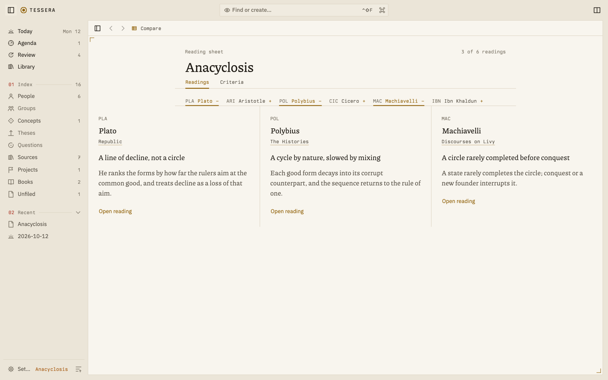
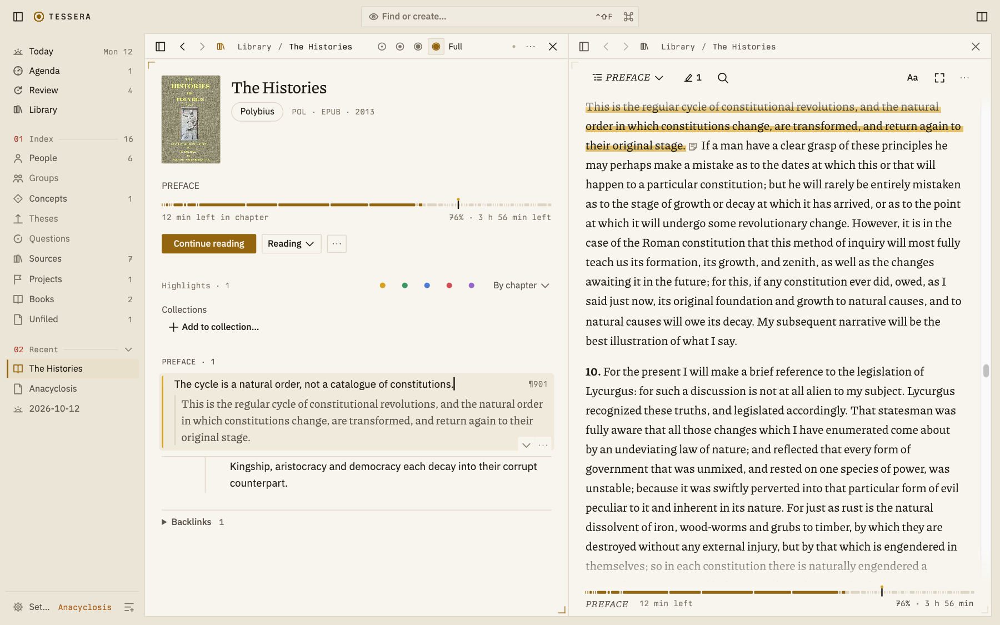
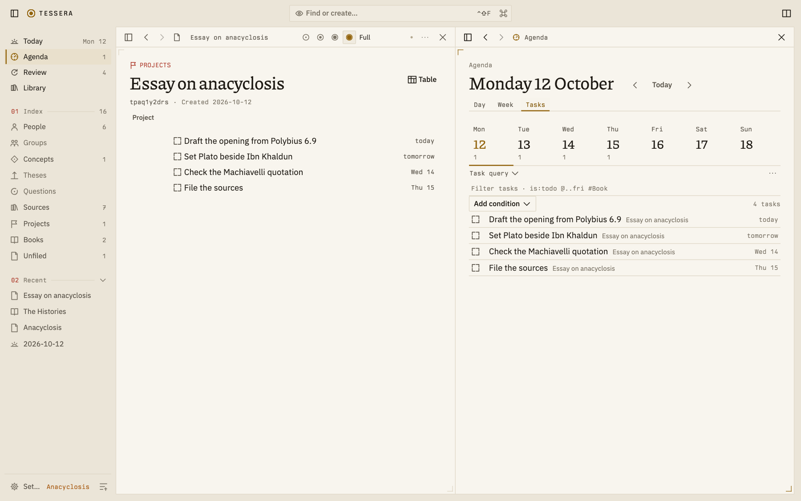
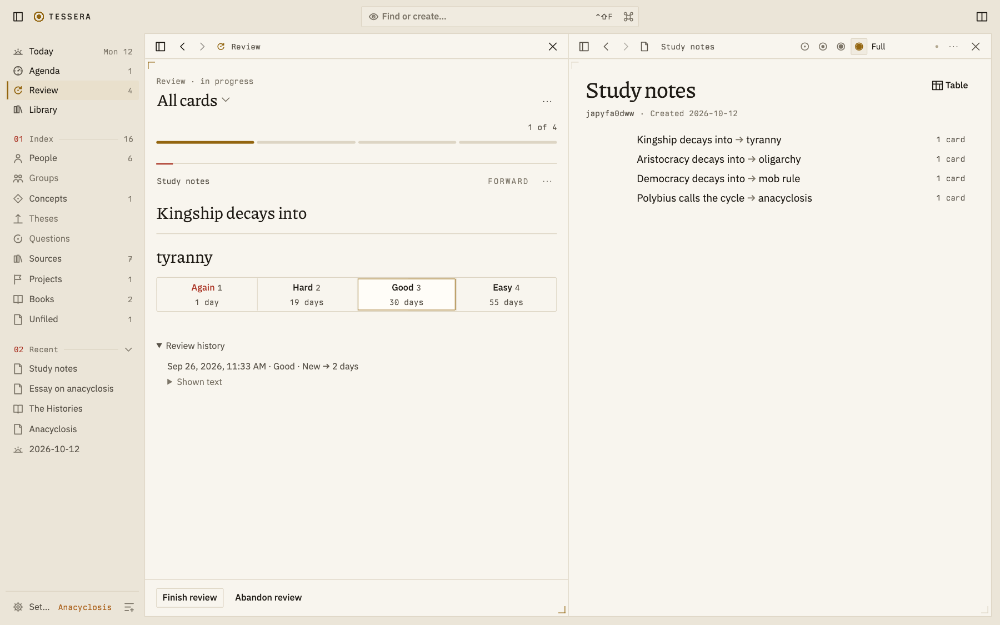

# Tessera

Tessera is a local-first outline workstation for notes, questions, evidence, tasks and study. You write in an outline of small addressable blocks. Each block is one tile; pages, journals, agendas, investigations and review sessions are different ways of arranging the same tiles.

Status: the daily outline, structure, action, learning, library and reading workflows are working. Pages, journals, references, search, fields, saved tables and two panes share operation-based autosave, undo and conflict handling. Tasks support planning, recurrence, projects, clocked work and historical agendas. Cards derive from authored notes and vocabulary, with query-backed decks, review sessions and retained scheduling history. EPUB books and web articles are ingested as immutable snapshots, read beside the outline, highlighted into cited blocks and exported as BibTeX or CSL JSON. Questions, perspectives and side-by-side comparison have started; capture and the rest of inquiry follow the [roadmap](docs/roadmap.md).

## Screenshots

The notebook below studies anacyclosis, Polybius's cycle of constitutions. Its quotations come from W. R. Paton's public-domain 1923 translation.

### Perspectives on one idea

Each thinker's position sits under the idea it answers, with its source's siglum in the margin and a constellation of every holder beside the page.



### Compare positions

Compare presents selected readings side by side, with source sigla, shape marks beside the holders and each account's prose. Authored questions sit below the sheet; fields remain in the source outline.



### Read and cite sources

A source page sits beside its reader. Highlighting a passage writes an ordinary block on the source page that cites it.



### Tasks and agenda

Project tasks stay in their outline. In Agenda's Tasks view, one query line filters by project, state and dates, and each term becomes a removable chip. Add condition brings task, source and field filters into one searchable picker.



### Review beside the notes

Review a deck beside the notes its cards come from, on a quiet reading sheet with a compact grading strip, interval previews and the card's retained history.



## What it is for

- **Writing in outlines.** Nest, move, fold and zoom blocks with the keyboard or the mouse. Vim users get real Vim motions inside a block and structural commands across blocks.
- **Reusing thoughts without copying them.** A reference shows the original block's current text. Editing the original updates every place it appears.
- **Questions that change their answers.** An investigation keeps its dated assessments. Accepting a new answer supersedes the old one without erasing it.
- **Several accounts of one thing.** Sources, passages and attributed positions stay distinct, so disagreement is visible instead of averaged away.
- **Work and study attached to knowledge.** Tasks, schedules and flashcards live on the blocks they concern, with their history intact.
- **Agents as ordinary clients.** Command-line tools and language-model agents use the same checked operations as the editor. They never write to the database directly.

## Principles

1. Never lose work. Unsaved, saved, conflicted and superseded are different states, and the interface says which one applies.
2. Identity outlives wording. Moving, editing or referencing a block keeps its ID, its cards and its history.
3. Structure is added, not chosen up front. A block can gain a task, a question, a card or a type without becoming a different object.
4. Don't drop a frame. Typing, scrolling and navigation have explicit budgets, measured on large notebooks.
5. Quiet and keyboard-first, in a dark or light theme, with every action also reachable by a visible control.

## Documents

- [Vision](docs/vision.md): who it is for and what it must do.
- [Lessons](docs/lessons.md): what the prototype proved and what it got wrong.
- [Domain model](docs/domain-model.md): blocks, capabilities and their rules.
- [Architecture](docs/architecture.md): runtime, editor, storage and sync decisions.
- [How it works](docs/how-it-works.md): the implementation as built, and where to look when something breaks.
- [Sync](docs/sync.md): replicating a notebook between your own devices, and what keeps collaboration possible.
- [Design](docs/design.md): the browser client's tokens, shell, rows, tables and popups.
- [Performance](docs/performance.md): budgets, the measured baseline and the spikes that decide the stack.
- [Roadmap](docs/roadmap.md): build order and exit criteria.

## Install

### macOS app

Download `Tessera_<version>_aarch64.dmg` from the [latest release](https://github.com/solforged/tessera/releases/latest) and drag Tessera into Applications. The app is ad-hoc signed, not notarized, so macOS blocks the first launch: open it once, then choose Open Anyway under System Settings → Privacy & Security (or run `xattr -dr com.apple.quarantine /Applications/Tessera.app`). Later updates install without that step.

The app is a window onto the notebook service, which keeps running as a launch agent when the window is closed, so the command line, agents and ingestion jobs keep working. At launch it makes sure the agent runs the `tessera` inside the app: if the agent runs another build, it stops the service, backs up the notebook, starts the app's build and waits for it to answer. If that build does not answer, the previous build restores the backup and runs again, and the app says so. An existing agent keeps its notebook and port.

The app checks the latest GitHub release a minute after launch, every six hours, and from Tessera → Check for Updates…. It downloads and verifies a signed update, then asks to restart; restarting moves the service onto the new build with a backup first. Closing the window hides it; Quit stops the window, not the service. View → Reload reloads the page, and the window reloads by itself when another build starts serving. Help → Show Service Log opens `~/Library/Logs/tessera/serve.log`; the app writes its own steps to `desktop.log` beside it. To use the bundled command line, link it onto your path: `ln -s /Applications/Tessera.app/Contents/MacOS/tessera ~/.local/bin/tessera`.

### Android app

`crates/tessera-android` is a Tauri 2 app for Android phones and foldables. The notebook runs inside the app, in its private storage, and the pages reach it over Tauri's IPC, so nothing listens on a port. The phone keeps its own notebook; it does not sync with a desktop notebook. Library → Add opens Android's file picker for EPUBs. Long-pressing the app icon offers New note and New task, which open Add to today over the current page with the keyboard up; text or a link shared to Tessera opens it with that text. Web articles, backups and service details are left out, as in the browser demo.

Build a debug APK for arm64 and install it on a phone with USB debugging enabled:

```sh
mise run android:build
adb install -r crates/tessera-android/gen/android/app/build/outputs/apk/universal/debug/app-universal-debug.apk
```

mise provides the JDK and the Android SDK; the SDK needs an NDK (`sdkmanager --install 'ndk;<version>'`), or `NDK_HOME` must name one. Extra arguments go to `tauri android build`. The Gradle project in `crates/tessera-android/gen/android` is committed; `tauri android init` regenerates it.

### Command line

Build a self-contained binary with [mise](https://mise.jdx.dev), which installs the pinned Rust, Bun and wasm tools from `mise.toml`:

```sh
mise install
mise run cli:install
tessera install
```

On macOS, `tessera install` starts a launch agent and opens the service at <http://127.0.0.1:4318>. Open that URL in a browser. The agent starts at login and restarts the service if it exits. It writes stdout and stderr to `~/Library/Logs/tessera/serve.log`. `tessera uninstall` stops the agent and removes its plist, not the notebook. Install and uninstall are macOS-only; on Linux run `tessera serve` directly.

Install stops the running service, backs up the notebook beside it (listed under Settings → Backups), starts the new service and waits up to a minute for this build to answer. With `--rollback /path/to/previous/tessera`, a build that does not answer is replaced by that executable, which first restores the backup.

To choose a notebook or port, use `tessera --notebook /absolute/path/to/notebook install --port 4397`. `TESSERA_NOTEBOOK` also persists that notebook choice in the agent. Without either, the service opens the notebook last chosen in Settings → Notebooks, or else the one in the platform data directory. Install refuses a binary under `target/debug` unless `--allow-debug` is given.

Settings → Notebooks switches the running service to another notebook folder, or starts an empty one. The service drains, releases the old notebook and restarts itself on the new one at the same ports, and every open window reloads on it; a window still holding the old notebook's identity is refused (`409 notebook_changed`) rather than allowed to write into the new one. The list lives in `notebooks.json` in the platform data directory's `tessera` folder. A service started with `--notebook` can switch too, but the choice lasts only until it restarts.

The `embed-web` feature compiles `web/dist` into the binary. `tessera serve` needs no `--assets` flag; `--assets web/dist` still overrides the embedded editor during development. Builds without that feature serve only the API unless given `--assets`. The service remains loopback-only.

Logs go to stderr through `tracing`. `RUST_LOG` selects the filter, defaulting to `info`; the launch agent sets `RUST_LOG=info`. CLI JSON and exports remain on stdout.

### Building the app

`mise run desktop:build` builds the editor, the command line and `target/release/bundle/macos/Tessera.app` for this Mac; extra arguments go to `tauri build`, such as `--bundles app`. To develop the window against a development service, run the built app's binary with `TESSERA_DESKTOP_URL=http://127.0.0.1:4320/`; it then leaves the launch agent alone and never updates itself.

The macOS app accepts EPUBs opened from Finder, imports them into its notebook and shows the Library. To make it the default, select an `.epub` in Finder, choose **Get Info → Open with → Tessera → Change All…**. On Android, choose **Tessera** in the EPUB's **Open with** chooser, then **Always**; **Share → Tessera** also imports an EPUB. Android reads the sender's content URI while its permission grant is active, copies it into a private inbox, and clears that copy after submitting the import. Both shells show upload errors and ingestion progress through the Library.

While the app runs, **⌘⇧E** from any app opens a small Add to today panel: type a line, press Enter, and it lands at the end of today's journal while focus returns to the app you were in. Inside Tessera, **⌘E** (File → New Capture) opens the same line over the current page. If another app already holds ⌘⇧E, Tessera starts without it and notes that in `~/Library/Logs/tessera/desktop.log`.

Releases come from `v*` tags matching the workspace version. `.github/workflows/release.yml` first publishes the app, its DMG, the macOS command line, the signed updater archive and `latest.json`, which installed apps poll, then adds the Linux command line. Signing the updater archive needs the `TAURI_SIGNING_PRIVATE_KEY` secret, whose public half is in `crates/tessera-desktop/tauri.conf.json`. Losing the private key strands installed apps on their version.

### Shipping a build

`mise run ship [commit]` makes a commit (default `HEAD`) the installed app on this Mac. It builds Tessera.app in a separate worktree under `~/Library/Caches/tessera/ship`, so uncommitted edits never ship. It quits the app if it is running, replaces `/Applications/Tessera.app`, and runs the app's `tessera install` with the agent's previous executable as the rollback, so the notebook is backed up and the new build must answer. On success it links `~/.local/bin/tessera` to the app's command line; on failure it also puts back the previous app. It reopens the app if it was running. Settings shows the build's commit. A release newer than the shipped version replaces it through the app's updates.

### Backup and restore

```sh
tessera backup /path/to/new-backup
tessera info --notebook /path/to/new-backup
tessera --notebook /path/to/restored-notebook restore /path/to/new-backup
```

Backup can run while the service is running. Its destination must be empty. It contains an online SQLite snapshot (`notebook.db`), immutable `objects/` files and `manifest.json` with the notebook ID, schema version, backup timestamp, object count and database page count. Restore preserves notebook identity and checks migrations. Stop the destination service first. Restore refuses a non-empty destination unless `--force` is passed; that flag never bypasses a live service lock.

### Syncing a replica

```sh
tessera --notebook /path/to/replica sync clone http://127.0.0.1:4318
tessera --notebook /path/to/replica sync
tessera --notebook /path/to/replica sync status
tessera --notebook /path/to/replica sync conflicts
tessera --notebook /path/to/replica sync pin <source-id>
tessera --notebook /path/to/replica sync reclone
```

A running service is the hub. `sync clone` copies its notebook, without original book files, into an empty directory and registers it as a new device. `sync` pushes the replica's changes, files and reading positions and pulls the hub's. When both sides changed one block's text, the hub keeps its text and adds the replica's wording right after it; `sync conflicts` lists those copies and any changes the hub could not apply. A replica keeps every cover; a book's images arrive when it is opened, and `sync pin` keeps a book's original file and images ahead of time. A replica that has not synced for 30 days is retired: its next `sync` still sends its changes, then asks for a new clone, which `sync reclone` makes in place, keeping pins and files. Stop any service using the replica first. Phones and other machines sync this way once the tailnet listener lands; see [sync](docs/sync.md).

### Agents

`tessera mcp` is a Model Context Protocol server on stdin and stdout. It talks to the running service, so start the service first (`tessera install` or `tessera serve`). Register it with an MCP client, for example Claude Code:

```sh
claude mcp add tessera -- tessera mcp
```

Other clients take the same command in their JSON configuration: `{"command": "tessera", "args": ["mcp"]}`, adding `--notebook /path` before `mcp` for a non-default notebook.

Seven tools read:

| Tool | Returns |
|---|---|
| `tessera_search` | Blocks matching text, with their pages. |
| `tessera_list_pages` | Page titles, optionally with journal days. |
| `tessera_read_page` | A page, journal day or one block's subtree as an indented Markdown outline. Each block's comment gives its ID and revision, tags, task planning, project, question, citations and cards; field entries show as `Name::`. |
| `tessera_tasks` | The agenda for a day or a run of days, or tasks filtered by status, dates, priority, project or a saved task view. |
| `tessera_cards` | A block's or page's cards, the due, new or full queue (optionally a deck's or a type's), review statistics, or decks. |
| `tessera_query` | Types, fields and saved views, or a type's or view's blocks with their field values, filtered and sorted by field name. |
| `tessera_library` | Sources, a source's contents, its passages in order from an ordinal with passage IDs, passage search, or highlights. |

Seven tools write:

| Tool | Change |
|---|---|
| `tessera_add_note` | Appends a Markdown outline to the end of a page, a journal day or a block, creating a missing page or day; without a target it writes to today's journal. List items nest by indentation, headings contain what follows them, and `- [ ]`, `- [x]`, `- [doing]`, `- [waiting]` or `- [cancelled]` items become tasks. The result names the cards the note made and any card syntax that made none. |
| `tessera_edit_block` | Replaces a block's text or heading level; editing a page's root renames the page. |
| `tessera_move_block` | Moves a block and its children after a sibling, or first or last under a parent. |
| `tessera_delete_block` | Deletes a block and its children, or a page. |
| `tessera_set_task` | Makes a block a task or changes its status, scheduled date and time, deadline and time, warning days, repeat or priority; done records a completion. |
| `tessera_hold_card` | Holds a card out of review, or releases it. |
| `tessera_cite` | Links existing blocks to library passages: a whole passage, a range, or the first occurrence of a quote. |

Written text follows the editor's syntax. `[[Title]]` links the page with that title and creates it when missing. Card operators (`>>`, `<<`, `<>`, `>>>`, `>>1.`) and clozes (`{{c1::answer}}`) make cards. A child block `Name:: value` becomes a field entry on its parent, creating the field when missing. A write given a block's or card's revision is refused if it changed since it was read.

Each write is one change attributed to the agent by its MCP client name, and open windows show it at once. `tessera_recent_changes` lists agent changes and `tessera_undo` reverses one; Settings › Agent changes lists them too, with an Undo button. Undo refuses rather than overwrite a later edit by anyone else, so undo several changes newest first. A page or field the change created stays while other blocks use it.

Agents without MCP use the same endpoints: `POST /api/agent-changes` with a body like `{"actor": {"kind": "agent", "name": "my-agent"}, "kind": "add_note", "target": {"kind": "page", "title": "Inbox"}, "blocks": [{"text": "A thought", "children": []}]}`, `GET /api/agent-changes` to list and `POST /api/agent-changes/{seq}/undo` with `{"actor": …}` to undo. The other kinds are `edit_block`, `move_block`, `delete_block`, `set_task`, `set_card_held` and `cite`; `crates/tessera-core/src/agent.rs` defines their fields.

## Development

Requires [mise](https://mise.jdx.dev). `mise install` installs the toolchain pinned in `mise.toml` and `mise.lock`; `mise tasks` lists the tasks, which the CI workflows run too.

```sh
mise install
mise run serve
```

`serve` builds the editor and serves the notebook in `.tessera/dev` at <http://127.0.0.1:4320>. Port 4318 belongs to the installed app. Without `--notebook` (or `TESSERA_NOTEBOOK`), `tessera` uses the notebook last chosen in Settings → Notebooks, or the platform data directory's `tessera/notebook`. A missing notebook is created; an existing one is never overwritten.

For live reloading, run `mise run serve --dev-origin http://127.0.0.1:5173` and `mise run web:dev` in a second terminal, then open <http://127.0.0.1:5173>.

`mise run seed:clickaround` writes a notebook for click-through testing to `~/.local/share/tessera/notebooks/clickaround` (or the folder given) and adds it to Settings → Notebooks. It holds the week ending today: journal days, two projects with tasks, clocked work and completions, repeating routines, people and concepts with typed fields, cards with a week of review history, the bundled *Meditations* with highlights, catalogue records, collections and saved views. Everything is written through a temporary service's API. Pass `--replace` to start again on the current week; it refuses while a service has that notebook open.

The service binds to loopback only and rejects other hosts and browser origins. `tessera info` prints the notebook's identity as JSON.

Checks: `mise run check` runs formatting, Clippy, the Rust and editor tests, and the editor build; `mise run fmt` formats. Backend budgets: `mise run bench --root /tmp/tessera-bench --fail-on budgets`. `mise run fonts:keys` redraws the key glyphs in `web/src/ui/fonts/keys.woff2`.

### Browser demo

<https://tessera.solforged.io> runs the real notebook engine in the browser: `tessera-core` and the service's notebook and library routes compile to wasm (`crates/tessera-web`) and run in a worker over SQLite in the browser's private storage. The tour seeds a public-domain EPUB from Project Gutenberg (Marcus Aurelius' *Meditations*, `web/src/demo/meditations.epub`) for the library and reader, and visitors can upload their own EPUBs. Web articles, backups and service details are left out. Build it with:

```sh
mise run demo:build
```

It compiles the engine with the wasm32 target, binds it with wasm-bindgen into `web/src/demo/pkg`, shrinks it with `wasm-opt`, then builds the pages.

The output in `web/dist-demo` is static; serve it with every non-asset path rewritten to `demo.html` (see `web/vercel.json`). `.github/workflows/demo.yml` builds and deploys it to Vercel on each push to `main` once the `VERCEL_TOKEN`, `VERCEL_ORG_ID` and `VERCEL_PROJECT_ID` secrets exist.

## Acknowledgments

Tessera borrows ideas from tools and thinkers its author admires:

- **Outliners with addressable blocks**, such as Logseq, Roam Research, RemNote, and Tana: outline-first writing, journal days, block references and backlinks.
- **org-mode and org-roam:** scheduled and deadline dates, repeaters, an agenda and clocked work connected to notes.
- **Vannevar Bush's memex:** associative trails that keep the context of discovery close.
- **[FSRS](https://github.com/open-spaced-repetition/py-fsrs)** for memory scheduling, and **Anki's** four-grade review.

## License

[MIT](LICENSE).
