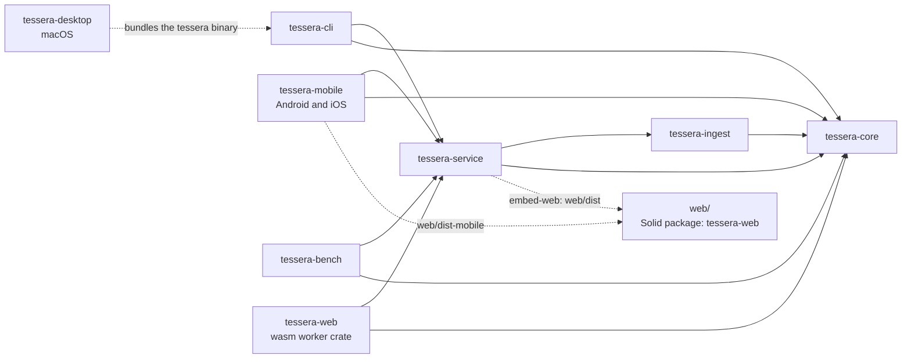

# Architecture

Tessera is a local Rust service that owns one SQLite workshop, plus a browser editor and other clients that talk to it. The prototype's measurements show that its slow paths came from doing page-sized work per edit, not from its framework, SQLite or HTTP. So the stack stays familiar and the work per edit gets small.

The main processes and how they connect. The service on the Mac owns the workshop and is the hub that replicas sync with, including other Macs (not drawn). The phone app and the browser demo each run `tessera-core` in their own process.

```mermaid
flowchart TB
    subgraph Mac["Clients on the Mac"]
        Browser["Browser editor"]
        Desktop["Tessera.app window<br/>tessera-desktop"]
        CLI["tessera CLI"]
        MCP["tessera mcp<br/>for agents"]
    end
    subgraph Hub["tessera serve, run by the launch agent"]
        Service["tessera-service<br/>one writer"]
        Core["tessera-core<br/>rules and transactions"]
    end
    DB[("`notebook.db`<br/>SQLite")]
    Objects[("objects/<br/>original files")]
    subgraph Phone["Android and iOS app"]
        AndroidPage["Editor WebView"] -->|"Tauri IPC"| AndroidHost["tessera-mobile<br/>embedded router + core"]
        AndroidHost --> AndroidDB[("private workshop")]
    end
    subgraph Demo["Browser demo"]
        DemoPage["Demo editor"] -->|"postMessage"| Worker["wasm worker<br/>tessera-web + core"]
        Worker --> OPFS[("OPFS SQLite")]
    end
    Browser -->|"HTTP + WebSocket, loopback"| Service
    Desktop -->|"HTTP + WebSocket, loopback"| Service
    CLI -->|"HTTP, loopback"| Service
    MCP -->|"HTTP, loopback"| Service
    CLI -.->|"install, serve"| Hub
    Service --> Core
    Core --> DB
    Core --> Objects
    AndroidHost <-->|"sync: HTTPS through Tailscale Serve"| Service
```

## Decisions

| Area | Choice | Why |
|---|---|---|
| Core | Rust library `tessera-core` | Transactions, identity rules and derivation in one tested place |
| Storage | SQLite, WAL, FTS5, `synchronous=FULL`; source files in a SHA-256 object store beside it | One workshop directory the CLI and backups can use; durable on power loss; books don't bloat the database |
| Service | Rust `tessera-service` on loopback | Single owner of the file; every client gets the same rules |
| Transport | JSON operations over HTTP; change stream over WebSocket | Agents can use plain HTTP; windows get pushed updates without polling |
| UI | Solid, TypeScript, Vite | Fine-grained updates: typing touches one row, and structural edits cost less than React's list reconciliation in spike 2 |
| Text editing | CodeMirror 6, one active editor per pane, with its Vim extension | Real Vim motions and IME handling without writing a text engine |
| Outline rendering | Plain DOM rows, virtualized with TanStack Virtual for Solid | Bounded memory, mount time and layout cost on large pages |
| Drafts | IndexedDB outbox of pending operations | Asynchronous, incremental, no quota cliff at a few megabytes |
| Packaging | Browser, plus a Tauri macOS app that wraps the same pages and updates itself, and a Tauri Android and iOS app that runs the workshop in process | The macOS app adds a window, menus and signed updates; the service stays the single owner, so the CLI and agents work with the window closed. A phone has no service to own its workshop, so the phone app is the owner |

Each choice has a spike that can overturn it. See [performance](performance.md).

## Core

`tessera-core` exposes typed operations: create, edit text, split, merge, move, indent, delete, restore, add or remove a capability, and so on. Each runs in one transaction. It checks the base revision, applies the change, updates derived data (links, search, types from text, cards), writes a change row and returns the new revisions. A change row carries a global change ID and the device that made it; IDs the change itself creates are derived from it, so another device applying the same change gets the same rows (see [sync](sync.md)).

Reads are set-based. Loading a page is a handful of queries for blocks, links, capabilities and field values, never one query per block. Sibling order uses sparse ordinals with an index, so moves don't rescan siblings.

Field values are indexed as the text that produces them is written: an owner, a field, an entry and a value block. The index stores no copies of text; a query reads the value blocks through the field's current kind, so changing a kind never touches the index. Field-presence queries use whole entry references in the link index, not value counts, so empty entries remain discoverable. Queries gather candidates by type membership, full-text search or field ownership, then filter and sort the readings in memory, which keeps every comparison rule in one place.

Tasks and projects store retained capability rows keyed by block ID. Task occurrences and work sessions remain separate audit records. Capability writes check the owning block revision; semantic no-ops do not bump it. Page reads and change events carry set-based capability sidecars, including identity-protection flags for retained task/project or review history.

Card units use a unique source-block/role-key identity. Authored text changes derive only the affected sources, once at the end of the batch; grading or resetting first flushes preceding authored source edits. Existing deferred tag renames still rewrite after explicit operations. Migration 009 backfills definitions once without changing source text or revisions. Reopening a current workshop does not rebuild cards.

Library sources and citations are retained capabilities. Immutable snapshots and passages are staged separately from attribution; attaching them and creating metadata fields uses ordinary operations. Original bytes and extracted resources live at `<workshop>/objects/<first two SHA-256 hex digits>/<remaining 62 digits>`. Writes use a same-directory temporary file, sync its contents, publish without replacing an existing object, then sync the directory. Passages have a separate insert-only FTS5 index. Reading coverage and persistent ingestion jobs are operational state rather than authored outline changes.

Review, deck and task-view operations use the same attributed, idempotent batch path. Their resource revisions stay separate from block revisions in receipts and change notifications. Immutable review events retain the shown definition and before/after scheduler state. Task/card source queries reuse field-query selection without its intermediate row limit; outer capability filters and ordering run before truncation.

Review corrections live in append-only `review_undos`; the effective-events view excludes corrected grades from scheduling, counts and session progress. Evidence order is `(change_seq, event_order, id)`, with `event_order` derived from the operation's position within its command, never a local rowid. Migration 035 reconstructs older ordering from retained operations. Sync repairs retained pre-upgrade review patches inside the transaction before publishing their effects.

## Service

`tessera-service` holds the workshop's one connection behind a lock, so reads, agent context queries and writes take turns.

Editor receipts and change streams use the local `editor_events` cursor, not replicated `changes.seq`. `GET /api/changes/head` reads it without loading payloads. A cold window reads the head before settings, roots or pages, then catches up and subscribes from that floor.

Page snapshots store their replay floor with the cached page in one IndexedDB record. An acknowledgment cannot advance it past unseen changes from other writers:

- Normal page opens fetch fresh snapshots.
- Offline restores refresh cached pages and resume from the oldest restored floor.
- Unknown floors, cursors ahead of the server after a journal reset, or gaps over 500 events reload open documents and reseed from the head rather than replay workshop history. Pending commands stay in the outbox.

Revision checks make overlapping snapshot and event reads idempotent. Sync-actor events still force structural page reloads. The CLI uses a running service; otherwise it explains how to start one with `serve`.

Capability endpoints expose task plans and occurrences, project descendants, work sessions, card previews and review history, saved task views, decks and review sessions. Writes remain batches, not separate unchecked resource mutations. Their receipts and stream events carry changed capability/resource IDs as well as block changes, so an open source and its agenda or review stay consistent.

Agents write through `POST /api/agent-changes`:

- Add a note to a page, journal day or block named by title, date or ID.
- Edit, move, delete or set the task of a block by ID.
- Hold or release a card; create, change or delete a deck.
- Cite library passages from existing blocks.

Under the writer lock, the core plans ordinary operations from current state and commits one attributed batch. It creates missing target pages or days, links hand-written `[[Title]]` references and converts `Name:: value` shorthand by the editor's rules, creating missing field definitions.

Every committed batch appears in `/api/history` with its actor, origin, reason, summary and undo eligibility. Local batches whose operations all have safe inverses store them in `change_history` in the same transaction, built from targeted reads of each operation's block, card or deck just before it applies; agent plans also track the pages and field definitions they created. Batches with an operation that has no inverse (split, merge, review grades, ingestion, settings, views, definition edits) and remotely applied changes are listed without one. Undo commits another attributed batch and links both entries:

- An intervening edit by anyone fails its revision check and refuses the undo.
- Blocks, cards and decks touched only by later change-and-undo pairs count as unchanged, so changes undo newest first; undoing an undo reactivates the earlier edit.
- Created pages and field definitions are deleted only while nothing outside the change lives on them or links to them.

`tessera mcp` wraps these endpoints and service reads as Model Context Protocol tools over stdio. Reads cover pages, search, tasks and agenda, cards and decks, typed queries, library and sync state. The service remains the only writer.

Ingestion runs in one service worker. Network fetches and parsing happen off the write connection; the worker stages content-addressed snapshots, then commits the source attachment and metadata as an attributed batch. Extractors live in `tessera-ingest`, which has no database access, so each format is tested on files alone. Persistent jobs resume after restart and retry transient network/server failures after 30 seconds, two minutes and ten minutes before failing the fourth attempt. The worker never holds the workshop mutex across network I/O.

The service binds to loopback and rejects untrusted hosts and origins. Remote editor access is out of scope; devices sync through a separate listener described in [sync](sync.md).

Local deployment uses one binary built with `embed-web`, which compiles the built editor into `tessera-service`. `--assets` remains a development override.

On macOS, `tessera install` registers a per-user launch agent with restart-on-exit and file logging. `tessera uninstall` leaves workshop data intact. Install:

1. Stops the old service.
2. Backs up the workshop through the read-only snapshot path, so a newer build can back it up before migration.
3. Starts the new build and waits for its version and build report.
4. Given a previous executable, rolls back by restoring the backup with that executable and reinstalling it.

Structured `tracing` events cover migrations, service lifecycle and ingestion, filtered through `RUST_LOG`. Online backups use a fresh SQLite backup connection. Immutable object files are hard-linked, with a copy fallback when linking fails. Restore holds the service's OS ownership lock and opens the restored workshop to check migrations. See [Backup and restore](usage.md#backup-and-restore) for the shared store, automatic schedule and retention.

## Desktop app

`crates/tessera-desktop` is a Tauri 2 macOS app. `Tessera.app` holds the window executable (`tessera-desktop`) and command line (`tessera`), which the launch agent runs. The window holds no workshop state.

At launch, the window reads the agent's plist. If the agent runs another executable or the service reports another version or build, it runs bundled `tessera install` with a rollback target, preserving the agent's workshop and port. A failed build is remembered and not retried until a newer one arrives.

The window loads the service's own origin. Page requests pass its host and origin checks unchanged; Tauri commands stay unreachable from the workshop page. Other origins open in the default browser; downloads go to `~/Downloads`.

Updates come from `latest.json` on the latest GitHub release, signed with a minisign key whose public half is in `tauri.conf.json`. The app installs a downloaded update only when the user restarts, after copying the outgoing `tessera` aside as the rollback target. The page reloads when the service's build changes. WebKit, not Chromium, renders the editor in the app; the outline, undo, clipboard, reader, export and external links were checked there.

The window has no native title bar. It uses the overlay title bar style, and the page's rail takes its place: Tauri's drag script moves and zooms the window from `data-tauri-drag-region`, which `capabilities/main.json` allows for the splash page and the loopback service origin, and nothing else. An initialization script marks every page with `data-window-controls="inset"` before it paints, and the window switches it to `hidden` in full screen, where macOS hides the window buttons.

## Phone app

`crates/tessera-mobile` is a Tauri 2 app for Android and iOS. It opens a workshop in private app data and holds the ownership lock for the process lifetime. Recreated activities reuse that workshop rather than open a second writer.

`tessera_service::embedded_router` builds the workshop and library routes, as for the browser demo's worker. It omits host and origin policy, assets, backups, service details and WebSocket.

`web/src/mobile/transport.ts` sends requests over Tauri IPC. Bodies travel as base64 because Android IPC carries only JSON. Replies are raw frames of status, content type and body.

Changes arrive on a Tauri channel. Like WebSocket, `stream_changes` subscribes before catching up from history and returns when the page closes the stream or reloads. Nothing listens on a port, so other phone apps cannot reach the workshop.

The activity handles size and fold changes, resizing without a page reload. On a Galaxy Z Fold, reader position, the open note, caret and keyboard survived moving to the cover screen and back.

The page draws edge to edge and pads the shell by safe-area insets. Android no longer shrinks an edge-to-edge window for the keyboard, and WebView ignores `interactive-widget=resizes-content`. `MainActivity` therefore pads the content view by the keyboard inset, resizing the page above it.

Article URLs are not offered: `reqwest`'s platform TLS verifier needs JNI initialization and its Android component, which the app does not yet set up. Release builds need signing configuration in the Gradle project.

## Browser editor

The editor is split into layers that the prototype mixed together:

1. **Document store.** Blocks keyed by ID, each with its own immutable snapshot. Components subscribe to one block, so typing re-renders one row.
2. **Commands.** Outline operations (split, indent, move, fold, zoom) as pure functions over the store, producing operations for the service and inverses for undo.
3. **Text editor.** One CodeMirror instance in the focused block of each pane. Other blocks render as static DOM with reference and card decorations.
4. **Rendering.** A virtualized list of visible rows with measured heights and scroll anchoring. The focused or composing row stays mounted.
5. **Sync.** Coalesce text edits for 150 to 300 ms (1 s maximum), send them as revision-checked operations, and store pending ones in the IndexedDB outbox until the service acknowledges them. "Saved" appears only after a commit.

Undo is a stack of operations and their inverses, shared by both panes on the same page. Cross-block selection uses block ID plus offset at each end, so it works when rows are off screen.

Reader highlights that overlap or touch form one union. The earliest source-page highlight keeps its block and citation identities, color, notes and review state; unreferenced duplicates contribute their children before removal. Referenced highlights and citations on other pages remain intact. Range edits, child moves and removals share one document undo step. A reader-level action applies the same merge to existing clusters.

EPUB 2 extraction checks the package guide's HTML contents when NCX contains only sparse navigation. Existing sparse imports lazily backfill navigation from the preserved linked contents passage without replacing source, snapshot or passage IDs. Citation reads return the chapter title rather than exposing an EPUB href as the location label.

Page commands include task/project edits and work-session operations, with capability snapshots and inverses alongside text. Review sessions, decks, grades and saved task views use workshop-level commands in the same ordered outbox; they are not assigned fake page IDs. Commands are persisted before sending, and the first compiled request body is frozen for byte-identical replay after uncertain delivery or reload. Rejected commands stay recoverable until explicitly dismissed.

Structural workshop commands identify pages whose snapshots and outlines must refresh before acknowledgment is exposed to their caller. A card composer navigates only after that refresh. If the write succeeds but a subsequent read fails, the command remains pending and replays its frozen idempotent request; the form cannot submit a second insertion while delivery is unresolved.

Review keeps the shown card snapshot until acknowledgment and revalidates it against committed changes. A stale grade cannot advance the queue or silently adopt a new definition. Command-state equality isolates review refreshes from unrelated local page bookkeeping. Recovery feedback is workshop-wide and does not change location when focus moves between panes.

Two panes, back and forward history, and per-pane fold, zoom and caret state are part of the shell from the start.

## Conflicts

A stale operation fails without writing. Clean remote changes merge into the local view block by block. When a remote change touches a block with unsent local text, the local text is kept and the block shows a conflict with both versions. Nothing is merged automatically. Replicas on other devices differ: the hub rebases their stale structural changes onto its state and keeps both versions of conflicting text; see [sync](sync.md).

## Why not the alternatives

- **WASM with SQLite in the browser:** origin-private workshop storage is out of reach of the CLI, agents and ordinary backups. The browser build uses it with its own backups: Settings › Backups downloads the workshop as one SQLite file and restores one.

  `crates/tessera-web` runs `tessera-core` and the service's workshop and library routers in a worker over the OPFS SQLite pool. The editor uses a swappable transport in `web/src/api/client.ts`.

  There is no `objects/` directory: source objects are rows in the same database's `browser_objects` table. Uploads are ingested inline before the request returns. Article URLs are not offered because the worker cannot fetch other origins.

  A restore writes the file to a staging workshop, validates and migrates it there, and only then replaces the live database; opening finishes a restore that was cut off. Before a schema upgrade, opening keeps one copy of the old workshop. `sqlite-wasm-vfs` is vendored with a fix that lets SQLite roll back a hot journal left by a browser killed mid-save.

  On macOS, build with `AR_wasm32_unknown_unknown` pointing at rustup's `llvm-ar`; Apple's `ar` cannot index the bundled SQLite.
- **React:** the larger ecosystem, but its list reconciliation added about 7 ms per structural edit at 10,000 mounted rows in spike 2, against about 1 ms for Solid, for the same correctness.
- **ProseMirror or Lexical as one big editor:** better cross-block text selection, but no usable outline-aware Vim. In spike 2, ProseMirror matched CodeMirror on IME, undo and cross-block selection and failed only on Vim.
- **Canvas rendering:** would mean rebuilding selection, IME and accessibility.
- **Go or another rewrite language:** no measured benefit; the prototype's slowness was algorithmic.

## Repository layout

Arrows are local Cargo path dependencies, from dependent to dependency. Dashed arrows are build-time links: `embed-web` compiles `web/dist` into the service, the phone app ships `web/dist-mobile`, and the macOS app bundles the `tessera` binary.



```text
crates/tessera-core      domain model, migrations, operations
crates/tessera-service   HTTP and WebSocket service
crates/tessera-cli       command line
crates/tessera-desktop   macOS app: window, launch agent handover, updates
crates/tessera-mobile    Android and iOS app: workshop in process, pages over IPC
crates/tessera-bench     corpus generator and backend budget checks
crates/tessera-ingest    extractors for EPUB books and web articles
crates/tessera-web       browser demo: core and service routes in a WASM worker
web/                     Solid editor
mise-tasks/              development, build and publishing tasks
docs/                    design documents
```
