# Design

How the browser client looks and behaves. Tokens live in `web/src/tokens.css`; components use tokens, never raw values. Orrery gives the notebook a midnight desk, an ink-blue canvas and gilt focus. Reference slips, registers and perspective sheets carry the same type hierarchy into floating and comparative surfaces.

Status: applied to the shell, the outline and the table. The permanent global rail and inset workspace are being evaluated in the running app. Later stages add their sections here before they are built.

## Principles

1. **The text is the interface.** Controls stay quiet until hover, focus or selection, and every action is also reachable from a visible control.
2. **Act where you are looking.** Controls attach to the block they affect. Popups open at the caret or at their trigger, never at a pane edge.
3. **One meaning, one form.** Structure is a neutral bullet. A type is a tinted pill with its name. Task state is a glyph. Color never carries meaning alone, and type hues never reuse status hues.
4. **Work happens in panes.** Tables, views, fields, settings, search results and references open in a pane. Dialogs are for short controls and confirmations only.
5. **Summaries in the row, details on selection.** A block shows its state as compact trailing metadata; field rows appear as children under it.
6. **Calm by night and day.** A midnight shell frames the ink-blue canvas, or a vellum one by day. Gilt marks focus and primary actions. Only floating layers cast shadows.
7. **Built for long sessions.** 28 px rows, 15 px writing, a 760 px measure. Apparatus is 11.5 px; other labels start at 12 px.
8. **Keyboard and pointer parity.** Menus show shortcuts beside actions. Vim is optional.
   Unavailable menu items remain in the arrow-key order. Focus or hover shows their reason, also exposed as an accessible description; activation leaves the menu open without running the action.

## Tokens

### Type

Three voices separate writing from publication and apparatus. IBM Plex Sans Variable is bundled for your writing, inputs and ordinary controls. Piazzolla Variable is bundled in normal and italic for the names of things and for what someone else wrote: page titles, heading rows, library and work titles, displayed highlights, quotes and the reader. A quotation, highlight or passage from a book or article stays in Piazzolla wherever it is shown, including inside an outline row. The notebook's own sentences stay in Plex wherever they appear, including an outline row that cites a source: glosses and standfirsts, positions and questions, and their previews in Find and on hover. Read projection prose, including its in-place editor, stays in Piazzolla. The font belongs to the projection, never to focus. Berkeley Mono is used when installed, with system monospace fallbacks. Its commercial font files are not bundled.

Apparatus uses `--apparatus`: 400 at 11.5 / 16, with tabular numerals and slight tracking. It covers breadcrumbs, save state, Vim mode, sidebar section headings, picker metadata, counts, progress and resurfaced metadata. UI labels stay in sentence case. Key hints (`⌃⇧F`, `⇧↵`, `Space`) keep the apparatus size in the sans voice.

Plex has no modifier glyphs, so `web/src/ui/keys.css` adds a face to the Plex family with ⌃ ⇧ ⌘ ⌥ ↵ and the four arrows, drawn by `mise run fonts:keys` at Plex's cap height and stem. Without it each system's fallback drew them, at mismatched sizes on Android.

| Token | Size / line | Use |
|---|---|---|
| `--text-apparatus` | 11.5 / 16 | Apparatus in Berkeley Mono |
| `--text-meta` | 12 / 16 | Pills and labels |
| `--text-control` | 13 / 18 | Buttons, menus, sidebar, table cells |
| `--text-body` | 15 / 24 | Writing and inputs in Plex |
| `--text-quote` | 16 / 24 | Quotes and displayed highlights in Piazzolla |
| `--text-h3` | 16 / 24 | Heading 3 |
| `--text-h2` | 18 / 26 | Pane and section titles |
| `--text-outline-h2` | 19 / 26 | Heading 2 in the outline |
| `--text-h1` | 24 / 30 | Heading 1, view and dialog headings |
| `--text-title` | 32 / 38 | Page titles in Piazzolla |

Piazzolla page titles use weight 430 and optical size 30. Heading rows use weight 480 and optical size 20. Quotes use optical size 16; the reader uses 17.

### Space and size

Steps 2, 4, 8, 12, 16, 24, 32, 48 px.

| Element | Size |
|---|---|
| Row height | 28 px |
| Indent | 24 px |
| Measure | 760 px |
| Gutter left of the measure | 48 px |
| Sidebar | 208 px |
| Global rail | 48 px |
| Pane header | 36 px |
| Pointer targets | 24 px |
| Icons | 16 px, 14 px inline |

On a coarse pointer (a touch screen), targets grow to 32 px and rows to 36 px. Row menus that wait for hover elsewhere stay visible.

Every screen composes its page spacing from shared tokens, so moving between screens never shifts the title or the text column.

| Spacing | Distance |
|---|---|
| Pane inset | 24 px; 16 px below 600 px |
| Pane header to first line | 24 px; 16 px below 600 px |
| Eyebrow line to title | 4 px |
| Title to metadata or mode tabs | 8 px |
| Whole heading block to body | 16 px |
| Between sections | 24 px |
| Section head to first item | 8 px |
| Inside and between boxed cards | 16 px |
| After the last item | 48 px, plus the height of any bar fixed over the content |

Page titles are Piazzolla at 32/38 px, 24/30 px below 600 px. The [reader](surfaces/reader.md), a [live review session](surfaces/cards-review.md) and Find keep their own spacing.

### Color

Orrery uses midnight `--shell` (#0a0d13), ink-blue `--canvas` (#0e121a), parchment `--text` (#e6e1d6) and gilt `--accent` (#d8aa55). Muted text is cool gray. Rubric red `--danger` (#d97a6b) marks danger and short insertion rules; `--warning` is warm orange. Doing and scheduled work are blue; done is sage. Type and highlight hues stay separate from these roles.

Orrery by day is the light theme: the same roles on vellum, a `--canvas` of #f8f5ee inside a #ebe5d8 shell, ink `--text` (#1f1b15), antique gold `--accent` (#93650f), oxblood `--danger` (#ad3a2b) and a deeper steel blue. It overrides color tokens only, under `:root[data-theme="light"]`; type, space and shape never change, and reader figures are not dimmed.

[Settings › Appearance](surfaces/settings.md) chooses System (the default, following the operating system), Light or Dark per device, stored in local storage rather than the notebook. The entry imports `shell/theme.ts` first so the page paints in the right theme, and `index.html` paints the system theme before any script runs.

| Role | Token |
|---|---|
| Shell: global rail and sidebar | `--shell` |
| Table headers and banners | `--surface` |
| Canvas: panes | `--canvas` |
| Raised: popups, pills, chips | `--raised` |
| Hover, selection, divider, control border | `--hover` `--selection` `--line` `--control-border` |
| Selected text, in the editor, static rows and the reader | `--text-selection` |
| Text primary, secondary, tertiary | `--text` `--muted` `--faint` |
| Gilt accent and focus ring | `--accent` |
| Warning, danger | `--warning` `--danger` |
| Type hues, pills only | `--type-1` to `--type-6` |
| Task states, stage 3 | `--status-*` |
| Highlight colors: reader ink under the line, nameable on midnight, dots at full strength | `--highlight-yellow` `-green` `-blue` `-red` `-purple` |

Pills take a 12% tint of their hue with a 30% border. A selected row adds a 2 px gilt bar at its left edge; keyboard focus inside a menu looks the same, never a ring.

Controls share four shapes:

- **Modes and tabs:** [Library states and Highlights processing](surfaces/library.md), [Agenda, Week and Tasks](surfaces/tasks-agenda.md), [Review's Due, New and All](surfaces/cards-review.md), [reader settings](surfaces/reader.md), and a creator's role. They are mono labels with faint counts. The current one is gilt with a 2 px gilt rule beneath the whole tab, label and count alike, never a box or fill. Strips that switch views (Library states, Review queues, Agenda modes) stand on a hairline baseline, and every tab's rule lands on it. Forms use these tabs instead of native selects.
- **Menu triggers and date ranges:** bordered buttons with a `--line` hairline that brightens to `--control-border` on hover.
- **Text fields:** sit on `--surface` with a `--line` hairline that brightens while hovered or typed in. Agenda's add field is a bare row on a hairline under the plus.
- **Section heads:** sidebar, [journal Agenda](surfaces/journal.md), and [Settings](surfaces/settings.md). They are mono: an optional rubric numeral, the name, a hairline rule, then state or count at the right in `--faint`, with the chevron last on collapsible ones. Journal days' Journal and From your highlights set only the name as an H2, in Piazzolla at `--text-h2`; the rule, state and chevron stay as above.

Counts, dates and result lines (`1 of 1 task`, `15 of 15 rows`, `1 card · 1 due`) are mono; sentences never are. Civil dates in the apparatus read as ISO, `2026-10-03`.

Focus has one frame per control:

| Focused control | Appearance |
|---|---|
| Text field | Border turns gilt, with no outer ring |
| Mode tab | Faint rule beneath its label |
| Current mode tab | Keeps its gilt rule; its label brightens |
| Other controls | Gilt ring |

### Shape and elevation

Radius 2 px for controls, 3 px for popups, zero for the workspace and resurfaced slips, full for pills. Popups have a 1 px `--line` border and `--popup-shadow`; dialogs `--dialog-shadow`. The workspace frame has a 1 px `--line` border and no shadow. Rows and tables cast none.

Each pane has 9 px registration corners 4 px inside its content, clear of toolbars, gilt when active and `--line` otherwise. Popups carry a 24 × 2 px rubric mark at the top. The rail notebook name has an oculus mark in gilt.

A [resurfaced slip](surfaces/journal.md) sits on `--raised`, marked by its highlight color as a 2 px bar at the left. The mono source line carries the short source title, chapter or passage and date, with Open, Keep and Mute beside it.

### Motion

Motion acknowledges an action without delaying it: 140 ms for popup entry and sidebar movement, 90 ms for popup exit and hover feedback, with a short ease-out and no bounce. Popups travel 4 px; toasts and the reader's selection toolbar rise the same distance.

Its vocabulary comes from the desk: ink is drawn, leaves are laid down, marks are stamped. Rules and bars draw from an edge, a page settles from the side it lies on, a new mark arrives in gilt that fades to its resting color. Nothing springs, bounces or overshoots. Old content stays until its replacement is ready, so a change happens once, at the moment of replacement, never on stale or empty content.

- Clickable button icons scale subtly on hover, focus and press. Rows, pills and list items fade their hover fill.
- Fold and disclosure chevrons turn rather than swap. A menu trigger's trailing chevron turns while its menu is open. Recent, related sections and review history expand and collapse in place.
- A revealed answer fades in. The save state icon turns while saving.
- In the [reader](surfaces/reader.md), a page slides to the next in 220 ms (`--motion-page`), following a finger that drags it and finishing from where the finger let go. Past a chapter's edge the page fades a step aside and the next fades in from the side it lies on.
- A new highlight draws its band under the words left to right in 420 ms (`--motion-ink`). The reader's toolbar and book map drift 4 px toward their edges as they fade.
- The reader's text and a [source page](surfaces/library.md) fade in once they are ready rather than arriving in pieces. The note sheet's writing area rises from the bottom edge, and the sheet fades away once the note is kept.
- A mode strip's gilt rule glides from the old tab to the new one over 220 ms, like a ruling pen along the baseline. It appears in place when a strip first shows, follows count and width changes without gliding, and only glides for a tab the reader chose.
- A selected row's accent bar and the Library's opened-source marker draw down from the top over `--motion-ui`.
- A cover image fades in over `--motion-ui` the first time it loads; one already loaded shows at once.
- Reduced motion sets durations and travel to zero and disables icon scaling.

Pane destinations enter on target identity, not on document updates. A navigation turns one leaf with a view transition: the outgoing content stays on screen until the incoming surface has something to show (up to 400 ms), then lifts away over `--motion-fast` while the new content settles from 12 px (`--motion-leaf`) over `--motion-page`, from the right going forward and from the left going back. Pane chrome changes at once without moving, the other pane does not move, and pointer input passes through to the new page during the motion. A source cover visible on both sides, on the shelf or a Reading now card and on the source page, travels between them. A surface still loading after the hold keeps its own entry fade for when it lands. Without view transitions the content fades and rises by `--motion-distance` over `--motion-ui`.

An explicit editing destination skips the pane-turn snapshot and activates its live caret immediately. A zoomed editor with local text does not wait for catalog metadata before accepting input. The source header and field apparatus keep their space hidden until their metadata is ready.

Typed text and Backspace corrections during a caret handoff wait for the requested editor, not a delivery timeout. Pointer actions, navigation, Escape or focus moving to another editable cancel the handoff. Other editing keys and shortcuts end collection and retain native handling; the captured prefix still reaches the requested caret once. Composition and shortcuts are never replayed.

Surfaces mark what the motion waits for. A lazily loaded surface counts as pending until it renders, and a surface root carries `data-pane-pending` while it has nothing of its target to show. The reader instead carries `data-pane-loading`: restoring its position needs animation frames, which a held transition never gives, so the leaf turns at once and its text fades in where it lands. Agenda, Review, Compare, filing queue and type-view mode panels fade in over `--motion-ui` when their tab is chosen; the outgoing panel is not copied, so a long list costs nothing to leave and input belongs to the new panel immediately.

In the [Library](surfaces/library.md) a change happens once. A control answers the click at once (a tab's rule, a pressed filter, the search text), while the content it governs keeps showing the previous result until the new one is ready, then changes in a single step: the panel cross-fades from the old content to the new over `--motion-ui` with a view transition, with no blank or half-faded frame, and a toolbar row appearing above it carries it down in the same motion. A refresh that changes nothing visible does not fade. Changing Library tabs is not a navigation and never replays the pane's entry.

A Library refresh keeps each unchanged row as the same object, so cards, shelf covers and a cover traveling back from a source page stay mounted. Reading now cards keep the last source they read and take the article or book format from the row, so a card returns with its cover or spine and chapter line as it left them.

A side column, such as the catalog card, opens only once it has something to show. In that frame the page beside it moves over to make room, gliding from its old place over `--motion-page` rather than jumping, while the column settles in from 12 px and fades in; closing glides the page back. Showing another item in an open column swaps its content in place without moving or fading the column.

No animation runs while typing or restoring scroll. Reduced motion prevents content animations and view transitions, and removes tab-rule and sidebar-bar transitions entirely.

Outline folds animate the visible descendant group and following rows over `--motion-ui`, rather than running one animation per descendant. Outgoing children remain until collapse finishes; virtualization stays bounded and the active editor stays mounted. Reversing a fold settles the previous transition first. Reduced motion changes the tree immediately.

## Shell



Desktop pointer dimensions, not to scale. The pane detail shows the measure and row controls, and the apparatus margin that eligible wide concept pages gain; split panes do not.

### Voices by job

Mono is for what the machine knows: ids, dates, counts, paths and modes. Key hints are the exception, in sans at apparatus size. Sans is for what you write and for places and actions. The serif is for what was written to be read.

Glyphs mark places (Today, Agenda, Review, Library) and kinds of page; one glyph stands for one place everywhere it appears, and actions that read well as a word keep the word. Place glyphs are drawn from circles and rules like the oculus, with an optional filled hub.

### Global rail

Permanent across every pane. A three-column grid:

| Position | Controls |
|---|---|
| Left | Sidebar toggle, Tessera wordmark with its oculus and notebook-path tooltip, then the bare sync mark |
| Center of the window | Find or create with the Commands icon in one 400 px search-shaped control |
| Right | Icon-only Layout button |

Find or create shows the eye glyph and opens its picker beneath the search trigger; Commands opens the command palette. Layout opens the active view beside, moves to the next pane, evens pane widths, closes the active pane or toggles the sidebar. Global controls are never duplicated inside pane headers.

In the macOS app the rail is the window's title bar. The window buttons sit centered in its height over its left end, so its start moves in by `--window-controls-width` (84 px) except in full screen. Dragging any part of it that is not a control moves the window, and double-clicking zooms it.

### Sidebar

Width 208 px. The desk has no heading: Today, Agenda, Review and Library, in `--text` with their glyphs, each with live state at the right in mono.

| Destination | Live state |
|---|---|
| Today | Weekday and day |
| Agenda | Tasks planned for today, in `--danger` when any is overdue |
| Review | Cards, questions and notes due |
| Library | Unprocessed highlights |

Zero counts are left out. Counts refresh after each committed change, canceling a refresh still in flight, and disappear rather than go stale when a request fails.

After the desk, sections appear in this order:

1. Pinned, shown only when a page or saved table view is pinned.
2. The [Index](surfaces/notes.md).
3. Unpinned saved Views whose type is not a kind in the Index.
4. Collapsible Recent.

Section headings are mono: a rubric numeral counted over the sections shown, the name, a hairline rule and a count. Saved table views have a pin control on hover or keyboard focus, always shown on a screen without hover. Pinning is stored per notebook alongside page pins. Task views and decks are selected in their own destinations.

Settings sits at the foot above a hairline, with an icon-only Fields button beside it. A non-default notebook's name appears beside Settings in the warning color and truncates before the Settings label, which never shortens; the foot carries no build. Rows are 28 px with one left edge at 8 px. The row for the active pane's target gets the 2 px gilt bar, the selection fill and a gilt glyph. Destinations open in the active pane; ⌘-click opens beside.

### Workspace frame

The panes share one square inset canvas, with a 12 px outside gutter at the right and bottom. Collapsing the sidebar adds the same gutter on the left. The rail and sidebar use the same shell surface.

### Panes

The workspace is a row of up to four panes. Each has a header, in this order:

1. Back and forward.
2. The glyph of the place or page kind, gilt in the active pane. Typed pages reuse the outline's loaded kinds, falling back to explicit page types and the loaded index; questions and projects use their capability glyphs.
3. The pane's number while split, in faint mono.
4. Breadcrumbs or the pane title in mono.
5. Save state.
6. The Vim mode when on.
7. The page menu.
8. Close while split.

Opening beside lands in the pane right of the one it came from, replacing what is there or adding a pane at that position, so the pane you started from never changes. A fifth pane closes the pane farthest from it. A list (Library, an index, a table or the research desk) with a pane to its right opens its rows there on a plain click and keeps focus, so it stays the list; its divider carries a small arrow toward that pane.

Panes share the width equally until a divider is dragged. Dragging snaps at a third, a half and two thirds of the pair and shows the snap in a mono slip; arrow keys move a focused divider by 5%, a double click evens the row, and widths persist with the row. No pane is narrower than 420 px: panes the window cannot fit fold into 32 px spines at the row's ends, showing the pane's number in rubric red over its title set vertically. Clicking a spine shows that pane, and the row slides to keep the active pane in view.

While split, the active pane's header carries a 2 px gilt rule along its top. Inactive panes mute their title and hand their tab rules the control border, keeping the gilt for the active pane.

Holding ⌘ (Ctrl elsewhere) over anything that opens shows where a click will land before it happens: a gilt frame over the pane it would replace, or a hatched ghost of the new pane labeled `New pane N`, adding when a pane will close. Dragging a page link, a sidebar page, a backlink, a related block, an index entry or a Library row onto a pane shows the same guide: dropping on the pane replaces it, and dropping on its left or right edge inserts a new pane there. Escape cancels a drag.

Below 840 px of window width the row becomes pane tabs, numbered, over the active pane; spines, dividers and header numbers step aside.

A table pane is titled with its saved view's name, else its type's, and an index pane with its kind's plural. Breadcrumbs reserve at least twelve mono characters for the current title and ellipsize its ending; ancestors may shrink. Below 840 px of pane width, the depth dial collapses to its current iris, and unavailable projection tabs, Read's reason and the Vim tag step aside. Below 600 px of pane width, ancestors, the kind glyph and unavailable history buttons step aside too. If the remaining controls cannot share a line with the title's minimum, they wrap instead of erasing the title.

On journal days the page menu leaves out what only titled pages can do (Rename, Merge into…, Description, Stream and Question) rather than listing it disabled. Saved shows as a 4 px dot with a hidden label only after the service acknowledges the text. Queued and fast saves keep the quiet dot but its hidden label says Saving…; slow saves, offline and errors speak in sans, errors in `--danger`.

The Vim mode shows only in the active pane, as a hairline-boxed mono tag of fixed width:

| Mode | Appearance |
|---|---|
| Normal | `--text` |
| Insert | Gilt |
| Visual | `--selection` |
| Blocks, while moving between blocks | `--muted` |

Every label is six letters, so a mode change never shifts the header.

[Journal headers](surfaces/journal.md) also hold their own previous-day, calendar and next-day controls; these always target the owning pane. Page errors stay under their owning header. Notebook recovery feedback appears once above every pane, so activating a pane cannot move a control between pointer-down and click.

Non-page panes (table, fields, settings, agenda, review, library, reader, index) share the workspace frame.

### Agent dock

The agent dock is a 360 px column right of the workspace, framed like it, so opening beside never pushes it away. The rail's agent glyph, a four-point star in `--agent` (inquiry's steel, never the gilt), or ⌃⇧A shows and hides it; the choice is kept per device. Below 1048 px it lies over the panes as the sidebar does, and below 600 px it takes the screen. It hides in reader full screen and does not exist in the browser demo.

From the top:

1. A header: the glyph, `Agent`, the model in use as a mono menu of the connected models with Agent settings…, and Hide.
2. Context: a mono line, `Reads N pages · drag links here to add`, over one chip per page in a shown pane (a zoomed pane sends its block). × leaves a pane's page out and strikes its chip through; + takes it back. Links, rows and references dragged onto the dock add chips of their own, whose × removes them.
3. The thread: `You` and `Agent` in mono over each turn. Your words sit on `--raised`. The agent's text renders references as links. Reading and searching show as faint mono lines (`Read Asabiyya`). Each change it makes is a card with a 2 px `--agent` bar: its page in mono capitals, what it did, then Show, which brings the row into view in its pane or opens the page beside and lights the row once, and Undo. An undone change reads Undone; a refused undo says why under the card.
4. The composer: three lines, Enter sends and Shift-Enter starts a line; Send turns into Stop while the agent works, and Clear empties the thread when it rests.

With no model connected the thread says `Connect a model` and offers Agent settings. Rows the agent changed carry a 2 px `--agent` bar at the left and the agent glyph in the outside rail, above any backlink count; the glyph opens the change with Undo. Marks last as long as the thread.

Settings › Agent lists the models: name, then mono kind, model and whether a key is saved, and the address. Each has Test, Edit, Remove and Make default. Adding or editing opens a form in place: presets (Anthropic, OpenAI, OpenRouter, Ollama, llama-server) fill the name and address; Speaks chooses Anthropic or OpenAI-compatible; Model is typed as the provider names it; Key is write-only, with Forget the saved key. Models and keys stay on the machine, outside the notebook, its backups and sync.

### Narrow layouts

| Width | Behavior |
|---|---|
| Below 1048 px | Sidebar becomes a toggleable overlay |
| Below 840 px | Working-pane tabs show one pane at a time, in the mode-tab style: rubric pane number, mono title, gilt rule under the current pane, and Close pane at the strip's end |
| Below 600 px | Find or create, Commands and Layout retain accessible labels on icon controls; workspace gutter shrinks to 4 px |

While the sidebar is open, a shade in the shell color dims the workspace beside it. Tapping or clicking the shade closes the sidebar. On the cover screen the open sidebar covers its own toggle, so it opens on a masthead instead: the oculus and TESSERA wordmark with Close sidebar at the right, then the notebook name and its note count in mono apparatus, over a hairline. The name is always shown there, in `--warning` for a notebook other than the default, and the foot leaves it out. Hidden navigation is inert immediately, including during its exit.

Below 600 px:

- Outlines take the 16 px pane inset like every page. Titles and headings start at that edge, only the bullet stays left of the text, and the fold and block menu move to the end of the row being edited or selected.
- Field labels stack above values, so long values keep the measure.
- The [library search](surfaces/library.md) takes its own line above sort, export and add.

The global rail stays visible in every layout except the cover screen (a touch screen under 600 px), where a bottom nav replaces it: Today, Agenda, Find, Review and Library. Today selects only today's journal, Agenda and Review select their own panes, and Find selects while its picker is open. Library selects only the Library pane or a reader; source pages, type indexes, tables, Fields and Settings select no primary place. The rail's sync status moves to a row above the nav, shown only while sync is not Synced. Library's long press lists the note types in use. The sidebar opens from a button at the start of the pane header, a book's breadcrumb is its title alone, and the nav steps aside while the keyboard is up. Unfolding brings the usual shell back around the same page.

### Mac menus

Settings opens from the Tessera menu. File › New offers Page (⌘N), Question (⌥⌘N), Task, Card, Project and Source…. File also offers Open Today (⌘T), Import Book… and Add to Today (⌘E), using the same commands as the web shell and bringing the main window forward. The Dock menu offers Add to Today, New Page and New Question through those same commands. About shows the release version with the build hash in parentheses when available.

### Measure

Outline content is at most 760 px, centered, so a note's title sits where every other screen's title does. A gutter of two pointer targets (48 px, 64 px on touch) hangs left of it for row controls. Panes share the width; text never shrinks to fit.

The first four visual depths have equal indentation steps; subsequent steps get progressively smaller, approaching but never reaching eight normal steps or one quarter of the pane's content width, whichever is smaller. A bare mono nesting-depth number in the left gutter identifies each compressed row. Ancestor threads retain the first four levels, and field slots use the same compressed positions. Stored depth, row accessibility levels, folding and zoom keep the full hierarchy.

### Find or create

One picker searches pages, blocks, highlight quotations and authored text or tags, and the passages inside books; a leading `>` switches to commands. Everything, Highlights, Books and Pages chips filter grouped results under mono headings and live counts, in this order:

1. Highlights.
2. Pages and notes, or Books when every result is a book page.
3. An explicit Create page row.
4. In your books.

A block already shown as a highlight is not repeated among the note results. Other note matches occupy one column, with their text clamped to two lines and the containing page title as mono apparatus beneath.
Queries with no full-text word tokens, including emoji and punctuation, match authored display text literally and never turn empty name folding into a wildcard.


| Result | Search and metadata |
|---|---|
| Highlights | Case-insensitive quotation, authored text and tag matching against up to 500 highlights loaded once per opening |
| Passages | Search starts after three characters, debounces by 100 ms and cancels superseded requests; up to 40 matches. Source siglum, chapter when available and paragraph number |
| Books | Actual percentage and highlight count |
| Pages | NFC-normalized, Unicode-casefolded exact title comes first, including a locally created page not yet in server search, and suppresses Create page |

At wide widths the finder has equal index and preview halves: page titles with their first lines; block matches in their full surrounding outline, with ancestors dimmed, the target highlighted and scrolled into view; or a passage between its neighbors with highlight ranges and every search term marked. Block previews scroll their outline independently of the page title and opening keys.

On the touch cover Find and Commands occupy the keyboard-resized visual viewport, with results growing upward from the bottom field, the best match nearest the thumb and Cancel at the right. Find puts scope chips immediately above the field. The writing pane also fits this viewport and reveals the active caret; Agenda capture stays above the keyboard, and date pickers keep their actions visible while their body scrolls.

- Enter opens or creates in the invoking pane; passages and highlights open at their place in the [reader](surfaces/reader.md), and ⌘Enter opens beside. Enter during a pending search waits for that query's results; editing the query, changing scope or closing cancels that intent.
- Arrows select and Escape closes. Only plain Home and End select the first and last result; modified chords retain native query editing. Scope chips return focus to the query. Creation errors keep the entered title intact.
- Tab drills into page-result children and Shift-Tab returns; a drilled search never offers root-page creation.
- New page remains a command with a direct title form anchored below search, not a separate rail button; on the touch cover it opens as a bottom sheet. A title already in the notebook, matched without case, shows `“{title}” already exists.` and changes the action to Open page.
- Creating from Find or New page commits an empty first block with the page and opens its unzoomed Outline with the caret live in that block. Typing immediately after submit continues into the body, including while the page is loading. Opening an existing page does not force an editing caret.

Command mode starts with Go to: [Highlights, Unfiled, Sources](surfaces/library.md), [Agenda week, Agenda tasks](surfaces/tasks-agenda.md), [This week, This month, This quarter and This year](surfaces/journal.md), followed by each notebook type's index and table. The period commands open today's journal with its corresponding inline ledger, not an agenda period. ⌘ opens these destinations beside. The query stays visible while the longer command list scrolls. Navigation, Page, View and Editing retain their existing commands and shortcut hints below.

With no command query, Page lists only applicable actions; searching retains the full catalog, including unavailable actions with their reasons. Copy page reference copies the active page's notebook link. Undo and Redo remain in Commands with ⌘Z and ⌘⇧Z, and Compare perspectives remains searchable alongside the visible Compare projection tab.

Renaming a titled page to an existing title offers **Merge into “Title”**; the page menu's **Merge into…** uses the page picker. A confirmation explains that the merge is permanent.

The surviving page keeps its title and receives the duplicate's blocks, with matching field entries appending their values. References, aliased references, tags and memberships redirect to the survivor, so its backlinks include both pages' former incoming links. Journal days, the Fields page and library sources cannot be merged; source-details title collisions remain errors.

The permanent merge confirmation stays a bounded short-control popup, with the shared popup heading and control-sized explanation rather than expanding to the titles' intrinsic width.

## Surfaces

- [Library](surfaces/library.md): Library pane, adding sources, the inspector, the Highlights desk, source pages, sigla, collections and citation chips.
- [Reader](surfaces/reader.md): reading books and articles, navigation, selection, highlights, notes and reader settings.
- [Tasks and agenda](surfaces/tasks-agenda.md): tasks, planning, work sessions, projects, Agenda, Week and Tasks.
- [Journal](surfaces/journal.md): journal days, the period trail, Today tiles and Add to today.
- [Cards and review](surfaces/cards-review.md): card authoring, card state, review queues and review sessions.
- [Perspectives](surfaces/perspectives.md): perspectives, Compare, questions and answers.
- [Notes](surfaces/notes.md): Index, finding aids, note header, aliases, type icons and names.
- [Fields and tables](surfaces/fields-tables.md): Fields register, field and type pages, tables and views.
- [Research desk](surfaces/desk.md): linked question, perspective and cited-source queries.
- [Settings](surfaces/settings.md): notebook and device settings, Appearance, time zone and sync controls.

## Block row

```text
 gutter            measure
 [⋮] [›]   (•)  Text of the block  #book  #source      ◷ Oct 4  3
 handle fold  bullet text         type pills              trailing
```

### Handle, fold and block menu

Handle and fold live in the gutter and show on hover, focus and selection. The handle opens the block menu and drags. The fold is hidden on leaf rows; a collapsed block shows a ringed bullet. Below 600 px both sit at the end of the row being edited or selected instead. Prose outlines whose content column is at most 856 px wide keep their text and standfirst on the title edge; their block controls follow the text when selected or focused, and collapsed or card markers remain available at rest.

Dragging starts after a small movement and shows an indented horizontal drop line: the upper or lower half of a row chooses before or after its subtree, moving right of its text edge makes it the first child, and moving left chooses an ancestor depth. A selected row moves the whole selection with its subtrees in one undo step; the pane scrolls at its edges, Escape cancels, and drops cannot cross the zoom boundary or enter a moved subtree.

The titled Block actions menu names its block in at most two mono lines. Edit, Insert below, Move…, Copy reference and Open beside come first. Move contains Indent, Outdent, Move up, Move down, Move to page… and, on journal days, Integrate. Move to page opens the shared page picker and places the selected roots with their subtrees at the end of the chosen page, preserving identities and capabilities in one undo step. The source page stays open and offers Undo.

Choosing a Move to page destination reserves its undo step before saving. Undo requested while the move is pending waits for its acknowledgment, then reverses the move without undoing earlier text.

Named Image, Field, Task, Project, Perspective, Question, Assessment, Relation, Cards and Citation managers appear only when present, retaining each when features coexist. Add field… and Make… follow; Make adds only absent features and keeps the note's text. Archive or Unarchive and Delete… remain last and preserve selection and subtree scope. Zoom and Select stay in Commands, with their bullet, gestures and keys intact. Drill-ins replace the rows in place under a title and Back control. Closing or completing an action returns keyboard ownership to the editor or outline.

Clicking the edited row's fold chevron or task checkbox keeps the editor owning the keyboard. Saving or canceling a page title returns ownership to the outline.
Structural edits finish any pending fold animation before unfolding and editing their caret target.

### Bullets and prose

The bullet is a filled dot in `--faint`, 24 px target, gilt on hover and selection. Click or ⌘. to zoom (⌘⇧. zooms out), drag to move. The page title aligns with the bullet column; below 600 px the bullet is the first thing in the row, just inside the title's edge.

[Journal days](surfaces/journal.md) show bullets; [titled pages](surfaces/notes.md) read as prose. On a prose page the bullet rests hidden and returns on hover or selection, where it still zooms and drags, and a collapsed block keeps its ringed bullet. Depth starts as 1 px `--line` threads under the first four ancestors' bullet columns; deeper rows retain their compressed indentation and mono depth cue.

Show bullets and Hide bullets under Appearance… in the page menu override a page's default; overrides are stored per notebook with the pins. Appearance also holds Show archived or Hide archived. Editing, keys and export are the same in both.

### Gloss and depth

A titled page's gloss is an entry for the built-in Gloss field among its top-level blocks, added or edited from Description… → Gloss in the page menu or the palette, which create the field and put the entry first. Adding the entry and its empty value is one undo step.

The definition's standfirst role sets it at `--text-gloss` in Plex, muted, on the text edge, with no field label. The same role works on any definition, including one named Summary. Clicking edits its sentence, and an empty gloss says what to write. Reference preview cards show the page's first standfirst under the title and leave it out of their rows.

Titled pages have four depths:

| Depth | Visible content |
|---|---|
| Gloss | The gloss alone |
| Opening | The gloss and the top-level text before the first top-level heading |
| Perspectives | The opening, every heading whose parent shows, and perspectives directly under a shown heading, each closed to its own row |
| Full | Full |

The dial sits in the pane header as four irises whose pupils widen with depth, the current one gilt in a `--surface` well, followed by its name in sans. Below 840 px of pane width only the current iris shows, opening a Depth menu of all four; neither a desktop split nor a phone sacrifices its title to the other stops.

`[` and `]` step it when no block is being edited, and the palette has a command per stop. Depth belongs to the pane's history entry, so back, forward and reload restore it. A zoomed page always shows in full, and the dial hides there and on journal days. Read and Compare keep its place empty, so the projection tabs never move under the pointer. Rows that leave the list stop being edited or selected.

Structural edits reveal their caret target. If the current depth hides an inserted or moved block, the pane switches to Full before editing it.

A zoom's trail is the pane header's breadcrumbs. The page repeats it above the title only below 600 px of pane width, where the header keeps just the current crumb. A journal zoom is titled with its spoken date (Tuesday, October 13), as the day itself is.

If another pane deletes the zoom target, the pane resolves to its nearest surviving ancestor or the page root. Breadcrumbs and the depth dial follow that resolved target.

### Text and type pills

Text is the block body. References render inline in the accent without an underline, which appears in the accent on hover; wrapped references align left. A click opens the reference in its pane; ⌘-click opens it beside (Ctrl-click off Mac). A page named by a perspective's holder or an attribute value is a name rather than a prose link: it keeps the text's color with a `--line` hairline underline and turns gilt on hover or focus. While a block is edited a reference stays one label: clicking or tapping it puts the caret at its nearer end, so the row keeps its shape and the ID never shows.

References to blocks that contain references use the same live display pipeline: the outer label reads the inner labels, not stored IDs. Quote summaries, breadcrumbs and field-kind previews use that pipeline too.

At rest, `**bold**`, `*italic*` and inline backticks render as bold, italic and code. `[label](https://example.org)` and `[[https://example.org|label]]` show the authored label as an external link. Editing shows their unchanged source; clicking formatted prose places the caret at its source position.

Type pills follow the text at meta size. Clicking a pill opens a menu: open the table, open the type page, remove a manual membership. A text membership says so instead of offering removal.

### Field entries

[Field entries](surfaces/fields-tables.md) are children rendered with a field icon and muted name; editing one shows the name as an atomic widget, never the reference ID. Values are ordinary child blocks.

A field whose values are all leaves reads through its definition's role. Standfirst values sit as sentences under their owner, without labels. Attributes and citations form one aligned bed: the field icon takes the bullet slot, the name sits in a 168 px muted column beside the first value, and later values follow with the name left blank. Citation references read as siglum · locator. Prose fields follow the bed at full measure, with their label above. A name that does not fit wraps. Fields whose values have children, and an entry being edited, retain two levels. Phone labels stack above values.

A page's own fields read as a specimen block under the imprint, as the site sets title, standfirst, imprint, then text. Names are mono apparatus in `--faint` without the field icon, starting on the title edge. Attribute values are `--text-control` in `--muted`, and a dotted hairline separates rows. On phones each name sits over its value, both on the title edge. Nested fields sit inside prose and keep the bed above; journal days and the reading register set fields their own way.

- Clicking a name opens a menu titled with the field name and its owning note as context: Open field page, Definition…, Templates… and Remove from this note last. Definition groups Kind…, Options… or Links to…, Hide…, Role… and Counts as…; Kind opens the change preview on the field page. Templates holds Add to or Remove from each owning type's template and is omitted without an owning type. Nested choices replace the rows in place with a header Back. The block menu's Field manager and the leader key `f` open the same menu.
- An entry with no value shows its name and a blank value; clicking the blank adds a value and edits it. Blank values show no text.
- Backspace at the start of the first inline value does nothing; at the start of a later one it joins the value above.
- A page that opens on a field selects its value row instead of editing.
- Enter on a selected field begins filling its first value.

Each kind has its own value editor, the same in outlines and tables:

| Kind | Click | ⌘-click |
|---|---|---|
| Choice | The pill opens its options: type to filter, Create option for a new name, Clear | Opens the option beside |
| Relation | The pill opens its target; the blank space after it, or Enter on the selected value, opens a picker of the target types | Opens the target beside |
| Date | Opens the date picker at the value; a year or year-month can still be typed | |
| Checkbox | A control that writes `yes` or `no`; other spellings stay text | |
| Text, number, URL, identifier | Edits the text | |

Choice and relation values never show their reference text. Their pills sit centered on the label's line. Insert below (`o`, or the block menu) on a choice or relation value adds a blank value and opens its picker. Leaving a blank value that is not the entry's first removes it. A value its kind cannot read keeps its text with the tables' dotted `--warning` underline and the problem in its tooltip; identifiers and target constraints are checked only in tables and on field pages.

### Field area

Every block or page with field entries or template fields has a field bed at rest. Populated fields stay visible. A page's missing template slots stay visible under its heading, since the page itself is never selected or edited; a nested owner's missing template and recipe slots appear only while it or one of its fields is focused. Slots never add content until used.

- On a page, an Add field line in mono apparatus closes the area, followed by a small gap before the notes.
- On a nested block, `+ Field` appears at the end of its last field row while the block or one of its fields is hovered, selected or edited, without changing any row's height.
- A page or block without fields adds one from Add field… in its page or block menu, or with `name::`.

Slots read as suggestions: the name in `--faint` and no value text. On a page, slot names take the specimen block's mono apparatus without the icon, the value reads `Add…` in `--faint`, and a dotted hairline follows each slot. Slots share the field labels' edge and sit on the canvas outside the row's hover and selection. A slot adds the entry with a blank value and opens its kind's editor; a checkbox slot adds a ticked value.

Add field opens a picker with missing template fields under Template, then the rest, and Create field for a new name. A perspective instead begins with From this recipe: Gist, Work, then its subject's explicit or derived criteria. A suggested field takes its recipe or template place among the entries; another follows the last entry. Each addition is one undo step.

A definition's Hide setting (Never, When empty, Always; see the [domain model](domain-model.md#types-and-fields)) leaves its entries and slots out of outlines. A field the owner's type requires is the exception while it has no value: its slot shows even at rest, outside the focused owner. An entry stays while it or one of its values is edited or selected. The area then counts `N hidden`, which reveals that owner's hidden fields in this pane.

Hide and template changes from the field menu belong to the field and the type rather than the note, so they offer the Undo toast instead of joining the page's undo history.

Inserting or removing a value transfers its area and measured height in one layout update, without briefly shrinking or growing the scrollable page.

Clicking a value or pressing Enter on a selected field enters filling mode for that owner. Tab and Shift-Tab move through its fields and missing slots in recipe or template order, creating an entry only when reached. Shift-Enter adds a newline. Enter on an empty value leaves for the next ordinary row under the owner. While its value picker has a query or an arrow-key highlight, Enter picks instead. Escape leaves without moving. Each value keeps its normal undo grouping. Outside filling mode, Tab and Shift-Tab still indent and outdent ordinary outline rows.

### Capability metadata

Capability metadata follows the source text without replacing it. Clicking a task glyph completes the task, or reopens a done or canceled one. Right-click or ⌘⇧Enter opens the status menu, which marks the current status. Open hover previews the done color.

[Planning facts](surfaces/tasks-agenda.md) read in mono relative to today (`today`, `tomorrow`, `Fri 16`, `17 Oct`, `due Fri 16`, `every week`). A missed date reads `since Tue 6` or `was due Thu 8` in `--danger`. Priority is three rising bars filled to its level: high in `--danger`, medium in `--warning`, low in `--muted`, unlit bars in `--line`; its name is the tooltip and accessible label.

| Task state | Appearance and controls |
|---|---|
| Open without facts | Plan, a hairline chip with the calendar glyph in `--muted`, only under hover, focus or selection; a page's own task always shows it. Hover brightens its border and text |
| Done | `done today` and muted text; no Plan |
| Canceled | Only muted, struck-through text; no Plan |
| Parent | `1/2` for its done subtasks, canceled ones left out |
| Running work session | A pulsing dot and `h:mm:ss` ticking each second in `--status-doing`, opening Work sessions |

Project and review controls open the attached capability. Source text keeps its natural width; controls wrap beneath it when they cannot fit beside it. Wrapped planning values stay left-aligned.

Activating a metadata control does not begin a text selection, so its anchor stays under the pointer while the popup opens.

### Images

An [image block](domain-model.md#images) sets its figure on the text edge above the caption, at its natural size up to the measure and at most 70% of the viewport's height, never upscaled. Its pixel size is known before the bytes arrive, so the row does not jump when they do. On the dark canvas a figure takes `--image-filter` and brightens on hover. The caption is the row's own text in `--muted`; an empty caption shows nothing at rest, and Enter on the selected row edits it.

Paste a copied image into a block, drop image files on a row, or choose Insert image (`/image`, or Make… → Image…). An empty block takes the first image itself; otherwise the images follow the block as siblings. Text copied with an image wins, since Office copies a picture of its own text. Each gesture is one undo step.

Clicking the figure opens the viewer: the image as large as the screen allows on `--shell`, with the caption and Close on one line above it. Escape, Close or a click beside the image returns to the outline. The block menu's Image manager offers Open image, Replace image… and Remove image, which keeps the caption as an ordinary row.

Backspace at the start of a caption, or at the start of the row after an image, selects the image row instead of merging; Delete at the end of a caption does nothing. Enter at the start of a nonempty caption opens an empty row after the image.

The mask editor turns an image into [occlusion cards](domain-model.md#image-occlusion). It opens from the Image manager (Draw masks… or Edit masks…), Edit masks in the viewer, Image occlusion in the card menu, the Edit image masks command, and Edit card on an occlusion card in Review. Like the viewer it takes the screen. The caption and Close sit above a toolbar of three groups: the shape for new masks (Rectangle, Ellipse), the mode (Hide one, Hide all), and Group, Ungroup, Area and Delete. Below the image come the selected group's Hint and Answer fields, then a mono count such as `2 cards · 3 masks` beside Cancel and Save. Masks are gilt and translucent while editing, each marked with its group's mono letter.

- Drag on the image to draw a mask in a new group. Click a mask to select its group; Shift-click, or a long press on touch, adds a group. Drag a selection to move it, its corners to resize, and Alt-drag to copy a mask into the same group.
- Group merges the selected groups into the first; Ungroup gives each selected mask its own group. Area, then a drag, crops what the selected group's card shows.
- Delete or Backspace removes the selected masks, and the arrow keys nudge them by 1% of the image (5% with Shift). ⌘Z and ⌘⇧Z undo and redo within the editor.
- Escape clears the selection, then closes; with unsaved changes it asks Discard changes to these masks?, with Keep editing and Discard. Save is one undo step in the outline, and a refused save keeps the draft with its reason.

### Cards

[Cards](surfaces/cards-review.md) show their syntax quietly outside editing: `>>`, `<<` and `<>` become →, ← and ↔ in `--faint`, and cloze answers carry a dotted accent underline with the hint in their tooltip. Clicking places the caret at the same source offset.

A block that makes cards takes a small outlined index card in `--faint` in place of its bullet as soon as the syntax yields a card, template cards included. A task keeps its checkbox, and the mark keeps the folded-children ring. The mark and the summary (`2 cards · 1 not yet`) open the Cards popup.

Each card there shows its kind, front and, beneath it in `--muted`, the answer: a cloze as the whole sentence with its answer underlined, a multi-line or list answer as its lines joined by `·`. The state reads New, Due, In 6 days, Not yet or Paused.

| Card state | Actions |
|---|---|
| New | Not yet or Start |
| Reviewed | Pause or Resume, and Reset with confirmation |

Start all appears when several cards include held ones, then Review.

Held cards leave Review, its counts and forecasts and keep their schedule; holding is undoable. Malformed syntax is reported beneath the row once the block is left or its text has rested for 1.5 seconds, politely rather than as an alert. ⌘ on Review opens it beside.

### Conflicts and recovery

The warning badge opens both retained versions under the row. Resolution actions use the shared hairline buttons; the badge and actions grow to the touch target size on coarse pointers. Long unbroken text wraps inside the panel.

If a revision changed only because a block moved or was indented and its saved text is unchanged, pending text rebases and saves automatically without a conflict notice.

A reload can observe an earlier queued write from the same window before its acknowledgment arrives. Recovery replays that frozen write and its later typing in order, without treating the intermediate text as a conflicting edit.

In recovery banners, Details opens on its own full-width line beneath the status and actions, rather than narrowing the explanation into a side column. Its disclosure takes the shared pointer target size.

An offline reload shows the cached outline with queued edits applied and leaves it editable. Service-only summaries can show Unavailable without blocking that outline, and refresh when the connection returns.

Reopening the same browser profile recovers drafts left by closed windows. A window still open retains its own queued edits; another window never replays them on its behalf.

A change the notebook refused shows and copies the words it carried. Only a change without words, such as a task date or a grade, keeps its raw record, because that is all there is to recover.

Undo preserves another window's later text by patching only non-overlapping regions. If the regions overlap, it skips that history entry and says `Changed elsewhere; nothing to undo here`.

Undo of a page rename also guards the tag spellings it rewrites in other pages. If a source changed, the rename stays in place and the rejected command is retained.

A version that sync kept beside a block sits under it, inset behind a hairline at its left, under a mono label (`Sol's Fold's version, kept beside`). Use this, Discard and Keep both follow as bordered buttons in the control font. Each is one undoable step.

### Headings and selection

Headings are Piazzolla block styles at the h1, outline-h2 and h3 tokens, weight 480. Typing `# `, `## ` or `### ` at block start sets the corresponding heading and removes the prefix, preserving any text after it.

Rows highlight on hover with `--hover`; selection uses `--selection` plus the accent bar. While a range is selected, every row under a selected block takes the same fill and bar, field values included, because those rows move, copy and delete with it.

Shift-click on another row selects the range from the current row; Shift-click inside the block being edited extends its text selection instead.

Non-Shift caret navigation, including modified arrows and Home/End, clears any cross-row text range before the editor moves. A native text selection collapses inside its row before an arrow can cross to another row; Shift navigation retains the range's anchor.

⌘A in row-selection mode selects all visible outline rows. Backspace and forward Delete remove a row range, and either removes a single selected row when Vim is off.

Copy and cut act on a single selected row or range and include every descendant, folded or archived, as indented plain text plus Tessera's structured clipboard format. Structured paste inserts intact subtrees at the destination depth: copy creates new identities with task state and card syntax, while cut within the same notebook restores and moves the original identities, capabilities, planning and work or review history.

Pasting over selected rows replaces those rows and their subtrees in one undo step. External HTML becomes native content, never stored markup: headings keep their level (up to three), list items become nested rows, table rows keep their cells separated by ` | `, images keep their URL or alt text, and soft breaks stay within their row. Markdown paste consumes heading, bullet, numbered-list and task markers into native rows, headings and task states; fenced code keeps its markers literal.

An external link keeps its target and caption as `[[https://url|caption]]`. Pasting one HTTP or HTTPS URL over selected words in a single row wraps those words as its caption rather than discarding them. Markdown `[caption](url)` and HTML anchors paste into the same spelling. Tessera's structured clipboard data takes precedence over external formats and retains its existing identity and capability rules.

A paste without supported text, HTML or Tessera block data leaves the selection untouched. A cut still saving in another window waits for a retry without changing the destination; pasting the same cut after its move creates a copy.

Opening a page selects nothing, so no row lights up that you did not choose; journals still open editing their last empty block. ↓ or `j` then selects the first visible row and ↑ or `k` the last; other keys wait for a selection. Back and forward restore the row you had selected.

An open that names a block selects it, and one that names a caret (Add note, Make card, Highlight and note) starts editing there.

Clicking blank canvas below the last row of a page or journal edits its trailing empty block, or appends an empty sibling at the visible root when one is needed.

### Row mechanics

Settled by the 2026-10-02 audit; each rule has a document-layer test in `web/src/document/outline-*.test.ts`.

Structural edits and paste keep the top visible row at its screen position, then reveal the editing caret only if it would be outside the viewport. Both adjustments settle as one scroll decision before the changed list height paints, with caret reveal taking precedence even when source reading order moves the edited row.

**Enter**

| Caret or block state | Result |
|---|---|
| End of a block with children | Inserts its first child, unfolding the parent to edit it |
| End of a leaf | Inserts a sibling after it |
| Start of nonempty text | Inserts an empty block above, keeping the original id, children and capabilities and the caret in its text; at a zoomed root the empty block is its first child |
| Mid-text | Right part moves to a new block; original id stays on the left |
| End of a multi-line (`>>>`) or list (`>>1.`) card | Starts its first answer line as a child |
| After a task, including a split that divides it | New block is a fresh todo without planning facts |
| Empty, childless todo | Removes the checkbox, keeping the caret, to leave the list |
| Empty, childless field value outside filling mode | Removes the value and inserts an empty sibling after its field entry, with the caret there, even when it was the sole value. A zoomed field entry or value keeps normal Enter inside its subtree. Filling mode instead leaves for the owner's next ordinary row. |

Each split and its new task, or exit from a field value, is one undo step. Empty tasks in other states or with children follow the task Enter rule and keep their original status and planning facts. Enter never cuts a `[[reference]]` or `#tag`: with the caret inside one, as in a query kept with Escape, the split falls just after it. A selection reaching into one replaces the whole token.

Caret navigation and block splits stay on extended-grapheme boundaries. Backspace and forward Delete remove the same whole user-perceived character, including combining marks, emoji modifiers and conjuncts.

Continuous typing over a selection, including one across blocks, is one undo step that restores its text and block boundaries.

**Backspace**

At the start, Backspace merges into the previous visible row (a sibling's last unfolded descendant, never a folded hidden row); the merged block's children follow it. A first child with no previous sibling outdents instead.

On a row that merging would strip of a capability or its history, it acts on that first:

| Row | Result |
|---|---|
| Empty and childless | Deleted; caret moves to the end of the previous row |
| Todo with text | Loses its task state; next Backspace follows the plain rules |
| Project, relation, perspective, question or assessment with text or children | Loses that capability, one per Backspace, as its Remove action would; undo restores it, with any acceptance the removal cleared |

Rows whose only protection is history, such as reviewed cards, still refuse to merge while they have text.

Headings likewise drop their style first. Backspace straight after a reference, or Delete straight before one, removes the whole token; undo restores the original caret. Inside a `[[query]]` still being typed, both delete one character.

**Delete, arrows and tree commands**

- Delete at the end joins the next sibling, appending its children in order. At a zoomed root it does nothing, so it never merges a sibling outside the zoomed subtree.
- Arrows at a visual row boundary cross to the neighboring row keeping the screen column, including across field gutters. Bidirectional text uses the editor's visual movement, not logical string endpoints, to find that boundary. The pane retains the preferred column through shorter rows and editor remounts until another key, a pointer action or a text edit resets it. Escape keeps the caret offset so the next Enter or `i` resumes there.
- Indent, outdent and move act on the selection's roots with their subtrees, never leave the zoomed subtree, and are silent no-ops without a history entry at a boundary (no previous sibling, top level, first or last sibling). Outdent lifts each selected root relative to its own parent and leaves the following siblings under that parent. Move up and Move down require roots with the same parent; unavailable menu commands say why, and their chords do nothing. A multi-row selection survives the command and its undo or redo.
- Outdenting a single empty, childless todo without planning facts, as Enter leaves after a task, keeps it a todo only when it lands below a task. Below a plain line it becomes a plain line in the same undo step, so a heading typed after a task list is not a task.
- Delete of a subtree selects the previous visible survivor; folding a descendant selects the folded parent; zooming out selects the block being left. A hidden or remotely deleted edited or selected row selects the previous visible survivor, or the next when none precedes it, and keeps outline keyboard ownership.

**Capability identity**

Capability identity stays on the original block through moves, end splits, undo and restoration. A merge cannot remove an active task or project, a block with completion or work history, or reviewed cards; a block that was a task and has no history merges like any other. Deleting is allowed. An interior split cannot divide active card syntax; moving reviewed syntax onto a new source identity is also refused.

## Keyboard language

Three layers, each reaching the same actions as the palette and the block menu: typed triggers, chords and the leader.

### Typed triggers

Typed triggers act in block text. Each character means one thing, opens a picker at the caret, and Escape keeps it as text. References, inline code and field shorthand never open one.

| Trigger | Means |
|---|---|
| `[[` | Reference to a page, field or block |
| `((` | On an otherwise empty row: Quote block, a frozen [quote](domain-model.md#quotes) of a block and its subtree. Inside other text: Block reference, searching blocks only |
| `#name` | Type: picks a page used as a type, or creates one |
| `@` | When: `@fri` schedules, `@by fri` or `@due fri` sets a deadline; Tab flips the field, Enter picks |
| `/` | Every block verb: statuses, schedule, deadline, priority, repeat, clock, project, headings, references, types, cards |
| `name::`, `::` at block start | Field entry; `::` alone picks the field |
| `[] `, `# ` | Todo, heading; on a line that is already a task, `[] ` just disappears |
| `>>`, `<<`, `<>`, `>>>`, `>>1.`, `;;`, `{{c1::}}` | Cards; ⌘⇧C wraps the selection in a cloze |

#### References

`[[` and `((` close their pair as in Roam and Logseq, and a typed closer steps over the paired one. Selecting text and typing the pair surrounds that text, with the caret before the closer. The picker opens under the opening brackets and stays there while the query grows or shrinks. It closes as soon as the text no longer holds an open query, however that text changed.

The open `[[query]]` is tinted in the accent until a choice replaces it with a reference. The picker searches the whole bracketed query, including any text after the caret, and a choice replaces all of it. Unmodified Enter or Tab picks, including when pressed before results arrive; modified chords keep their editing actions. Shift+Enter closes the picker and inserts its newline after a paired reference, never inside the query. The block being edited is never offered.

Accepting a reference freezes that query and moves the caret into the following prose before its lookup or page creation finishes. Typing and Backspace continue in the retained editor; Escape can leave editing without revoking the accepted target or absorbing the continuation into its title.

Enter accepts a selected Quote before its snapshot lookup finishes. An immediate Escape leaves editing without canceling that choice; a later edit to the same row instead keeps the authored text and reports why the quote could not be saved.

The caret lands after the reference, with a space when a word or the end of the block follows; punctuation or a space typed next takes that space's place, on phone keyboards too. Backspace in an empty `[[]]` removes both pairs. A query that names no page or field exactly offers Create page after the matches, except an ISO date, which only offers its existing journal.

`[[Title]]` typed by hand, or kept as text with Escape, links the one page whose title or alias is that name once the block is left, keeping the typed wording. A name two or more pages share stays unlinked and is marked; see [Aliases](surfaces/notes.md#aliases). A name no page has creates the page; a date only links a journal that already exists.

A hand-typed reference spanning lines or containing a nested `[[opener]]` stays wholly literal, including its inner brackets. Name normalization never removes authored newlines.

#### Types

`#` at block start or after whitespace opens a type picker under the hash once a non-space name character follows. It searches the same pages as Add type and offers Create type for a new name. Enter or Tab replaces the token with `#Title` for a single word of Unicode letters, combining marks, numbers, `_`, `-` or `/`, otherwise `#[[Title]]`, followed by a space. Escape keeps the text. Web rendering and server membership derivation use that same bare-name character set.

A bare `#`, `# `, repeated hashes, URL fragments, references, code, card/cloze syntax and field shorthand do not open the type picker; `# ` at block start still makes a heading.

A tag being typed is not saved until the word is finished: a space or Enter, a choice from the picker, the caret leaving it, or 3 seconds without a keystroke. Until then no type page or sidebar row appears, so typing `#phil` slowly never shows `p`, `ph` or `phi`; the text is already kept for recovery.

A page made for a tag or by Add type goes away again once no tag, manual type or link uses it, unless it was edited, gained content or is named by a saved query.

#### Field shorthand

`name::` reads as a field label while it is typed: the field icon, the name in `--muted`, and a tinted hint at the end. A name no field has reads New field, then New number field or the kind its value suggests once one is typed. A known field shows its kind until a value is typed. Leaving the first value of a field just made this way sets that kind and shows a notice, such as page count is now a number field, with Undo.

Leaving a value on a tagged block may instead show the template offer, such as strength is on another #proposition too, with Add to #proposition and Not now buttons. It names the tag as the block spells it. An offer stays while you keep typing, because it has no Undo to compete with the outline's. Add replaces it with a notice that has Undo.

Space straight after `::`, or Tab anywhere in the name, makes the entry at once and puts the caret in its value; leaving the block converts it as before. `::` at the start of a block opens a field picker listing each field with its kind and Create field for a new name, and picking makes the entry the same way. Conversion, including its first empty value, is one undo step.

The picker puts the owner's missing template fields first, in template order, and fields the owner already has last. A choice field's value offers its options as you type, with Add option for a new one. A new date entry opens the date picker for its value, and a new relation entry opens the relation picker.

#### Slash commands

`/` matches titles and aliases (`/due` finds Deadline, `/h1` Heading 1) and shows each row's faster key, so the menu teaches the chords. `/question` finds Make question rather than Card; `/link` finds Reference rather than Copy reference.

A slash command removes its `/query` before it runs; syntax rows such as Reference and Cloze replace it with their syntax and leave the caret inside. Reference uses the same paired `[[]]` query as typing `[[`. Planning commands on a plain block make it a todo first.

The Cards rows are Card, Reverse card, Reversible card, Multi-line card, List card and Cloze. On an empty block a card row leaves the operator after the caret, so the front is written first; a block that already has an operator keeps it. Image (`/picture`, `/figure`, `/screenshot`) opens the file chooser for Insert image.

#### Cloze

Make cloze (⌘⇧C, in the palette) wraps the selected words of one block in the next numbered cloze, leaving surrounding spaces outside it; with no selection it inserts an empty one at the caret. It refuses a selection that touches an existing cloze, a reference or code, and a block that already has a card operator, and says why.

### Chords

Chords are for what happens constantly. ⌘ acts on the current block:

| Chord | Action |
|---|---|
| ⌘Enter | Toggle todo and done |
| ⌘⇧Enter | Open the status menu |
| ⌘. | Zoom in |
| ⌘⇧. | Zoom out |
| ⌘⇧T | Open the table |
| ⌘B | Wrap or unwrap the selected text in bold while editing |
| ⌘I | Wrap or unwrap the selected text in italic while editing |

⌃⇧ is shell navigation. ⌥↑ and ⌥↓ move blocks. No ⌥-letter chords: on macOS they type accented letters.

Insert newline and Split block are available in the palette only while editing a block. In Vim, plain `u` invokes notebook undo only in normal mode with no pending command; visual `u`, modified keys and pending commands stay with Vim. Completed Vim commands and insert sessions have separate undo groups.

### Leader

Space on a selected row, or in Vim normal mode, opens a menu of single letters. Unavailable actions stay listed with their reason.

| Letter | Action |
|---|---|
| `t` | Status |
| `s` | Schedule |
| `d` | Deadline |
| `p` | Priority |
| `r` | Repeat |
| `w` | Clock in or out |
| `o` | Make project or open its controls; on a journal day, make the block a project page |
| `q` | Make question; make answer beneath the nearest question, or open the menu of an existing question |
| `v` | Make or remove perspective |
| `c` | Add card |
| `z` | Zoom in |

`c` opens the card kinds:

| Letter | Card kind |
|---|---|
| `c` | Card |
| `r` | Reverse card |
| `b` | Reversible card |
| `m` | Multi-line card |
| `l` | List card |
| `z` | Cloze |

Space c c makes a forward card.

## Popups and feedback

Floating layers open below the element or caret that opened them, with a 4 px gap. They are start-aligned unless the anchor is in the viewport's right half, flip above when below is too short, are clamped to the viewport and never cover the anchor. A menu flips whenever only the space above holds all of its items and uses the available vertical space before scrolling, rather than an arbitrary fixed height cap.

Fixed forms opt into intrinsic-height fitting and choose the larger space when they cannot fit below; growing result lists keep the stable-placement policy. Find or create opens beneath the global search trigger; the dedicated command palette centers near the top of the viewport.

Escape closes the topmost one and returns focus to the editor or outline that owned the keyboard before a mouse-opened menu, not its trigger. Closing retires the panel's input handlers immediately, leaving an inert, accessibility-hidden visual for the brief exit animation. A transparent shield absorbs pointer input in its original area until the exit ends, so a repeated tap cannot reach the surface underneath. The rest of the screen, focus and keyboard handling stay available. The retired panel has no IDs and cannot steal focus from a successor popup. Reduced motion removes it immediately.

Bottom sheets share a grab area and an accessible Close button. Dragging downward from the grab area dismisses the sheet; dragging within its contents keeps the content's own scrolling behavior.

### Shared popup patterns

- **Menu:** 28 px desktop rows with a label and shortcut at the right; an icon column is reserved whenever any item has one. Cleaned action menus use hairline dividers and keep danger last. Piazzolla titles have Close; a drill-in replaces the rows with its title and Back, including ArrowRight to enter and ArrowLeft or Backspace to return. Context is at most two mono lines. Titled menus become bottom sheets with 44 px rows on coarse phones below 600 px. Dedicated selectors may retain section labels. Existing information headers remain above root rows, with their buttons in the arrow-key order.
- **Picker:** an input on top and 28 px rows below. Arrows move, Enter picks, typing filters, the mouse hovers to highlight. Chips before the input show steps already chosen. Optional mono section headings group results without entering the keyboard selection order. Used by the palette, reference completion, Add type, Add condition and the time zone.
- **Form:** compact labeled controls with an optional 18 px Piazzolla title and an action row. Fixed forms fit their content; a date picker's footer remains visible when its body must scroll.
- **Confirm:** 13 px body text and two buttons.
- **Preview:** a read-only card for a reference's target; see [Reference previews](#reference-previews).

| Surface | Shape | Placement |
|---|---|---|
| Find or create: pages, blocks and explicit page creation; `>` finds commands | Picker, one line per hit with the page path in meta size; Tab drills into children | Below the global search trigger, 560 px |
| Dedicated command palette | Picker, grouped by action section, with shortcuts; disabled reasons appear on the selected row and remain available to assistive technology | Top center, 560 px |
| [Add to today](surfaces/journal.md) (⌘E) | One capture line under a mono rubric, its completions in a picker beneath, key hints and Add on a hairline | Top center, 560 px; a bottom sheet on the cover |
| [Card composer](surfaces/cards-review.md#card-composer) | Front and back under a mono rubric, the front in the display voice, key hints and Create on a hairline | Below its trigger, 560 px; top center without one; a bottom sheet on coarse pointers |
| `[[`, `((`, `#`, `name::` completion and Add type | Picker | Below the opening brackets, the caret or the block |
| `@` dates and `/` commands | Picker without an input; the block text is the query, sections label `/` rows, faster keys at the right | Below the token |
| Leader, status and priority menus | Menu; leader letters at the right and pressed directly | Below the row |
| Add filter | Picker in three steps: field, condition, value; Backspace on an empty query steps back | Below its trigger |
| Block menu | Routine actions, Move drill-in, present-feature managers, Add field and Make chooser | Below the handle; bottom sheet on coarse phones |
| Page actions | Titled Menu with page context, full ID, Copy ID and Created; Description, Make and Appearance drill in with Back | Below its trigger; bottom sheet with Close and 44 px rows on coarse phones |
| Note actions | Titled Menu with the existing note header; Open, File under, Rename and Delete, then More for Merge and Copy reference | Below its trigger; bottom sheet on coarse phones |
| Source actions | Edit details, Copy citation key, Collections…, Export…, Source settings… and Delete source last; drill-ins replace rows with a header Back | Below the trigger; a bottom sheet below 600 px with a coarse pointer |
| Field entry | Open field page, Definition…, Templates… when an owning type exists, Remove from this note last; Kind, Hide, Role and Counts as drill into Definition | Below the field name; a bottom sheet below 600 px with a coarse pointer |
| Notebook, layout, pill, column, view, sort and field kind menus | Menu | Below their trigger |
| New page | Title form; Open page for an existing title | Below search; a bottom sheet on the touch cover |
| Delete page | Confirm | Below its trigger |
| Reference preview | Preview, 380 px | Below the line of the reference under the pointer, or the reference at the caret |
| Block backlinks | Each referring block with its page breadcrumb, parent and children, and an Open beside glyph on hover; `--measure` wide | Below the row's reference count |
| Undo toast | One at a time; an outline notice owns that pane's ⌘Z until a newer outline edit returns Undo to the document | Bottom center |
| Sync status | An icon-only button after the Tessera wordmark wherever a hub has paired devices or a copy has a Mac. Shape and color together: an 8 px filled circle in `--status-done` for synced or sending (`ok`); an 8 px hollow ring with a 1.5 px `--warning` stroke for unreachable or review (`wait`); a 7 px square rotated 45° in `--danger` for version mismatch, forgotten or retired (`act`). No animation. On pointer devices, hover after 350 ms or keyboard focus shows a slip: the state in mono, colored `--text`, `--warning` or `--danger`, then a short hint in muted sans. The slip has no controls and hides on leave, blur, Escape or an open summary. Click or tap opens the summary; coarse pointers never show the slip. On the cover screen a row above the bottom nav shows only `wait` or `act`, with the same glyph, label and detail | Global rail's left, immediately after the wordmark; above the bottom nav on the cover screen |
| Sync summary | Device → Mac register over the state's title, one or two sentences naming the side that is behind or what to check, the one fixing action (Download page on the Mac and GitHub releases, Try again or Sync now, Pair again, Download the notebook again) and `Settings › Devices`, which opens Settings with that device expanded. The top bar uses `--danger` for `act`, `--warning` for `wait`, and no bar for `ok`, clear of the pointer | Under the mark, left-aligned, 380 px with its pointer under the glyph; a bottom sheet on touch |
| Phone setup | Where is your notebook? with two numbered choices: Use my Mac's notebook (Scan code or Type code, then the Mac's address and code) and Start a notebook on this phone. Pair again shows only the first, with the address filled in | Top center, 560 px; a bottom sheet on touch; on first run |
| Save state | Says Saving… only when a save takes longer than a second | Pane header, never a toolbar or a row |
| Loading notices | Only after 300 ms, so fast reads show nothing until the content arrives | In place of the content they precede, in the pane or section that is loading |

A block menu acts on the row whose handle opened it, even within a larger selection. Explicit multi-row actions such as move, indent and delete still act on the selected roots.

Refreshes after a commit keep the current content on screen and swap in only what changed. An index opened again shows its last read at once.

Native `<select>` is never used; a bordered menu button or a picker replaces it.

### Reference previews

Resting the mouse on a `[[reference]]` for 350 ms opens a slip in the outline, editor or another reference-rendering surface. Moving to another reference while a slip is open takes a third of the delay; a 200 ms grace period covers the gap.

| Target | Preview |
|---|---|
| Page | Breadcrumb, 24 px Piazzolla title, 16 px gloss, existing type/source/task/project metadata, and perspective/backlink counts |
| Page without a gloss | Short prose preview, with actual field values as a fallback for field-only pages |
| Block | Retains its parent, highlighted target and first descendants |

The footer uses Plex for Beside and Open (Go to block for blocks), mono for counts. On touch, holding a reference opens its slip without navigating; tapping still opens the page. Touch input does not open hover slips.

Pin or ⌘ keeps the slip open; Unpin restores its compact form. A pinned page lists its actual [attributed perspectives](surfaces/perspectives.md), with sigla, holders, gists and inline shape glyphs. Selecting a holder expands authored prose, or opens the original perspective if there is no prose to expand.

Open perspective and source links preserve access to the original outline; [Compare perspectives](surfaces/perspectives.md) opens the subject's sheet. Pages without perspectives keep their prose preview. Bodies scroll within `--preview-body-height`; unpinned block previews fade only when clipped. References inside a slip open stacked slips.

⌥Space opens the reference at the caret or the focused reference; Enter opens it, and Escape closes the topmost slip. On a focused reference outside the editor, ⌘Enter opens it beside; inside the editor ⌘Enter stays the capability toggle. Opening does not steal focus; focused slip controls retain native keyboard behavior. Deleted targets and failed requests have explicit notices.

## Quotes and backlinks

### Quotes

A quote row reads as cited text, not as a link. The frozen rows sit behind a hairline left rule in Piazzolla at the quote size, muted, indented by depth without bullets, like the outline at rest. A final faint mono line `… truncated at capture` marks a snapshot cut at its limit.

One mono rubric line follows: `QUOTE` · the source's page as an accent link (⌘ opens it beside) · the capture date in the notebook's time zone. When the source has moved on it adds `Source changed` and `Update`; when the source is gone it reads `Source deleted` and offers no update. Clicking the frame edits the row, which exposes the raw `((ID))`. Children of a quote row are ordinary blocks, for annotating the quote.

A `((ID))` row without a snapshot shows the target's live text in the same frame with `Capture quote`, or `Unresolved quote <ID>` when the target is gone. Elsewhere, in backlinks, breadcrumbs and search, a quote row reads as a mono `QUOTE` rubric followed by its target in the quote face. Copying a captured quote as text writes its frozen rows as `> ` lines.

### Backlinks

Below the outline, Backlinks is open by default and counts every distinct referring block, including references to the page's own blocks. Groups follow the referring page, newest first, under a mono capital heading that opens the page, with the group's count at the right. Each source shows its live text, opens at the block on click (⌘ opens beside), and has a disclosure that shows its parent and up to six descendants from the live page. An Open beside glyph appears at the right of the row under the pointer or in focus, and always on touch screens; related blocks follow the same pattern. A source that names one of this page's blocks only through an alias adds a faint mono `→` line naming that block, which zooms to it. Load more fetches the next hundred.

Blocks on the page with incoming references carry their count as a faint mono numeral in the outside right rail, where it cannot shift text or the editor. It opens the Block backlinks popup.

A relation's target shows a quiet meta line beneath its row, or beneath a page's title: `← qualifies` and its owners' labels, one group per field, after any argument line. Each label opens its owner where it is written, and its title names the owner's page. A field with more than three owners shows three, then a +N more button.

Unlinked mentions follows, collapsed and fetched only once opened. Each mention shows its breadcrumb as a mono capital link, its text with the matched title or alias highlighted, and Link, which turns the first whole-word match into an aliased reference keeping the original wording. The edit belongs to the source page's undo history.

## Icon

The app icon carries the notebook's central idea and its material. The idea is multiperspectival notes: one subject held in several attributed perspectives, with the source beside what you think of it; see [perspectives](surfaces/perspectives.md). The material is clockwork gold, the brass of an instrument: rings, rules and bevelled facets drawn in a few flat gilt tones. No glows and no multi-stop metallic gradients.

### Direction

Gold smalti. Byzantine mosaicists set gold tesserae at slightly different angles so each catches the light differently; that is the multiperspectival idea in material form.

The icon is a ring of twelve hand-cut gold tiles, each split into a lit and a dark facet at its own angle, around the oculus (ring and dot) with a wide gap so it never reads as a target. One parchment tile is lifted out of the ring at one o'clock and tilted 18°: a piece taken up to be looked at from another angle. Midnight ground only for now.

The source is `crates/tessera-desktop/icons/icon.svg`; desktop PNGs, the icns and the Android launcher icons are rendered from it, Android as a mark-only adaptive foreground on a midnight background.

### Grounds, family and legibility

- Orrery midnight (`--shell`) first. Oxblood (`--desk` #290401, Solforge's desk) waits until the mark is settled.
- It belongs with the wordmark's oculus and the place glyphs, which are drawn from circles and rules with an optional filled hub.
- One silhouette that still reads at 32 and 16 px, on white and on near-black.

### Misreads to avoid

- Safari's compass: a ticked ring with a needle or pointer; Sol judged the dial variants too close.
- A gear: reads as Settings.
- A bullseye or target.
- A letterform (H, T).
- A camera iris.
- A loading spinner.
- A slash through a ring: reads as prohibited.
- Atom-like crossed ellipses.
- Three-way symmetric spokes.
- Puzzle pieces.
- A shipping box.
- A stack of photos.

### Explorations

Rounds live in `~/Documents/tessera-design/icon-2026-10-10/`.

| Round | Exploration |
|---|---|
| 1 | Mosaic, oculus, tessera hospitalis (a token split between two holders) and split oculus |
| 2 | Orrery arms, dial with an alidade, faceted tessera, three-metal oculus, sight lines and split oculus on both grounds |
| 3 | Left the compass behind for an isometric cube (a tessera is also a die), a parted hospitalis tile and overlapping tiles |
| 4 | The faceted tessera was on the right track but not distinctive, so the tessera became gold smalti |
| 5 and 6 | Refined the ring with one tile lifted |

## Decisions

1. Three voices: Plex for writing, Piazzolla for publication, Berkeley Mono for apparatus. Orrery palette. Density: 28 px rows.
2. Handle and fold in a gutter outside the measure; bullets inside it, filled.
3. ⌘ (Ctrl off Apple keyboards) is the one "open beside" modifier; Shift selects.
4. Fields, Settings, tables and views are panes, not dialogs.
5. Pills are hue-tinted at meta size; bullets stay neutral.
6. [Tables](surfaces/fields-tables.md) divide rows, not columns; the title column is sticky.
7. A permanent global rail owns notebook-wide actions; pane headers own document actions.

## Open

- Type hue assignment: by a stable hash of the type title, or chosen per type and stored on the type page.
- Whether single-value field rows should also fold into the parent block's line.
- Direct drag resizing and notebook-shared column presentation; the current title-width control is pane-local.
