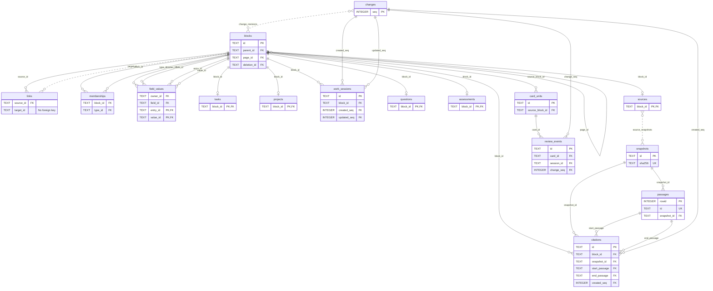

# Domain model

Everything a person writes is a block. Behaviour is added as capabilities, each with its own table, rules and history. Indexes such as links and full-text search are derived and can be rebuilt.

The main tables, with identity and reference columns only. Capabilities attach to block IDs; passages belong to immutable snapshots, not to the outline. Dashed lines are joins left out of the picture (`source_snapshots`, `change_revisions`) and the link target, which has no foreign key.

## Vocabulary

| Term | Meaning |
|---|---|
| Block | Addressable authored text with one parent and a position among its siblings |
| Page | A named root block |
| Note | A titled page, with the blocks beneath it as its content |
| Kind | What a note is about: a built-in kind such as Person or Concept, or a type you define |
| Journal day | A root block for one calendar date in the notebook's time zone |
| Reference | `[[id]]` or `[[id\|alias]]` in a block's text, pointing at another block |
| Link | The indexed occurrence of a reference; derived |
| Type | Reusable membership, such as `#book`, with an optional field template |
| Field | A typed reading of value blocks, such as Author or Read on |
| Capability | Behavior attached to a block: task, question, assessment, card, source, position, project, note |
| Change | One committed operation, with its actor and the revisions it produced |

Only these words appear in the schema, the API, the code and the interface.

## Blocks

A block has an ID (ULID), parent, page, ordinal, text, optional heading level (1 to 3), revision, archive flag and an optional deletion event. Roots have no parent. Page titles and journal dates are unique among live roots.

Rules:

- **Split** keeps the original ID on the left part. Children stay with it.
- **Merge** keeps the destination ID. It refuses when the source has history that cannot move, such as reviewed cards.
- **Move** keeps the ID and the whole subtree.
- **Archive** hides; **delete** tombstones with a shared deletion event; **restore** needs that event and the exact revision. **Purge** is explicit and refuses to destroy review history.
- Every write checks the revision it was based on. A mismatch writes nothing.

Parentage gives a block its reading context. A question beneath a source is about that source. Agent context always includes ancestors.

## References and links

A reference renders the target's current text. Editing the target updates every reference. A link row records source, target, alias and occurrence order; repeated references stay distinct. Backlinks come from links. A reference to a deleted block renders as unresolved and keeps its raw ID.

A page's backlinks cover references to its root and to every block on it, grouped by referring page. Sources on the same page are left out of that list but count towards each block's reference count. Unlinked mentions are blocks elsewhere that contain the page's title or an alias as a whole word, outside any reference or tag, and do not already link to the page.

### Quotes

A quote is frozen; a reference is live. A block whose whole text is `((ID))` is a quote row. It holds a snapshot of the target and its subtree (text, heading, revision and depth of each row), captured when the quote was made, and records one link to the target so the target's backlinks include it.

- The snapshot travels in the `set_quote` operation, so every device applies the same rows. Applying it never reads the source.
- A capture keeps at most 200 rows and 64 KiB of text and marks the snapshot truncated past either limit. A root too large to fit is refused.
- Editing or deleting the source leaves the quote unchanged. A quote reports whether its source is still live and whether any captured row changed or disappeared, or the source gained a descendant. Updating re-captures it as one undoable edit.
- Editing the row's text away from `((ID))` leaves the snapshot inert rather than deleting it, so undoing that edit brings the quote back.
- Merging pages redirects quote rows and their stored targets like references; the frozen text stays as captured.

## Types and fields

A type is an ordinary page used as the target of memberships. A block can have many types. Membership records whether it came from the text (`#book`) or was added manually; either keeps it.

A field definition is a block under the live page titled `Fields`, the system page every notebook has:

- Its name is the block's text.
- Its kind is text, number, date, checkbox, choice, instance, URL or identifier; the default is text.
- Choice options are child blocks of the definition.

A field entry is a block whose whole text is one reference to a definition, rendering as its name. The entry's parent owns the field; its children are the values. Typing `Author::` in the editor produces an entry.

Each definition has a `hide` setting for outlines. `never` is the default and shows entries and faint missing template slots. `when_empty` hides entries with no values or only blank values and omits missing slots; `always` hides entries and slots regardless of values. Editing or selecting an entry or its values keeps it visible, as does revealing the owner's hidden fields in that pane. Tables, queries, field pages, the Fields register and exports ignore this setting.

Values are plain blocks read through the field's kind. A value that does not fit shows a problem but is never rejected or rewritten.

| Kind | Value rule |
|---|---|
| Date | Links to a journal day or spells out the date. A bare year or year-month is valid for sources dated no more precisely. |
| Choice | Links to its option. |
| URL | An absolute `http` or `https` address. |
| Identifier | Reads an ISBN, DOI or arXiv ID in its usual spellings. Normalises to `isbn:` with 13 digits, lowercase `doi:` or `arxiv:`, so the same work matches however it was written. |

Changing a field's kind changes only how values are read. Owner counts include entries with no values and count each owning block once. Archived or deleted entries and owners do not count.

Date precision and sorting:

- Bare years of one to four digits have year precision: `180` and `0180` mean year 180; zero is invalid.
- Month and day forms require a four-digit year.
- Field sorting pads the year in its sort key without changing the written value.

A field's detail read may count readable and problem values using a proposed kind before one undoable kind change. Counts and samples follow these rules:

- Empty-entry counts include entries whose children are all blank.
- Owner samples combine an owner's entries in outline order and identify the first entry.
- Problem and readable samples identify each value's own entry.

A type may carry a template: an ordered list of fields shown first in its table and offered as empty slots in its members' field areas. Members' other fields follow the template, which is never required. Fill missing fields on the type page writes empty entries for members only when asked.

## Queries and views

A query selects blocks by type, text search or field ownership, filters by fields, sorts by title, creation, update or a field, and limits the result. A field-only query considers blocks owning any named field.

| Predicate | Matches when |
|---|---|
| Is present | A field entry exists, including one with no values. |
| Is set | At least one value has nonblank text. Unreadable values still count. |
| Is empty | No value has nonblank text. |
| Value comparison | Any value satisfies the comparison. |
| Is not | No value matches. |

Missing and unreadable values sort last. Fields used by filters remain table columns even when all their values are empty.

A view is a saved query with a name and a revision. Views are not blocks; saving and deleting them are operations like any other, so they are attributed and undoable. A type table is the unsaved query for that type's members.

## Tasks

A task capability adds status (todo, doing, waiting, done, cancelled), scheduled and deadline dates with optional times, warning lead, repeater and priority. Dates are local civil dates; times are `HH:MM` labels, not timestamps. Scheduling after a deadline is valid. Removing the capability deactivates it without erasing its history.

Completion records the exact planning snapshot and explicit completion date. A nonrecurring task becomes done; a recurring task stays on its original block and advances its dates. Fixed repeats advance one interval, catch-up repeats skip to the first interval after completion, and after-completion repeats count from the completion date. The scheduled date is the anchor when present, otherwise the deadline. Month/year repeats clamp to the last valid day; the signed separation between scheduled and deadline dates stays intact. Completion never archives. Undo reverses the exact latest occurrence only while its resulting task state still matches.

Status is stored, not a fixed workflow. `SetTask` moves between the unfinished statuses, cancels, or reopens a done task; only `CompleteTask` makes a task done, and a repeating task goes back to todo with its dates advanced. Undo restores the saved status and plan, so it has no arrow.

Clocked work sessions retain their start, end, note and revision. Only one unreversed session may run in a notebook. Completion, cancellation, removal and hiding the running task require an explicit stop first; stop and completion can commit atomically. Reversing a work command retains its audit record.

Task queries compose source type/text/field constraints with task status, priority, project ancestry and independent date ranges. Unfinished-or-recent selection includes unfinished tasks or an unreversed completion in the inclusive context-date range. Filtering precedes the outer result limit. The client query line resolves type and project titles to canonical IDs and relative dates to civil dates; field predicates remain separate from its text syntax. Named task views retain the full query, including its date context, rather than a textual query.

An agenda takes the displayed civil date, never an implicit device date. It merges schedule, deadline, warning, overdue, unplanned and completion reasons into one row per canonical source. A completion on that date uses the latest occurrence's planning snapshot and a done projection, not the next recurring plan. Cancelled tasks are excluded. Opening a row edits the original block; the journal contains no copied tasks.

## Investigations

A question capability makes a block an enduring question with an optional review date. Criteria are blocks beneath it. An assessment capability turns any block into a dated answer to a question. At most one assessment per question is accepted. Accepting a new one supersedes the old one, which stays readable. An assessment may also record aporia, that no answer holds yet; it is dated and cites its evidence like any other.

A question is in one of four states:

| State | Meaning |
|---|---|
| Open | The default: no accepted assessment yet |
| Answered | An accepted assessment exists |
| Parked | Paused; it accepts nothing new until resumed |
| Unsettled | Open by design: it recurs or may end in aporia, collects dated assessments and returns on its review date |

Stored with the question are whether it is unsettled, whether it is parked, its review date and which assessment it accepts. The state is derived in this order: parked, then unsettled, then answered when an accepted assessment exists, otherwise open. Answered is never stored, so it cannot disagree with the assessments. Accepting an assessment on an unsettled question records the current reading without settling it. Resuming a parked question returns it to whatever the rest of the rule gives. Export writes the derived state as the site's `state`.

## Sources, passages and positions

### Snapshots and passages

A source is a page with a source capability. Ingesting the same URL or file with different bytes creates a new, immutable snapshot identified by its content hash.

- A snapshot holds the document's structure and passages: headings, paragraphs, footnotes and other units, each with a locator.
- Original bytes live in the notebook's object store, addressed by SHA-256.
- Passages, structure and reading position live in the database.
- Passages are evidence, not authored blocks, and are never edited.

Writing about a passage creates a block that cites it. A citation names the source, snapshot and passage, keeping the exact text read even after a newer snapshot exists.

### Bibliographic metadata

Bibliographic metadata uses ordinary fields and entry/value blocks. The Library editor exposes:

| Purpose | Fields |
|---|---|
| Subtitle | Subtitle |
| Ordered creators | Author, Editor and Translator person references |
| Work | First published, Original language |
| Edition | Published, Publisher, Edition, Series, Number, Volume, Issue, Page range, Pages, Language |
| Identifiers | Repeated Identifier values for ISBN, DOI and arXiv |
| Description and location | URL, Site, Description, Cover |
| Reading dates | Started, Finished |

Title remains the page title; tags remain page tags. Citation key and reading state belong to the source capability. Pages is a total page count, not a cited range; Number is the source's number within its series. Volume and Issue retain the journal's labels as text. Page range holds a journal locator, including an article number such as `e0132145`. Publication dates may be a year, year-month or full date.

Non-empty bibliographic Pages values must contain only decimal digits and represent a positive whole number no greater than 9,007,199,254,740,991:

- The editor retains invalid drafts.
- The command boundary rejects newly invalid values atomically, including edits outside Library.
- Existing invalid values do not block unrelated work and may be cleared or repaired.
- Generic Number fields and series Number retain their broader numeric domain.

Optional metadata definitions are created on the first non-empty edit, reusing an ordinary definition by name without changing its kind. An empty inspector slot creates no definition, entry or value. These fields need no new source columns or database migration.

A snapshot's extracted value fills its field until an authored value replaces it. Resetting the field restores the extracted value; it is never discarded.

### Metadata exports

Exports read current field values, including authored overrides, and omit absent optional fields. BibTeX retains its BibLaTeX-compatible conventions:

| Field | BibTeX | CSL JSON |
|---|---|---|
| First published | `origdate` | `original-date` |
| Original language | `origlanguage` | `original-language` |
| Published | `date`/`year` | `issued` |
| Edition | `edition` | `edition` |
| Series | `series` | `collection-title` |
| Number | `number` | `collection-number` |
| Volume | `volume` | `volume` |
| Issue | `number` | `issue` |
| Page range | `pages` | `page` |
| Pages | `pages` | `number-of-pages` |
| URL | `url` | `URL` |
| Site | `organization` | `container-title` |
| Description | `abstract` | `abstract` |

Partial original dates retain their precision independently of Published. CSL's `number-of-pages` is a count, never its `page` range. When both exist, BibTeX uses Page range for `pages`; Issue takes precedence over series Number for `number`. Record plans accept `volume`, `issue` and `page_range` (also `page` or `pages`); lookup and snapshot ingestion keep these values in ordinary fields.

Markdown retains the source title, author/date/citation-key heading, URL, highlights and notes, and adds metadata as labelled values. Started and Finished export only as Markdown labels. They are reading history, not publication or access dates, so neither standard format receives a misleading date or custom key.

### Reading state and position

Reading state (inbox, reading, finished, abandoned) belongs to the source. Reading position belongs to a snapshot; source progress is that position as a share of its current snapshot's text.

Reading position is navigation state, not an authored change. It is stored per snapshot, is not undoable and adds no change rows. The first recorded reading of an inbox source changes its state to reading through an ordinary attributed batch.

Opening a citation is not reading: it changes neither state nor position. A citation jump must not call the reading-position endpoint.

### Citation keys and sigla

Citation keys are assigned at ingestion and never recomputed when fields change. An explicit authored edit may replace the key.

A suggested key combines:

1. The ASCII-folded lowercase family name of the first author, otherwise editor, site or `anon`.
2. The publication year, otherwise `nd`.
3. The first non-stopword title word.

Only letters and digits remain. Collisions gain `a` through `z`, then `aa` and onward.

Authored keys start with a letter, contain at most 64 letters, digits, underscores, colons or hyphens, and are unique among active sources ignoring case. A conflicting key is rejected, not silently suffixed or used to change the other source's key.

Every source has a siglum, a short mark as in a critical edition:

- **Authored:** a trimmed Siglum field of one to four letters wins and is upper-cased. Invalid values are ignored; clearing the override restores the derived mark.
- **Derived:** use the first three letters of the first author's family name, else editor, site or the title's first word containing letters. Keep Unicode letters, skip non-letters and upper-case the result; shorter names use what they have.

Only the authored override is stored, as an ordinary field. The effective siglum, full letter-only basis and whether it is authored are derived on reads, so editing an author changes the default mark. CSL JSON exports it as `citation-label`.

Unlike citation keys, sigla need not be unique. Library shows each source's own mark. In a citation context with several sources:

- Extend a later colliding derived siglum with further letters of its basis name, in order of first appearance (`THO`, `THOM`, `THOMA`).
- Once the basis runs out, append `2`, `3`, … .
- Authored sigla never change.

### Highlights and positions

A highlight is an authored block on the source's page that cites a passage. Like any block, it takes children, types, fields and card syntax. It is unprocessed when it has no non-blank children, no card and no incoming reference.

Marking a highlight processed or unprocessed overrides that rule until cleared; this is the only stored triage state. Because passages never change, a passage citation is a frozen quotation by construction.

A position is an attributed claim: who holds it, about which question or subject, supported by which passages. A position capability marks an ordinary block as one. Holder and subject are derived from its text and place, never stored:

- **Holder:** the page its first link points to.
- **Subject:** the block or page its second link points to, else its nearest ancestor question, else its page.

A position can therefore sit beneath a source-page highlight and still be filed under its concept. Its fields are ordinary children, by convention:

- **Gist:** its one-line summary.
- **Work:** the source it names, which gives its siglum; otherwise the first passage cited beneath it.
- Whatever criteria positions on one subject share.

Positions on the same subject are compared side by side, never merged. Assessments cite positions and passages, tracing a conclusion to its evidence.

A subject may own an explicit ordered set of criterion fields. Without rows in that set, Compare derives criteria from active positions' field entries in outline order, excluding Gist and Work. Position values remain ordinary entry/value blocks; explicit criteria offer missing fields as empty slots.

Questions beneath the subject attach to the first criterion linked in their text. They are scoped to the linked holder pages of its positions, or to all holders when none are named. These attachments are derived.

Only identical trimmed authored cell text is marked as an exact repeat; differing wording implies nothing.

A page's gloss is an entry for the Gloss field among its top-level blocks: the one- or two-sentence hover form shown under the title and in reference previews. It is an ordinary field, created on first use.

These map the three kinds of knowledge in the [vision](vision.md): a fact is an ordinary block, with a passage when it came from reading; someone else's view is a position; your own conclusion is an assessment. A perspective lens is a view of positions grouped by holder.

## Projects

A project capability gives a block an outcome, an optional deadline and active, done or cancelled status. Tasks anywhere beneath it are its canonical actions; nested tasks report their nearest active project capability. A completed project's capability remains active until explicitly removed. Completing a project does not complete its tasks or reassess questions beneath it. Removing the capability retains its history and block identity.

## Notes

A note is a titled page: a root block of kind page. Journal days and the Fields page are not notes. Blocks beneath the title are its content; there is no separate note record or copy. They keep their own behaviour, so a note can hold tasks, cards, questions and positions.

### Kinds

A kind says what a note is about. These are built in:

| Kind | Marked by | Meaning |
|---|---|---|
| Person | `#person` | An individual, such as an author or a thinker |
| Group | `#group` | A collective: an organisation, a school, a dynasty, a people |
| Concept | `#concept` | An idea, term or phenomenon, explained and compared |
| Thesis | `#thesis` | A claim you hold, stated as the title and argued beneath it |
| Question | A question capability on the page | An enduring question; see Investigations |
| Source | A source capability on the page | Something read, watched or listened to |
| Project | A project capability on the page | A bounded outcome |

Person and Group are entities: pages referred to by a position's holder or a source's creators.

- Person, Group, Concept and Thesis are system types in every notebook, like the Fields page. They take templates and fields like any type and cannot be deleted or merged.
- An existing type with one of those titles becomes the built-in kind, keeping its page, members, fields and template.
- Question, Source and Project come from capabilities and need no tag.

Types you define are also kinds, listed after the built-ins:

- A type can refine one built-in kind, as Philosopher refines Person. Its members are filed under both; positions and creators treat them as that kind.
- A note can have several kinds and is filed under each. A note with none is unfiled.
- Tasks and cards are not kinds. They belong to blocks within notes; Agenda and Review are their places.

A source's form is a built-in Form choice field: book, chapter, article, paper, report, post, thread, video or web page, with more options added as for any choice field. Lookup and ingestion fill it, and export writes it as the CSL type and BibTeX entry type.

Person, Group and Concept start with templates, filled in only when wanted:

| Kind | Template fields |
|---|---|
| Person | Aliases, Lived, Affiliated with (an instance of Group) |
| Group | Aliases, Active |
| Concept | Aliases, Coined by (an instance of Person), Coined in (an instance of Source) |

- A new type page with one of these titles gets its template. An existing page with an empty template offers it instead.
- A question page uses Add alias, since it has no type to carry a template.
- Lived and Active are text, allowing `c. 1493` and `106–43 BCE`, which a date field cannot hold.
- A Group's members are the people affiliated with it, not a second list.
- Templates change like any type's and never rewrite notes.
- Thesis starts without a template until it is settled how a thesis answers a question.

### Aliases

A note's aliases are values of the built-in Aliases field among its top-level blocks, stored like the gloss and available on every page. An alias is a whole other name: Tully for Cicero, sublation for Aufhebung, a short name for a long question.

Aliases need not be unique; two Plinys may both have Pliny. Matching ignores case, diacritics and apostrophes, treating other punctuation as a space. Thus `J. M. Keynes` and `j m keynes` are one name.

Completion and Find match titles and aliases. An alias result names that alias. Words within an alias match while typing, but only a whole alias links on its own.

Hand-typed `[[Name]]` left as text resolves by title or alias:

| Matching pages | Result |
|---|---|
| None | Creates a page as before. |
| One | Links as `[[id\|Name]]`, preserving the wording. |
| Two or more | Stays unlinked and marked. Choosing one links it; nothing is created. |

Imported source creators match people by title or alias after turning around catalogue forms such as `Cicero, Marcus Tullius`:

- One match links.
- Two or more leave an unlinked `[[Name]]`, marked like a hand-typed reference, rather than guessing or creating a duplicate.
- Choosing a person links it and adds the import's spelling as that person's alias.

Other alias rules:

- **Merge.** The page that goes away leaves its title as an alias of the one that stays.
- **Finding aids** list aliases as cross-references, `Tully, see Cicero`. A shared alias appears once and points to each page. Cross-references do not count as notes. An alias that only lengthens another alias of the same page, containing all its words, is omitted from cross-references but still matches.
- **Sorting.** A finding aid sorts by the full title. A person sorts by family name only when the page sets a Sort as field, since classical, medieval and many non-European names have no family name to find.

An agent may propose aliases, such as other phrasings of a question that a search might use. Each is an ordinary value written by the agent, marked as suggested until kept or removed, and undone like any agent change.

Events are a likely future built-in kind; the notebook's own types cover them until then.

### State

A note is working or settled. Working is the default and is not stored. Settle records that you stand behind the note as written; Reopen returns it to working. Editing a settled note does not reopen it; the note's apparatus shows that it changed after settling.

### Revisits

A note comes back only when it has a revisit date. On a page that is also a question, the revisit date is the question's review date; there is one date, not two. A question block within a page that has a review date comes back as itself.

From its revisit date onward a note waits in the notes queue in Review, earliest date first. It is reviewed in the ordinary outline, with its sources and backlinks at hand. A revisit ends in one of three ways:

| Action | Effect |
|---|---|
| Revisited | Records the revisit and sets the next date, or none |
| Later | Moves the date without recording a revisit |
| Settle | Settles the note and clears its date |

Revisits have no grade or scheduler: they judge the note, not your memory of it. Revisited proposes the next date at the interval just ended, measured from the previous revisit or, for the first, from when the date was set. The date can be changed or cleared before confirming.

Each action is an attributed, undoable operation and writes a revisit event. The note's last revisit is its latest Revisited event. Revisit events are authoritative history, kept like review events.

A note capability on the page holds the stored state, the revisit date and when that date was set. A page without one is working and has no revisit date.

### Index and views

The index lists kinds with note members or tagged non-page blocks, keeping their counts independent. Kinds with notes open a finding aid; tag-only types open their member table. Tagged blocks do not increase the distinct-note total or file their containing page under that kind. The finding aid is the unsaved note view for that kind, as a type table is for a type. It is derived from kinds and is never stored.

A note view queries notes with a layout and grouping. It selects by kind and supports the block query's type, text and field predicates, plus:

| Constraint | Find-line example |
|---|---|
| State | `is:settled` |
| Revisit: due, set or none | `revisit:due` |
| Links to a note | `links:Polybius` |
| Links from a note | `from:Postone` |
| Cited source, by siglum, citation key or title | `cites:MAR` |

Other Find words match title or gloss; each recognised term appears as a chip. Field predicates stay in the filter picker, as on tables.

One query has two layouts:

| Layout | Presentation |
|---|---|
| Index | Titles in columns under headings, with settled marks and revisit dates |
| Table | One note per row, fields as columns, as in type tables |

Index groups by first letter unless source cited, note linked, state, created month or a field's values is chosen. A note appears under every applicable heading, as in a book index. Source, link and field-value headings are ordered by how many notes they hold.

Saving a note view stores its query, layout and grouping as a view, filed in the sidebar under the kind it lists.

### Spreads

A spread sets several notes side by side. Selecting two to five notes in a view offers Spread. Each note is a column, with aligned rows:

1. Kind, title, gloss and state.
2. Each field any selected note has, blank where absent.
3. Cited sources, linked notes and opening prose.

Values shared exactly by two or more columns are marked, as are links between columns. Differing values imply nothing.

A spread is a page with a spread capability. Its top-level blocks reference notes in column order, following them as they change:

- Blocks beneath a reference are commentary on that column.
- Other top-level blocks are notes on the whole spread.
- Adding, removing or reordering columns edits these blocks.

A spread opened from a selection is unsaved navigation state; Save spread creates the page. The index lists spreads after the kinds.

Compare perspectives remains the sheet for positions on one subject; a spread compares whole notes.

## Cards

### Syntax

Cards derive from block text:

| Marker | Card kind | Front | Back |
|---|---|---|---|
| `>>` | Forward | Left side | Right side |
| `<<` | Reverse | Right side | Left side |
| `<>` | Both directions | Each side | The other side |
| Trailing `>>>` | Multiline | Text before the marker | Non-empty child outline |
| Trailing `>>1.` | List | Text before the marker | Direct children in order, with each child's subtree; one grade for the list |

A descriptor `Function ;; makes ATP` asks its name in its parent's context. Under `Mitochondria`, its front is `Mitochondria › Function`. The parent's subject is:

- The left side of its own operator, so `Mitochondria <> powerhouse of the cell` reads as `Mitochondria`.
- A cloze's full answer.
- Otherwise its whole text. A page title serves for top-level blocks.

An empty parent makes no descriptor card. Editing the parent changes the front without resetting progress.

The front must be non-empty. `::` remains field shorthand. A source block uses one direction operator, or numbered clozes. Numbered clozes use `{{c1::answer}}` or `{{c1::answer::hint}}`; repeated numbers form one unit, whose front masks that group's answers and reveals the other groups.

Escapes, code and references shield literal syntax. Mixed or malformed operators produce diagnostics, not guessed cards.

### Identity and eligibility

A source block plus a role key (`forward`, `reverse`, `cloze:c1`, `multiline`, `list`, `descriptor`) identifies a card. Wording and child edits therefore keep progress.

Only authored non-root block text derives syntax cards; page titles and journal dates do not. Applied type templates are the exception: each member, including a page, can supply a unit keyed by its identity and `tpl:<templateId>`.

Derivation shares the transaction with field values, membership or template changes. It changes definition revisions without rewriting scheduling state.

- Removed syntax, missing required values or a disabled or deleted template deactivate units.
- Restoring eligibility reuses the ID and progress.
- Archive and deletion hide cards from queues without destroying units or evidence.

### Holding

Each retained card has a `held` flag, independent of syntax and scheduling:

- Not yet holds a new card; Pause holds a reviewed card.
- Held units remain visible with their source but leave review queues, counts, forecasts and template introductions. They cannot be graded.
- Start or Resume clears the flag without changing the schedule or original creation order.
- Wording changes, syntax removal/restoration and Reset preserve it.
- Holding and releasing are revision-checked, undoable document edits.

### Templates and introductions

A card template belongs to a type and stores a name, front/back patterns, an applied flag and a new-per-day limit from 1 to 9999. It starts as a draft.

- Patterns reference field definitions by `{fieldId}`; `\{` is a literal brace. Renaming a field preserves its identity.
- Every referenced field needs a nonblank value. Unused fields never delay a card.
- Linked readings use the target's text; other values use authored text. Multiple values join with a comma and space.
- Draft previews and forecasts report ready members and those waiting on missing fields without creating empty cards.

Each template has its own daily introduction allowance:

- Due and New queues, Today counts and forecasts subtract units first reviewed on the notebook's local day before selecting new template cards.
- All is active, visible, non-held inventory, including deferred introductions. Explicitly reviewing All bypasses introduction pacing.
- Authored cards and already-reviewed units keep their existing queue rules.
- Apply forecasts separate existing due reviews from new introductions, without simulating follow-up reviews.

Card reads carry template and type names as provenance, separate from the actual source-page title.

### Source identity

| Edit | Rule |
|---|---|
| End split | Leaves cards on their original source. |
| Interior split | Cannot divide active card syntax. |
| Start split | Cannot move a reviewed card onto a new identity. |
| Merge | Cannot remove a source with any retained review event, even after markup removal. |

Task and project history impose the same source-identity protection.

### Review history and sessions

Review events record shown text, grade, scheduler version and state before and after. A reset is an event, not an erasure; reset-plus-grade commits both events atomically.

Scheduling uses FSRS-6 with default parameters, 90% retention and deterministic whole-day intervals. Reviewed cards acquire FSRS memory by replaying historical grades, keeping historical evidence intact.

Grading checks the card revision, definition revision and exact shown front/back. Due queues include new cards after reviewed due cards, with stable tie ordering. Saved decks are revisioned card queries over canonical sources, not copies or separate card stores.

Optional review sessions have open, finished or abandoned state. Closing one never discards grades. A session excludes cards already graded within it. Deck selection, queue selection and session identity are navigation state, not card ownership.

A stale or changed presentation's grade is rejected without an event. The client must obtain and show the current card before another grade. Pending delivery and confirmed rejection are distinct; neither is a successful review.

Undo last grade appends an immutable correction linked to the original review event and restores its exact before-grade schedule. Effective history excludes corrected grades without deleting evidence.

- Only the latest effective grade for the card and its session may be undone, with revision checks against intervening changes.
- Undoing a finished session's final grade reopens it; an earlier reset in the same command stays effective.
- Exhausting a confirmed session finishes it automatically after acknowledgement.

## Settings

A notebook has settings: its time zone and editing preferences. Setting one is an operation like any other.

## Changes and attribution

Every committed operation writes a change row: actor (person, agent name or client), operation, affected IDs and resulting revisions, and an optional reason. Agents may submit plans that are previewed, then applied atomically under an idempotency key. Undo works by applying an inverse operation, so history remains linear and inspectable across clients.

## Derived data

Links, full-text search, type membership from text, card definitions and field readings are derived in the same transaction as the text that produces them. Definitions can be rebuilt from blocks while retaining their role identities. Card schedules, review evidence, task occurrences and work sessions are authoritative history; rebuilding derived data never recreates or resets them.

## Open decisions

- How much change history to keep, and whether old assessments become immutable.
- Configurable task keywords beyond the five fixed states.
- Whether blank blocks persist or exist only in drafts.
- How concept and taxonomy comparison is modelled: types, positions about a concept, or a capability of its own.
- Whether vocabulary cards need anything beyond ordinary cards, such as language, part of speech or inflection fields.
- How newsletters arrive: a polled mail folder, a forwarding address or feeds only.
- How a thesis page answers a question. An assessment must sit beneath its question, and a thesis page is a root.
- Whether note views need facet counts beside the Find line, such as cited sources with their note counts, once a kind holds thousands of notes.
