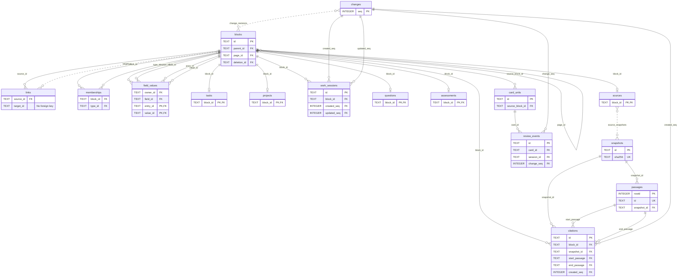
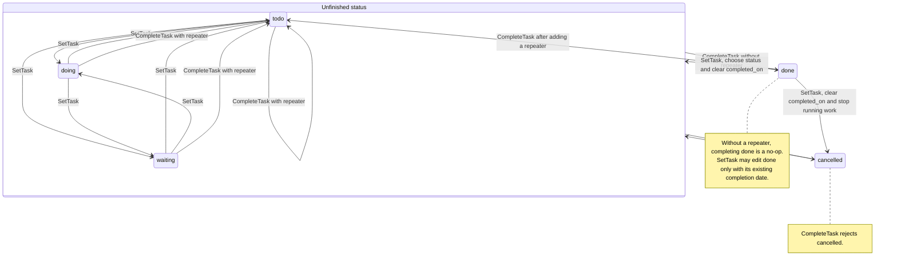

# Domain model

Everything a person writes is a block. Behavior is added as capabilities, each with its own table, rules and history. Indexes such as links and full-text search are derived and can be rebuilt.

The main tables, with identity and reference columns only. Capabilities attach to block IDs; passages belong to immutable snapshots, not to the outline. Dashed lines are joins left out of the picture (`source_snapshots`, `change_revisions`) and the link target, which has no foreign key.

## Vocabulary

| Term | Meaning |
|---|---|
| Block | Addressable authored text with one parent and a position among its siblings |
| Page | A named root block |
| Note | A titled page, with the blocks beneath it as its content |
| Kind | What a note is about: a built-in kind such as Person or Concept, or a type you define |
| Journal day | A root block for one calendar date in the notebook's time zone |
| Reference | `[[id]]`, `[[id\|label]]` or `[[id\|label\|locator]]` in a block's text, pointing at another block |
| Link | The indexed occurrence of a reference; derived |
| Type | Reusable membership, such as `#book`, with an optional field template |
| Field | A typed reading of value blocks, such as Author or Read on |
| Capability | Behavior attached to a block: task, question, assessment, card, source, position, project, note |
| Change | One committed operation, with its actor and the revisions it produced |

Only these words appear in the schema, the API, the code and the interface.

## Blocks

A block has an ID (ULID), parent, page, ordinal, text, optional heading level (1 to 3), revision, archive flag and an optional deletion event. Roots have no parent. Page titles and journal dates are unique among live roots.

Rules:

- **Split** keeps the original ID on the left part. Children stay with it.
- **Merge** keeps the destination ID. It refuses when the source has history that cannot move, such as reviewed cards.
- **Move** keeps the ID and the whole subtree.
- **Archive** hides; **delete** tombstones with a shared deletion event; **restore** needs that event and the exact revision. **Purge** is explicit and refuses to destroy review history.
- Every write checks the revision it was based on. A mismatch writes nothing.

Parentage gives a block its reading context. A question beneath a source is about that source. Agent context always includes ancestors.

## References and links

A reference renders the target's current text. Editing the target updates every reference. A link row records source, target, alias and occurrence order; repeated references stay distinct. Backlinks come from links. A reference to a deleted block renders as unresolved and keeps its raw ID.

A reference can carry an authored label and locator. The target ends at the first `|`; with a second pipe, the locator follows the last `|` and any intervening pipes belong to the label. An empty label uses the target's current text (`[[id||3.12]]`). Locators stay in authored text through resolution, editing, merge rewriting and export; they do not create passage citations or require a snapshot.

A reference to a source-capable page with a nonempty label or locator is a citation reference. It reads in ink with a dotted underline, with its locator after a thin space in faint apparatus mono; hover turns the text and underline to the accent. Plain title links to sources and references to ordinary pages keep the accent-link treatment. Source pages separate citing rows, including passage citations, into Cited in and all remaining referring rows into Backlinks, without counting a row twice.

Full-text search includes the current labels of canonical references. This index is derived from authored text and live targets, and refreshes when either changes; an explicit alias keeps its authored wording.

A page's backlinks cover references to its root and to every block on it, grouped by referring page. Sources on the same page are left out of that list but count towards each block's reference count. Unlinked mentions are blocks elsewhere that contain the page's title or an alias as a whole word, outside references, tags, URLs and code, and do not already link to the page.

A page opts into a stream with the manual `Stream` type or a project capability. Its Arrivals list contains the direct children of journal blocks linking that page, newest journal day first, limited to the last 100 calendar days and 200 children. Adding one appends a whole-row reference to the child's ID as one undoable outline edit; the source stays in its journal. Whole-row references anywhere on the stream page exclude those children from Arrivals. The page's ordinary outline order is the added order.

A whole-row `[[ID]]` reference to a live non-root block renders its current text and read-only descendants, with provenance opening the source. It initially shows 12 descendants and expands in place. Page links and missing targets keep inline-reference rendering. Batch subtree reads accept at most 256 IDs, return preorder rows capped at 200 per ID and 4096 in total, and flag each truncated subtree; these live reads do not change frozen quote semantics.

A saved-view reference uses `[[view:ID|remembered name]]`. The target is a canonical ID from the view store. Its authored text travels through ordinary block edits and sync; it creates no block link, backlink or field entry. A whole-row reference renders the saved query live, with its current name, purpose and recipe. Inline references and search snippets remain named links. The block keeps its remembered name when the view is missing, and offers relinking or removal. Restoring the view restores the live result. A desk recipe renders a compact name, purpose and Open desk link.

The plain-text clipboard export keeps the authored view reference, just as it keeps page references. It exports the view's remembered name and target, not a snapshot of the result rows. Full-text search can find the remembered name in the authored text.

Committing a live view cell returns keyboard undo to its page history before the save finishes. An immediate undo follows the committed write in the notebook's queue, including when that write creates the field entry and value.

### Quotes

A quote is frozen; a reference is live. A block whose whole text is `((ID))` is a quote row. It holds a snapshot of the target and its subtree (text, heading, revision and depth of each row), captured when the quote was made, and records one link to the target so the target's backlinks include it.

- The snapshot travels in the `set_quote` operation, so every device applies the same rows. Applying it never reads the source.
- A capture keeps at most 200 rows and 64 KiB of text and marks the snapshot truncated past either limit. A root too large to fit is refused.
- Editing or deleting the source leaves the quote unchanged. A quote reports whether its source is still live and whether any captured row changed or disappeared, or the source gained a descendant. Updating re-captures it as one undoable edit.
- Editing the row's text away from `((ID))` leaves the snapshot inert rather than deleting it, so undoing that edit brings the quote back.
- Merging pages redirects quote rows and their stored targets like references; the frozen text stays as captured.

## Types and fields

A type is an ordinary page used as the target of memberships. A block can have many types. Membership records whether it came from the text (`#book`) or was added manually; either keeps it.

A field definition is a block under the live page titled `Fields`, the system page every notebook has:

- Its name is the block's text.
- Its kind is text, number, date, span, checkbox, choice, relation, URL or identifier; the default is text. Relation is stored as `instance`.
- Choice options are child blocks of the definition.

A field entry is a block whose whole text is one reference to a definition, rendering as its name. The entry's parent owns the field; its children are the values. Typing `author::` in the editor produces an entry. A name no field has creates one spelled as typed, and an existing name matches regardless of case. The new field's kind comes from its first value. A whole reference makes it a relation, or a date when it names a journal day. A calendar date, a number or an `http(s)` address makes it a date, number or URL, and anything else leaves it text. A value typed before conversion sets the kind at creation. Otherwise leaving the first nonblank value sets it, with an Undo that returns the field to text.

Each definition has a `hide` setting for outlines. `never` is the default and shows entries and faint missing template slots, on a page at rest and on a nested owner while it is focused. `when_empty` hides entries with no values or only blank values and omits missing slots; `always` hides entries and slots regardless of values. Editing or selecting an entry or its values keeps it visible, as does revealing the owner's hidden fields in that pane. Tables, queries, field pages, the Fields register and exports ignore this setting.

A definition also has a presentation role: `standfirst`, `attribute` (the default), `prose` or `citation`. Standfirst values read as sentences under their owner, attributes form an aligned field bed, prose follows it at full width, and citation values show references as siglum and locator. The role changes no value or kind. Changing it is revision-checked, attributed and undoable; sync keeps the later change. Migration gives existing Gist and Gloss definitions the standfirst role. A later rename never changes a role.

The reading register projects field entry identities and reads each value from the shared document. Editing a blank standfirst does not replace its perspective slip or editor. Add perspective enters filling mode at the new Gist value; its recipe order continues with Work and the subject's criteria.

Values are plain blocks read through the field's kind. A value that does not fit shows a problem but is never rejected or rewritten.

| Kind | Value rule |
|---|---|
| Date | Links to a journal day or spells out the date. A bare year or year-month is valid for sources dated no more precisely. |
| Span | Keeps the written historical notation and reads an inclusive year range. BCE years are negative; unknown bounds are open. |
| Choice | Links to its option. |
| Relation | Links to a live block: a page, a journal day or a block inside a page. With Links to types, the target must be a member of one, by tag or manually. |
| URL | An absolute `http` or `https` address. |
| Identifier | Reads an ISBN, DOI or arXiv ID in its usual spellings. Normalizes to `isbn:` with 13 digits, lowercase `doi:` or `arxiv:`, so the same work matches however it was written. |

A relation target's label is its first line as plain text: trailing tags are dropped, inner tags read as their titles and references as their labels. Sorting, contains filters, group headings, card rendering and exports use that label.

A relation reads from both ends. Its target lists each owner whose value is exactly a reference to it, as `← qualifies` followed by the owners' labels, with no inverse name to define. A reference inside longer text stays a mention. Archived definitions and hidden owners or values are left out. author, editor, translator and collections read back elsewhere, as a person's Works and a collection's members, so the target's line omits them.

Changing a field's kind opens a reviewed interpretation map of every distinct written value. Choice mappings reuse or create options, and several spellings can share one option. Relation mappings propose only a page with a unique exact title or alias; creating a page requires an explicit choice, and the new page joins the field's Links to type when it has exactly one. Ambiguous and unreadable values stay as written. Applying the map and kind is one undoable change across every owner. Owner counts include empty entries and count each owning block once. Archived or deleted entries and owners do not count.

Renaming to another definition's name offers a merge preview with affected owners, pages, templates, saved views and conflicts. A merge redirects entries, template slots and saved view references to the surviving definition. It keeps conflicting entries side by side and moves option blocks without changing their identities. Filters, sort keys, column widths, grouping, collapsed headings and phone card fields stay in their original order. One undo restores both definitions, their entries and the exact saved queries.

Deleting a definition first shows its impact, including affected views by name. Archive hides it from field pickers but keeps values and views readable. Detach turns its values into ordinary `Name: value` blocks, retaining their child notes. Delete values requires explicit confirmation and removes their subtrees. Each action has one undo, including when the definition was archived first.

Spans accept years and ranges, `c.`, `fl.`, `b.`, `d.`, decades, centuries and `?` for open ends. For example, `c. 200–118 BCE` reads from -200 through -118, and `fl. 1340s` reads from 1340 through 1349. Approximation markers do not invent a wider range. A birth has an open end; a death has an open start. Year zero and reversed ranges are unreadable. Span sorting compares start year, then end year; open bounds extend to infinity. Filters compare inclusive overlap, strictly before or strictly after another span.

Date precision and sorting:

- Bare years of one to four digits have year precision: `180` and `0180` mean year 180; zero is invalid.
- Month and day forms require a four-digit year.
- Field sorting pads the year in its sort key without changing the written value.

A field's detail read may count readable and problem values using a proposed kind before one undoable kind change. Counts and samples follow these rules:

- Empty-entry counts include entries whose children are all blank.
- Owner samples combine an owner's entries in outline order and identify the first entry.
- Problem and readable samples identify each value's own entry.

A type may carry a template: an ordered list of fields shown first in its table and offered as empty slots in its members' field areas. Members' other fields follow the template, which is never required. Fill missing fields on the type page writes empty entries for members only when asked.

A template can grow from use. When a member's field gets a value and another member of that type already has one, the outline offers to add the field to the template, such as “strength is on another #proposition too”, with Add and Not now buttons. A field used once is never offered, since it may be a one-off. Each type and field is offered once per window, whatever the answer, and Add has an Undo.

## Queries and views

A query selects notes, questions, positions, sources, tasks or highlights with `source`. Omitting it preserves the existing type, text and field-owner selection. An explicit notes source without a type selects titled notes; type tables still include tagged blocks. Other sources select the entity's own block, not its containing page. Every row names both and carries its ordinary field values with their value block IDs for editing.

| Predicate | Matches when |
|---|---|
| Is present | A field entry exists, including one with no values. |
| Is set | At least one value has nonblank text. Unreadable values still count. |
| Is empty | No value has nonblank text. |
| Value comparison | Any value satisfies the comparison. |
| Is not | No value matches. |

Missing and unreadable values sort last. Fields used by filters remain table columns even when all their values are empty.

Relation equality and inequality compare the selected target's ID, not its label. A saved filter keeps its members when that target is renamed or edited. Older label-only filters migrate when the title identifies one page; an unresolved value matches nothing and must be selected again.

Attributes use a leading `@` wherever a field key is accepted, including filters, sorts, columns and grouping. Their values are derived and read-only; they have no value block IDs. Unknown attributes, including one from another source, are validation errors.

| Source | Attributes beyond title, page, created and updated |
|---|---|
| Notes | `@kind`, `@resolved`, `@revisit` |
| Questions | `@state`, `@parent`, `@program`, `@readings`, `@current`, `@last_assessed`, `@revisit`, `@inline` |
| Positions | `@holder`, `@subject`, `@question`, `@relation`, `@target_holder`, `@cites` |
| Sources | `@creator`, `@cited_by`, `@cited_in`, `@highlights` |
| Tasks | `@status`, `@due`, `@scheduled`, `@project` |
| Highlights | `@source`, `@color` |

The shared attributes are `@title` (text), `@page` (instance), `@created` and `@updated` (dates in the notebook's time zone). Questions use active, recurrent, parked and answered states. `@last_assessed` is the latest live assessment date, accepted or not. `@readings` counts positions about the question. Sources count distinct citing positions and highlighted blocks. Instance attributes compare stable IDs, not labels. Links and citations on a block source refer to its subtree.

Positions' `@question` includes their subject when it is a live question and every effective parent question above it. A parent question therefore selects positions about its branches too. Sources' `@cited_in` names each live block whose subtree cites that source, including positions and containing pages. Both are instance attributes and compare stable IDs. Repeated citations count once per block; hidden or deleted subtrees do not contribute.

Date filters accept `today`, `-30d` and `+7d`, resolved in the notebook's time zone on each read. A filter such as `{"field":"@last_assessed","op":"lt","value":"-30d","or_empty":true}` also matches an absent value. Saved filters keep the relative expression, not its current date.

Grouping uses `group: {key, collapsed?}` and returns distinct row IDs and counts under every applicable heading, including None for empty values. Counts cover the full match before pagination. Relation headings use target IDs, so renaming a target keeps the collapsed group identity.

A view is a saved query with a name and a revision. Views are not blocks; saving and deleting them are operations like any other, so they are attributed and undoable. A type table is the unsaved query for that type's members.

The query also carries its view recipe: `layout`, ordered columns with widths, sort keys in priority order, grouping with collapsed heading keys, phone card fields and a one-line purpose. Layout is `table` by default; positions also offer `register` and `matrix`. Register shows attributed perspective slips with editable field beds. Matrix groups positions by subject and places holders against that subject's criteria. Both edit the original value blocks through their page documents, with one undo per committed value. Saving, reopening and undoing a saved view keep the recipe with the query. Attributes remain read-only.

An unsaved entity view starts with its key attributes, applicable standfirst fields and fields filled on at least a quarter of its first result's rows. The register uses at most six starting columns, including Title and derived Refs. It records that choice in pane history, so later searches keep it. Existing saved recipes remain unchanged.

## Tasks

A task capability adds status (todo, doing, waiting, done, canceled), scheduled and deadline dates with optional times, warning lead, repeater and priority. Dates are local civil dates; times are `HH:MM` labels, not timestamps. Scheduling after a deadline is valid. Removing the capability deactivates it without erasing its history.

Completion records the exact planning snapshot and explicit completion date. A nonrecurring task becomes done; a recurring task stays on its original block and advances its dates. Fixed repeats advance one interval, catch-up repeats skip to the first interval after completion, and after-completion repeats count from the completion date. The scheduled date is the anchor when present, otherwise the deadline. Month/year repeats clamp to the last valid day; the signed separation between scheduled and deadline dates stays intact. Completion never archives. Undo reverses the exact latest occurrence only while its resulting task state still matches.

Status is stored, not a fixed workflow. `SetTask` moves between the unfinished statuses, cancels, or reopens a done task; only `CompleteTask` makes a task done, and a repeating task goes back to todo with its dates advanced. Undo restores the saved status and plan, so it has no arrow.

Clocked work sessions retain their start, end, note and revision. Only one unreversed session may run in a notebook. Completion, cancellation, removal and hiding the running task require an explicit stop first; stop and completion can commit atomically. Reversing a work command retains its audit record.

Task queries compose source type/text/field constraints with task status, priority, project ancestry and independent date ranges. Unfinished-or-recent selection includes unfinished tasks or an unreversed completion in the inclusive context-date range. Filtering precedes the outer result limit. The client query line resolves type and project titles to canonical IDs and relative dates to civil dates; field predicates remain separate from its text syntax. Named task views retain the full query, including its date context, rather than a textual query.

An agenda takes the displayed civil date, never an implicit device date. It merges schedule, deadline, warning, overdue, unplanned and completion reasons into one row per canonical source. A completion on that date uses the latest occurrence's planning snapshot and a done projection, not the next recurring plan. Canceled tasks are excluded. Opening a row edits the original block; the journal contains no copied tasks.

## Investigations

A question capability makes a block an enduring question with an optional revisit date. Criteria are blocks beneath it. An assessment capability turns any block into a dated reading of a question. At most one assessment per question is current. Write assessment adds a dated child block without accepting it. Assessments cite positions and passages through ordinary links and citations.

The decision journal appears once the question has an assessment. An empty question keeps Write assessment in its menu, Commands and slash completion.

A question is in one of four states:

| State | Meaning |
|---|---|
| Active | The default: no current answer yet |
| Answered | A current answer exists and resolution is allowed |
| Parked | Paused; it accepts nothing new until resumed |
| Recurrent | Open by design, with dated assessments and a revisit date |

Stored with the question are whether it is recurrent (`unsettled`), whether it is parked, its review date, its current assessment and its answer history. State is derived in this order: parked, recurrent, answered when a live accepted assessment exists, otherwise active. Accept current answer on a recurrent question records an answer without resolving it. Make recurrent keeps it open. Allow resolution lets a current answer resolve it. Park stops it coming back. Resume returns it to its derived state.

Accept current answer records a dated decision. Accepting another assessment records that the earlier answer was superseded on that date. Withdraw current answer clears the pointer and records its withdrawal date. The block, text and citations stay. Decisions live in the question's existing JSON state, with defaults for older notebooks. Each change uses the ordinary revision-checked, undoable capability operation; undo restores the previous pointer and history together. Sync uses the same later-change-wins rule as other capabilities.

Remove assessment remains a separate destructive action: it removes the assessment capability, not its text, and clears acceptance in the same change. Undo restores the assessment before restoring acceptance. Removing and restoring a question with a current answer, including a parked question, restores its state and history. A parked question may withdraw its current answer but cannot accept a new one until resumed.

A question may name another question as its parent through a pointer in its question state. Set parent question changes it as one undoable edit. Plain “Part of” prose stays ordinary text and never sets a relation.

The effective parent is the explicit parent while that block is live and still a question, otherwise the nearest ancestor question. This includes inline questions. Removing or deleting the parent leaves the stored pointer untouched; the relation returns when the parent returns. A new parent must be a live question, not the question itself, and must not create a cycle through explicit or structural parents. Undo preserves a restored question's existing pointer while its parent is absent.

Branches are questions whose effective parent is this question, including question pages and inline questions. Add branch question creates a child question; its parent comes from its place. A question opens with branches before its body, showing state, perspective count, current answer and revisit date. Branches do not repeat in ordinary backlinks.

The Questions ledger groups questions by their top-level program, includes inline questions with their containing page, and counts both. Active includes active and recurrent questions. Recurrent, Due, Answered and Parked select their corresponding states; Due means a non-parked question whose revisit date has arrived. All includes every visible question. Rows report their current assessment's date and first line, derived from the live assessment rather than copied text.

## Sources, passages and positions

### Snapshots and passages

A source is a page with a source capability. Ingesting the same URL or file with different bytes creates a new, immutable snapshot identified by its content hash.

- A snapshot holds the document's structure and passages: headings, paragraphs, footnotes and other units, each with a locator.
- Original bytes live in the notebook's object store, addressed by SHA-256.
- Passages, structure and reading position live in the database.
- Passages are evidence, not authored blocks, and are never edited.

Writing about a passage creates a block that cites it. A citation names the source, snapshot and passage, keeping the exact text read even after a newer snapshot exists.

### Bibliographic metadata

Bibliographic metadata uses ordinary fields and entry/value blocks. The Library editor exposes:

| Purpose | Fields |
|---|---|
| Subtitle | Subtitle |
| Ordered creators | Author, Editor and Translator person references |
| Work | First published, Original language |
| Edition | Published, Publisher, Edition, Series, Number, Volume, Issue, Page range, Pages, Language |
| Identifiers | Repeated Identifier values for ISBN, DOI and arXiv |
| Description and location | URL, Site, Description, Cover |
| Reading dates | Started, Finished |

Title remains the page title; tags remain page tags. Citation key and reading state belong to the source capability. Pages is a total page count, not a cited range; Number is the source's number within its series. Volume and Issue retain the journal's labels as text. Page range holds a journal locator, including an article number such as `e0132145`. Publication dates may be a year, year-month or full date.

Non-empty bibliographic Pages values must contain only decimal digits and represent a positive whole number no greater than 9,007,199,254,740,991:

- The editor retains invalid drafts.
- The command boundary rejects newly invalid values atomically, including edits outside Library.
- Existing invalid values do not block unrelated work and may be cleared or repaired.
- Generic Number fields and series Number retain their broader numeric domain.

Optional metadata definitions are created on the first non-empty edit, reusing an ordinary definition by name without changing its kind. An empty inspector slot creates no definition, entry or value. These fields need no new source columns or database migration.

A snapshot's extracted value fills its field until an authored value replaces it. Resetting the field restores the extracted value; it is never discarded.

### Metadata exports

Exports read current field values, including authored overrides, and omit absent optional fields. BibTeX retains its BibLaTeX-compatible conventions:
Both formats classify EPUBs and ISBN records as books, other DOI sources as journal articles, and remaining sources as web pages. BibTeX uses `book`, `article` and `online`; CSL uses `book`, `article-journal` and `webpage`.

| Field | BibTeX | CSL JSON |
|---|---|---|
| First published | `origdate` | `original-date` |
| Original language | `origlanguage` | `original-language` |
| Published | `date`/`year` | `issued` |
| Edition | `edition` | `edition` |
| Series | `series` | `collection-title` |
| Number | `number` | `collection-number` |
| Volume | `volume` | `volume` |
| Issue | `number` | `issue` |
| Page range | `pages` | `page` |
| Pages | `pages` | `number-of-pages` |
| URL | `url` | `URL` |
| Site | `journal` for journal articles, otherwise `organization` | `container-title` |
| Description | `abstract` | `abstract` |

Partial original dates retain their precision independently of Published. CSL's `number-of-pages` is a count, never its `page` range. When both exist, BibTeX uses Page range for `pages`; Issue takes precedence over series Number for `number`. Record plans accept `volume`, `issue` and `page_range` (also `page` or `pages`); lookup and snapshot ingestion keep these values in ordinary fields.

Markdown retains the source title, author/date/citation-key heading, URL, highlights and notes, and adds metadata as labeled values. Started and Finished export only as Markdown labels. They are reading history, not publication or access dates, so neither standard format receives a misleading date or custom key.

### Reading state and position

Reading state (inbox, reading, finished, abandoned) belongs to the source. Reading position belongs to a snapshot; source progress is that position as a share of its current snapshot's text.

Reading position is navigation state, not an authored change. It is stored per snapshot, is not undoable and adds no change rows. The first recorded reading of an inbox source changes its state to reading through an ordinary attributed batch.

Opening a citation is not reading: it changes neither state nor position. A citation jump must not call the reading-position endpoint.

### Citation keys and sigla

Citation keys are assigned at ingestion and never recomputed when fields change. An explicit authored edit may replace the key.

A suggested key combines:

1. The ASCII-folded lowercase family name of the first author, otherwise editor, site or `anon`.
2. The publication year, otherwise `nd`.
3. The first non-stopword title word.

Only letters and digits remain. Collisions gain `a` through `z`, then `aa` and onward.

Authored keys start with a letter, contain at most 64 letters, digits, underscores, colons or hyphens, and are unique among active sources ignoring case. A conflicting key is rejected, not silently suffixed or used to change the other source's key.

Every source has a siglum, a short mark as in a critical edition:

- **Authored:** a trimmed Siglum field of one to four letters wins and is upper-cased. Invalid values are ignored; clearing the override restores the derived mark.
- **Derived:** use the first three letters of the first author's family name, else editor, site or the title's first word containing letters. Keep Unicode letters, skip non-letters and upper-case the result; shorter names use what they have.

Only the authored override is stored, as an ordinary field. The effective siglum, full letter-only basis and whether it is authored are derived on reads, so editing an author changes the default mark. CSL JSON exports it as `citation-label`.

Unlike citation keys, sigla need not be unique. Library shows each source's own mark. In a citation context with several sources:

- Extend a later colliding derived siglum with further letters of its basis name, in order of first appearance (`THO`, `THOM`, `THOMA`).
- Once the basis runs out, append `2`, `3`, … .
- Authored sigla never change.

### Highlights and positions

A highlight is an authored block on the source's page that cites a passage. Like any block, it takes children, types, fields and card syntax. It is unprocessed when it has no non-blank children, no card and no incoming reference.

Marking a highlight processed or unprocessed overrides that rule until cleared; this is the only stored triage state. Because passages never change, a passage citation is a frozen quotation by construction.

A position is an attributed claim: who holds it, about which question or subject, supported by which passages. A position capability marks an ordinary block as one; the interface calls it a perspective, and the `positions` query source is labeled Perspectives. Holder and subject are derived from its text and place, never stored:

- **Holder:** the page its first link points to.
- **Subject:** the block or page its second link points to, else its nearest ancestor question, else its page.

Change holder and File under write the first and second link tokens through pickers. They keep the rest of the text. Change holder keeps an alias only when it also names the new holder. Use place removes a standalone subject token directly after the holder; a subject woven into prose stays for the author to edit. Each action is one undo step.

A position can therefore sit beneath a source-page highlight and still be filed under its concept. Its fields are ordinary children, by convention:

- **Gist:** its one-line summary.
- **Work:** the primary work it names, which gives its siglum; otherwise the first passage cited beneath it.
- **Account:** the secondary account, such as a position as another writer presents it. It shows under its own label, separate from Work and cited evidence.
- Whatever criteria positions on one subject share.

Positions on the same subject are compared side by side, never merged. Assessments cite positions and passages, tracing a conclusion to its evidence.

A subject may own an explicit ordered set of criterion fields. Without rows in that set, Compare derives criteria from active positions' field entries in outline order, excluding Gist, Work and Account. Position values remain ordinary entry/value blocks; explicit criteria offer missing fields as empty slots.

A position's recipe offers Gist, Work, then its subject's criteria, explicit when present and otherwise derived. Add field lists the missing recipe fields first under From this recipe. Filling mode uses the same order. Recipes are derived suggestions, not stored templates; they never require or add a field without an edit.

Questions beneath the subject attach to the first criterion linked in their text. They are scoped to the linked holder pages of its positions, or to all holders when none are named. These attachments are derived.

Compare question focus is view state, never notebook content. It shows the perspectives of the question's linked holders and marks its criterion; the two sheets share a perspective selection. Cell commits edit the ordinary value blocks through their page document and use that document's history.

A criterion cell is identified by its position and field IDs. A refreshed position read preserves its focused cell; keyboard commit returns focus to that cell for the next history command.

Criterion cells use the definition's kind and the field bed's shared value editors. Choice and Relation selections write target references, Date uses its calendar for readable or empty values, and Checkbox writes `yes` or `no`. Span values retain their written notation in the text editor.

Quoted criterion values keep the ordinary block's frozen quote capability and `((ID))` text. A newly inserted value and its snapshot share one document change, including the field entry when it is missing.

A holder's register groups its positions by their derived subjects and opens each position in its original place. A position zoom is a dossier of that perspective with block-scoped incoming links and relations, not the containing page's backlinks.

Read from a position zoom opens its titled subject in the unzoomed Read projection, revealing that position in the subject's local register or filed-elsewhere section. Reveal and its brief highlight are pane navigation state. The stored caret and scroll retain the location after reload; no block is copied or edited.

Only identical trimmed authored cell text is marked as an exact repeat; differing wording implies nothing.

A page's gloss is an entry for the Gloss field among its top-level blocks: the one- or two-sentence hover form shown under the title and in reference previews. It is an ordinary field, created on first use.

These map the three kinds of knowledge in the [vision](vision.md): a fact is an ordinary block, with a passage when it came from reading; someone else's view is a position; your own conclusion is an assessment. A perspective lens is a view of positions grouped by holder.

### Arguments

An argument capability, stored as a relation, marks an ordinary block as an authored argument edge. Its stored kind is `supports`, `disputes`, `qualifies` or `answers`. The block's text and children hold the reasoning and may cite passages. An edge cannot also be a position, question or assessment. Relations are never inferred from wording, link labels or differences between readings.

The endpoints are derived from the block's text and place, never stored:

- **Target:** the first linked block or page, when it is live and visible.
- **Source:** the nearest ancestor position or assessment; without either, the nearest ancestor question; without one, the page root. The edge itself is excluded.

An edge with no target or a deleted target shows a problem. An `answers` edge also shows a problem when its target is not an active question. These problems never reject or rewrite the authored text.

Relation reads filter by kind, source, target, source holder or target holder, with at least one filter. A holder filter matches a position held by that page or the holder page itself. Results include the edge, both endpoints with their containing pages, each position endpoint's holder and any problem. Moving an edge or changing its first link changes its derived endpoints.

Arguments and relation fields stay separate. An argument's source is derived from its place, so under a plain tagged block it would be the page root, not that block. Arguments also carry fixed meanings that Perspectives reads. A relation field is named by its author, starts at the block that owns it and feeds tables and lenses. A `qualifies` field and a Qualifies… argument therefore appear on different surfaces.

## Projects

A project capability gives a block an outcome, an optional deadline and active, done or canceled status. Tasks belong by ancestry or by an explicit `Project` relation field whose value references a block with an active project capability. The explicit field wins over ancestry; otherwise nested tasks report their nearest active project. A link in task prose does not assign membership. Removing a field assignment restores ancestry membership, if any. A completed project's capability remains active until explicitly removed. Completing a project does not complete its tasks or reassess questions beneath it. Removing the capability retains its history and block identity.

## Notes

A note is a titled page: a root block of kind page. Journal days and the Fields page are not notes. Blocks beneath the title are its content; there is no separate note record or copy. They keep their own behavior, so a note can hold tasks, cards, questions and positions.

Read, Outline and Compare are projections of that same document. Opening a projection creates nothing. Projection choices, folds and reading disclosures are device-local view state, not note content.

A reading subject is a question page or a page holding active positions about itself or its inline questions. Positions held on other pages do not make a holder's page a reading subject. The projections preserve field identities; a source's catalog card owns its bibliographic fields.

### Kinds

A kind says what a note is about. These are built in:

| Kind | Marked by | Meaning |
|---|---|---|
| Person | `#person` | An individual, such as an author or a thinker |
| Group | `#group` | A collective: an organization, a school, a dynasty, a people |
| Concept | `#concept` | An idea, term or phenomenon, explained and compared |
| Thesis | `#thesis` | A claim you hold, stated as the title and argued beneath it |
| Question | A question capability on the page | An enduring question; see Investigations |
| Source | A source capability on the page | Something read, watched or listened to |
| Project | A project capability on the page | A bounded outcome |

Person and Group are entities: pages referred to by a position's holder or a source's creators.

- Person, Group, Concept and Thesis are system types in every notebook, like the Fields page. They take templates and fields like any type and cannot be deleted or merged.
- An existing type with one of those titles becomes the built-in kind, keeping its page, members, fields and template.
- Question, Source and Project come from capabilities and need no tag.

Types you define are also kinds, listed after the built-ins:

- A type can refine one built-in kind, as Philosopher refines Person. Its members are filed under both; positions and creators treat them as that kind.
- A note can have several kinds and is filed under each. A note with none is unfiled.
- Tasks and cards are not kinds. They belong to blocks within notes; Agenda and Review are their places.

A source's form is a built-in Form choice field: book, chapter, article, paper, report, post, thread, video or web page, with more options added as for any choice field. Lookup and ingestion fill it, and export writes it as the CSL type and BibTeX entry type.

Built-in kinds start with templates, filled in only when wanted. Their fields are built in: the core owns their lowercase names, kinds and Links to types.

| Kind | Template fields |
|---|---|
| person | aliases, lived (span), affiliated with (a relation to Group) |
| group | aliases, active (span) |
| concept | aliases, coined by (a relation to Person or Group), coined in (a relation) |
| book | author (required; a relation to Person or Group), editor, translator, published, publisher, identifier, language |
| article | author, site, published, url |

- A new type page with one of these titles gets its template. An existing page with an empty template offers it instead.
- Required is rare: only a book requires author. Opening the notebook adds a missing author to Book's template; every other template field can be removed or reordered.
- A built-in field cannot be renamed, only recased. Opening the notebook recases older Title Case names, such as Author, and gives a built-in relation with no Links to types the types it expects, where those type pages exist. It never changes a field's kind, so an older `lived` stays text until a reviewed kind change. These are ordinary synced edits.
- A built-in relation links to its types only where those type pages exist; it never creates Person or Group.
- A question page uses Add alias, since it has no type to carry a template.
- A Group's members are the people affiliated with it, read back on its page as `← affiliated with`, not a second list.
- Templates change like any type's and never rewrite notes.
- Thesis starts without a template. A perspective's holder remains its first link.

### Aliases

A note's aliases are values of the built-in aliases field among its top-level blocks, stored like the gloss and available on every page. An alias is a whole other name: Tully for Cicero, sublation for Aufhebung, a short name for a long question.

Aliases need not be unique; two Plinys may both have Pliny. Matching ignores case, diacritics and apostrophes, treating other punctuation as a space. Thus `J. M. Keynes` and `j m keynes` are one name.

Completion and Find match titles and aliases. An alias result names that alias. Words within an alias match while typing, but only a whole alias links on its own.

Hand-typed `[[Name]]` left as text resolves by title or alias:

| Matching pages | Result |
|---|---|
| None | Creates a page as before. |
| One | Links as `[[id\|Name]]`, preserving the wording. |
| Two or more | Stays unlinked and marked. Choosing one links it; nothing is created. |

Imported source creators match people by title or alias after turning around catalog forms such as `Cicero, Marcus Tullius`:

- One match links.
- Two or more leave an unlinked `[[Name]]`, marked like a hand-typed reference, rather than guessing or creating a duplicate.
- Choosing a person links it and adds the import's spelling as that person's alias.

Record and snapshot imports file creators of kind `organisation` as Group, not Person, and keep their names in the given order. A combined byline (`A and B`, `A/B`, `A & B` or `A; B`) stays a plain name rather than becoming one Person. Existing callers still create individual creator pages by default. Each creator can set `create_page: false` to keep an ordered plain name instead, even when a matching page exists; this choice creates no entity and preserves the byline in details and exports.

Other alias rules:

- **Merge.** The page that goes away leaves its title as an alias of the one that stays.
- **Finding aids** list aliases as cross-references, `Tully, see Cicero`. A shared alias appears once and points to each page. Cross-references do not count as notes. An alias that only lengthens another alias of the same page, containing all its words, is omitted from cross-references but still matches.
- **Sorting.** A finding aid sorts by the full title. A person sorts by family name only when the page sets a Sort as field, since classical, medieval and many non-European names have no family name to find.

An agent may propose aliases, such as other phrasings of a question that a search might use. Each is an ordinary value written by the agent, marked as suggested until kept or removed, and undone like any agent change.

Events are a likely future built-in kind; the notebook's own types cover them until then.

### State

A note is working or resolved. Working is the default and is not stored. Resolve records that you stand behind the note as written; Reopen returns it to working. Editing a resolved note does not reopen it. The note's apparatus shows that it changed after resolution.

### Revisits

A note comes back only when it has a revisit date. On a page that is also a question, the revisit date is the question's review date; there is one date, not two. A question block within a page that has a review date comes back as itself.

From its revisit date onward a note waits in Review's Questions and notes queue, earliest date first. Inline questions join the same queue. Parked questions keep their date but stay out of Review, Today and the due count. Resume brings them back if their date has arrived. Each opens in the ordinary outline, with its sources and backlinks at hand.

| Action | Effect |
|---|---|
| Revisited | Records the revisit and sets the next date, or none |
| Later | Moves the date without recording a revisit |
| Resolve | Resolves a note and clears its date; clears a question's date and allows resolution without accepting an assessment |
| Keep recurrent | Marks a question recurrent and records a revisit with its next date |

Revisits have no grade or scheduler: they judge the note, not your memory of it. Revisited proposes the next date at the interval just ended, measured from the previous revisit or, for the first, from when the date was set. The date can be changed or cleared before confirming.

Each action is attributed, undoable and redoable. Only Revisited and Keep recurrent write a revisit event. Later, Resolve and Reopen leave revisit history unchanged. The last revisit is the latest event not undone. Events remain authoritative history; undo marks the event undone and restores the prior date and state. Redo reapplies the action, recording a new effective event for a completed revisit. Both directions check the block revision and leave newer edits alone.

A note capability on the page holds the resolved timestamp, revisit date and when that date was set. Working with no date needs no row. Questions keep their sole date in `review_on`; their note capability holds only the date-set timestamp. Today lists due items under Research to revisit, and Review's sidebar count includes them.

`GET /api/revisits?due=today` reads the queue. `GET /api/blocks/{id}/revisits` reads effective events and their actors. The agent API's `revisit` edit and MCP's `tessera_revisit` expose the same actions; `tessera_revisits` reads the queue.

### Index and views

The index lists kinds with note members or tagged non-page blocks, keeping their counts independent. Kinds with notes open a finding aid; tag-only types open their member table. Tagged blocks do not increase the distinct-note total or file their containing page under that kind. The finding aid is the unsaved note view for that kind, as a type table is for a type. It is derived from kinds and is never stored.

A note view queries notes with a layout and grouping. It selects by kind and supports the block query's type, text and field predicates, plus:

| Constraint | Find-line example |
|---|---|
| State | `is:resolved` |
| Revisit: due, set or none | `revisit:due` |
| Links to a note | `links:Polybius` |
| Links from a note | `from:Postone` |
| Cited source, by siglum, citation key, title or alias | `cites:MAR` |

Other Find words match title or gloss; all terms AND together. Titles and aliases resolve the link predicates, quoted values preserve spaces, and resolved terms become removable chips keyed by stable page identity. Ambiguous names require explicit completion selection. Field predicates stay in the filter picker, as on tables. `cites:` means notes with passage citations of any snapshot attached to the source, or any reference to its source page; it is independent of whether that reference carries a citation label or locator.

One query has two layouts:

| Layout | Presentation |
|---|---|
| Index | Titles in columns under headings; resolved marks and revisit dates are planned |
| Table | One note per row, fields as columns, as in type tables |

Index groups by first letter unless source cited, note linked, created month or a field's values is chosen. A query's `group` can also name any source attribute or field. A note appears under every applicable heading, as in a book index. Source, link and field-value headings sort by descending distinct-note count, ties by name, with None last. Source headings show siglum then title; link headings open the note. Created months sort newest first. Only Letter grouping shows the jump strip.

One query selects titled notes by type kind or capability kind; Index and Table show and count the same matches. Saving a note view stores its query, layout and grouping in the existing view's query JSON, filed in the sidebar under the kind it lists. Older stored queries without note presentation remain table views and default to Letter when opened in Index. No second store or database migration is needed.

Entity view recipes use that same query JSON. `layout` is `table`, `register` or `matrix`; an omitted layout means Table. This is separate from `note_view.layout`, which keeps Index and Table for note finding aids. `columns` is an ordered array of `{key, width?}`; an explicit array overrides the source's defaults and stays fixed through search and filtering. `sort` keeps its array priority. `group` holds its key and optional collapsed heading keys. `card` names phone card fields, with sort keys also shown by the client, and `purpose` is one line. Saving and reopening preserves each of these values. No table is added.

When detaching or deleting a field leaves a saved recipe naming a missing definition, `field_names` remembers its label as an object keyed by field ID. It is absent from unaffected recipes. Table and Index pause the results and name the missing field, rather than treating a failed predicate as an empty result. Remove from view removes that field's predicates and presentation references, then saves the repaired recipe. Its remembered label is removed when no references remain. Merge redirects references in the same batch as the entries; undo restores the exact earlier query and remembered labels.

### Research desks

A research desk is one saved view with `layout: "desk"`. The top-level query selects questions; `desk: {positions: Query, sources: Query}` carries the other two columns. All three use the existing query language. Selecting a question sets the positions query's `@question` condition. Selecting a position sets the sources query's `@cited_in` condition. Other conditions remain specific to their column.

The default questions query excludes parked and answered questions and groups by `@program`. Saving and reopening keep the three queries together, including their linked conditions. The focused column and selected row IDs belong to pane navigation state, so Back, Forward and reload restore them without changing notebook content. Linked filter labels resolve live reference titles while the column results load. Save and update use the ordinary attributed, revision-checked view operations and offer undo.

### Spreads

A spread sets several notes side by side. Selecting two to five notes in a view offers Spread. Each note is a column, with aligned rows:

1. Kind, title, gloss and state.
2. Each field any selected note has, blank where absent.
3. Cited sources, linked notes and opening prose.

Values shared exactly by two or more columns are marked, as are links between columns. Text is compared after trimming; whole references compare by link target, not label. Repeating a value within one column does not make it shared. Differing values imply nothing. Fields are ordered by their first appearance in the first column's outline, then the next column's, including empty entries. Cited sources include passage citations of their snapshots and references to their source pages.

A spread is a page with a spread capability. Its top-level blocks reference notes in column order, following them as they change:

- Blocks beneath a reference are commentary on that column.
- Other top-level blocks are notes on the whole spread.
- Adding, removing or reordering columns edits these blocks.

A spread opened from a selection is unsaved navigation state; Save spread creates the page. The index lists spreads after the kinds.

Compare perspectives remains the sheet for positions on one subject; a spread compares whole notes.

## Cards

### Syntax

Cards derive from block text:

| Marker | Card kind | Front | Back |
|---|---|---|---|
| `>>` | Forward | Left side | Right side |
| `<<` | Reverse | Right side | Left side |
| `<>` | Both directions | Each side | The other side |
| Trailing `>>>` | Multiline | Text before the marker | Non-empty child outline |
| Trailing `>>1.` | List | Text before the marker | Direct children in order, with each child's subtree; one grade for the list |

A descriptor `Function ;; makes ATP` asks its name in its parent's context. Under `Mitochondria`, its front is `Mitochondria › Function`. The parent's subject is:

- The left side of its own operator, so `Mitochondria <> powerhouse of the cell` reads as `Mitochondria`.
- A cloze's full answer.
- Otherwise its whole text. A page title serves for top-level blocks.

An empty parent makes no descriptor card. Editing the parent changes the front without resetting progress.

The front must be non-empty. `::` remains field shorthand. A source block uses one direction operator, or numbered clozes. Numbered clozes use `{{c1::answer}}` or `{{c1::answer::hint}}`; repeated numbers form one unit, whose front masks that group's answers and reveals the other groups.

Escapes, code and references shield literal syntax. Mixed or malformed operators produce diagnostics, not guessed cards.

### Identity and eligibility

A source block plus a role key (`forward`, `reverse`, `cloze:c1`, `multiline`, `list`, `descriptor`) identifies a card. Wording and child edits therefore keep progress.

Only authored non-root block text derives syntax cards; page titles and journal dates do not. Applied type templates are the exception: each member, including a page, can supply a unit keyed by its identity and `tpl:<templateId>`.

Derivation shares the transaction with field values, membership or template changes. It changes definition revisions without rewriting scheduling state.

- Removed syntax, missing required values or a disabled or deleted template deactivate units.
- Restoring eligibility reuses the ID and progress.
- Archive and deletion hide cards from queues without destroying units or evidence.

### Holding

Each retained card has a `held` flag, independent of syntax and scheduling:

- Not yet holds a new card; Pause holds a reviewed card.
- Held units remain visible with their source but leave review queues, counts, forecasts and template introductions. They cannot be graded.
- Start or Resume clears the flag without changing the schedule or original creation order.
- Wording changes, syntax removal/restoration and Reset preserve it.
- Holding and releasing are revision-checked, undoable document edits.

### Templates and introductions

A card template belongs to a type and stores a name, front/back patterns, an applied flag and a new-per-day limit from 1 to 9999. It starts as a draft.

- Patterns reference field definitions by `{fieldId}`; `\{` is a literal brace. Renaming a field preserves its identity.
- Every referenced field needs a nonblank value. Unused fields never delay a card.
- Linked readings use the target's text; other values use authored text. Multiple values join with a comma and space.
- Draft previews and forecasts report ready members and those waiting on missing fields without creating empty cards.

Each template has its own daily introduction allowance:

- Due and New queues, Today counts and forecasts subtract units first reviewed on the notebook's local day before selecting new template cards.
- All is active, visible, non-held inventory, including deferred introductions. Explicitly reviewing All bypasses introduction pacing.
- Authored cards and already-reviewed units keep their existing queue rules.
- Apply forecasts separate existing due reviews from new introductions, without simulating follow-up reviews.

Card reads carry template and type names as provenance, separate from the actual source-page title.

### Source identity

| Edit | Rule |
|---|---|
| End split | Leaves cards on their original source. |
| Interior split | Cannot divide active card syntax. |
| Start split | Cannot move a reviewed card onto a new identity. |
| Merge | Cannot remove a source with any retained review event, even after markup removal. |

Task and project history impose the same source-identity protection.

### Review history and sessions

Review events record shown text, grade, scheduler version and state before and after. A reset is an event, not an erasure; reset-plus-grade commits both events atomically.

Scheduling uses FSRS-6 with default parameters, 90% retention and deterministic whole-day intervals. Reviewed cards acquire FSRS memory by replaying historical grades, keeping historical evidence intact.

Grading checks the card revision, definition revision and exact shown front/back. Due queues include new cards after reviewed due cards, with stable tie ordering. Saved decks are revisioned card queries over canonical sources, not copies or separate card stores.

Optional review sessions have open, finished or abandoned state. Closing one never discards grades. A session excludes cards already graded within it. Deck selection, queue selection and session identity are navigation state, not card ownership.

A stale or changed presentation's grade is rejected without an event. The client must obtain and show the current card before another grade. Pending delivery and confirmed rejection are distinct; neither is a successful review.

Undo last grade appends an immutable correction linked to the original review event and restores its exact before-grade schedule. Effective history excludes corrected grades without deleting evidence.

- Only the latest effective grade for the card and its session may be undone, with revision checks against intervening changes.
- Undoing a finished session's final grade reopens it; an earlier reset in the same command stays effective.
- Exhausting a confirmed session finishes it automatically after acknowledgment.

## Settings

A notebook has settings: its time zone and editing preferences. Setting one is an operation like any other.

## Changes and attribution

Every committed operation writes a change row: actor (person, agent name or client), operation, affected IDs and resulting revisions, and an optional reason. Agents may submit plans that are previewed, then applied atomically under an idempotency key. Undo works by applying an inverse operation, so history remains linear and inspectable across clients.

## Derived data

Links, full-text search, type membership from text, card definitions and field readings are derived in the same transaction as the text that produces them. Definitions can be rebuilt from blocks while retaining their role identities. Card schedules, review evidence, task occurrences and work sessions are authoritative history; rebuilding derived data never recreates or resets them.

## Open decisions

- How much change history to keep, and whether old assessments become immutable.
- Configurable task keywords beyond the five fixed states.
- Whether blank blocks persist or exist only in drafts.
- How concept and taxonomy comparison is modeled: types, positions about a concept, or a capability of its own.
- Whether vocabulary cards need anything beyond ordinary cards, such as language, part of speech or inflection fields.
- How newsletters arrive: a polled mail folder, a forwarding address or feeds only.
- How a thesis page answers a question. An assessment must sit beneath its question, and a thesis page is a root.
- Whether note views need facet counts beside the Find line, such as cited sources with their note counts, once a kind holds thousands of notes.
