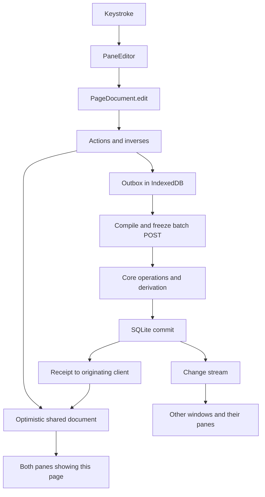
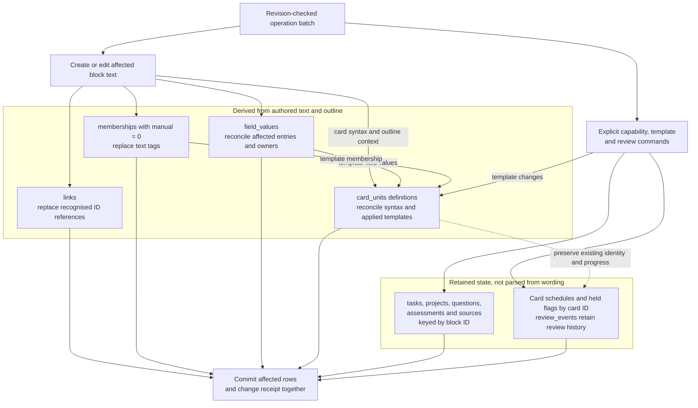
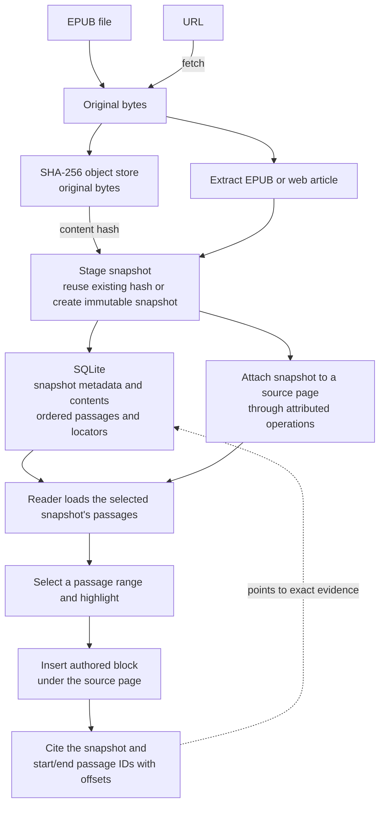
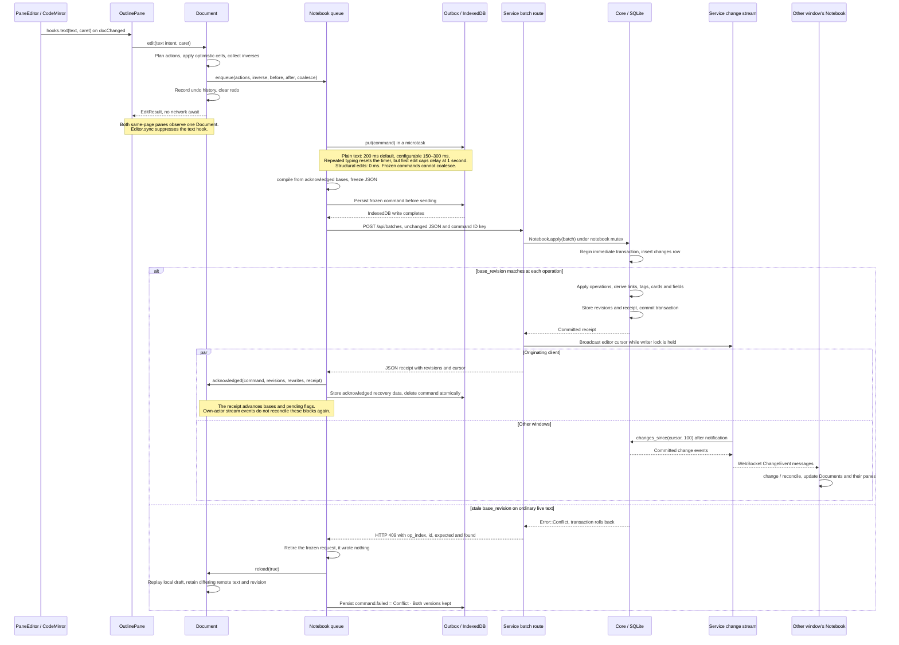

# How Tessera works

Tessera stores an outline in SQLite. The browser keeps an optimistic document, then sends revision-checked operations to the local service. This guide follows the implementation; [architecture](architecture.md), [domain model](domain-model.md) and [design](design.md) explain the intended structure and rules.

## The shape in one page

The CLI runs the service; each browser window creates a notebook client.

- `tessera serve` calls `tessera_service::serve` in the CLI process. `embed-web` compiles the editor into the binary, with no runtime asset directory; `--assets` overrides it for development.
- `tessera install` runs the service as a macOS launch agent. `uninstall` removes the agent, not data.
- `info` reads notebook identity directly. `add` and `export` find a running service through `service.lock`. No command dispatcher starts the service automatically.

Code: `crates/tessera-cli/src/main.rs`, `install.rs`; `crates/tessera-service/src/assets.rs`.

The service acquires `service.lock`, opens the notebook and binds to loopback. `AppState` holds one `Notebook` in `Arc<Mutex<Notebook>>`, sharing one SQLite connection for reads and writes. Code: `crates/tessera-core/src/ownership.rs` (`NotebookOwnership::acquire`); `crates/tessera-service/src/lib.rs` (`serve`, `run`).

`Notebook::open` opens `notebook.db` in the notebook directory, enables WAL, `synchronous=FULL` and foreign keys, then runs migrations. The singleton `notebook` row's ID namespaces browser recovery data. Code: `crates/tessera-core/src/notebook.rs:10` (`Notebook::open`, `Notebook::info`); `crates/tessera-core/migrations/001_notebook.sql`.

Every CLI command initialises `tracing` on stderr with `RUST_LOG`, defaulting to `info`. Service events report URL, notebook path, migration versions, ingestion job starts/outcomes and shutdown. The macOS agent sets `RUST_LOG=info` and sends both output streams to `~/Library/Logs/tessera/serve.log`; CLI JSON and exports remain on stdout.

- `tessera backup <dest>` uses a fresh read connection and SQLite's online backup API while the service can keep writing WAL commits. It copies published content-addressed objects and writes a manifest: notebook ID, schema version, Unix-millisecond backup time, object count and database page count. The destination must be empty.
- `tessera --notebook <dest> restore <src>` holds the service ownership lock through replacement and migration checks. A live service prevents restore even with `--force`; that flag only permits a non-empty destination. Existing immutable objects are retained.

Code: `crates/tessera-core/src/backup.rs`; [backup and restore](usage.md#backup-and-restore).



The input half lives in `web/src/outline/editor.ts` (`PaneEditor`), `web/src/outline/OutlinePane.tsx:1070` and `web/src/document/page-document.ts` (`Document.edit`, `apply`). The durable half lives in `web/src/document/index.ts` (`enqueue`, `compile`, `drain`), `web/src/document/outbox.ts` and `crates/tessera-core/src/operations.rs` (`Notebook::apply`).

A successful batch commits authored rows, derived indexes and its receipt together. The service broadcasts the sequence number under the notebook lock. POST returns the receipt; WebSocket consumers fetch committed changes after their cursor. Code: `crates/tessera-core/src/operations.rs:22`; `crates/tessera-service/src/lib.rs:447` (`catch_up`, `stream_changes`).

Receipts list touched blocks removed by the batch, including provisional type pages pruned by derivation. Acknowledgement hydration removes those IDs from local caches without requesting their block endpoints.

Same-page panes in one window share a `Document`. Another window has its own `Notebook` client and learns changes through HTTP catch-up and WebSocket streaming. Code: `web/src/document/index.ts:162` (`reconcileConnection`, `change`); `web/src/shell/App.tsx:504`.

## Blocks and the outline

The [block model](domain-model.md#blocks) maps pages, journal days and outline rows to `blocks`, with no separate page-content table. Root `text` stores the page title or journal date. Code: `crates/tessera-core/migrations/002_outline.sql:18`; `crates/tessera-core/src/model.rs:13`.

| Column | Stored meaning |
|---|---|
| `id` | Stable block identity; operations use this ID rather than a row position |
| `kind` | `page`, `journal` or `block` |
| `parent_id` | Immediate outline parent; null for roots |
| `page_id` | Owning root; equal to `id` on roots |
| `ordinal` | Integer sibling-order key |
| `text` | Authored source text, or root title/date |
| `title_key` | Lowercased page title for lookup and uniqueness; null on other kinds |
| `heading` | Null or heading level 1, 2 or 3 |
| `archived` | Boolean flag on this row |
| `revision` | Positive revision of this block's stored state |
| `deletion_id` | Null while live; deletion-event ID when tombstoned |
| `created_at`, `updated_at` | Stored millisecond timestamps |

The schema constrains roots and ordinary blocks, indexes siblings by `(parent_id, ordinal, id)` and enforces [live-root uniqueness](domain-model.md#blocks) through `title_key` or journal date text. The public `Block` response omits `ordinal`, `title_key` and `deletion_id`. Code: `crates/tessera-core/migrations/002_outline.sql:32`; `crates/tessera-core/src/model.rs:26`.

Sparse integer ordinals choose the midpoint between neighbours, or add/subtract 1024 at an end. If no gap remains, the engine renumbers siblings, including tombstones, without bumping authored revisions. Code: `crates/tessera-core/src/operations.rs:797` (`Engine::ordinal`).

Insert takes `parent_id` and `after`, not a browser-supplied ordinal. Core checks that `after` is a live sibling and copies the parent's `page_id`. Move changes parent, page and ordinal; cross-page moves update `page_id` and revisions throughout the subtree. Cycles and root moves are rejected. Code: `crates/tessera-core/src/model.rs:67` (`Operation::Move`); `crates/tessera-core/src/operations.rs:871` (`Operation::Insert` handling).

`Notebook::page` fetches live rows once, groups by parent and walks preorder. It returns a root, rows with computed depth (not a database column), manual memberships, external reference targets and capability sidecars. Code: `crates/tessera-core/src/reads.rs:72` (`Notebook::page`).

Revisions belong to resources, not the notebook. Blocks start at 1. Text, heading, archive, location or capability changes can bump revisions; equal-text edits do not. Multiple operations can bump one block repeatedly; receipts record its final revision once. Notebook-wide `changes.seq` is a separate commit cursor. Code: `crates/tessera-core/src/operations.rs:241` (`create`, `edit`, `bump`, `operation`); `crates/tessera-core/migrations/002_outline.sql:1`.

`base_revision` must match an existing block's revision at that operation's batch position. `Engine::checked` reports operation index, ID, expected and found revision; missing/deleted rows have no live revision. Failure rolls back the transaction and maps to HTTP 409. Code: `crates/tessera-core/src/operations.rs:572` (`Notebook::apply`); `crates/tessera-service/src/error.rs:49`.

`Operation` covers text, split, merge, move, delete/restore, fields, types, tasks, work and review writes. Merge checks source and destination revisions; restore names the deletion event and deleted block revision, following the [block rules](domain-model.md#blocks). Code: `crates/tessera-core/src/model.rs:55` (`Operation`).

Deletion tombstones the live subtree under one event; restore revives only its rows, not independently deleted descendants. Archive leaves rows live. Discovery computes hidden descendants from archived ancestors, while direct block/page reads include archived rows. Code: `crates/tessera-core/src/operations.rs:707` (`restore`); `crates/tessera-core/src/reads.rs:49` (`block`, `page`).

## Text is the source of truth for some things

Text writes rebuild affected reference/membership indexes and reconcile affected fields/cards, not the whole notebook. Links derive during create/edit; tag, card and field work finishes inside the batch transaction. Code: `crates/tessera-core/src/operations.rs:89` (`create`, `edit`, `derive_tags`, `derive_cards`); `crates/tessera-core/src/fields.rs` (`FieldChanges`).

What a text write derives, and what it leaves alone. Task, project, question and source state is never parsed back out of wording; card units keep their identity, schedule and history when their definition changes.



| Source | Parser or recogniser | Derived state |
|---|---|---|
| `[[id]]`, `[[id\|alias]]` | Core `storage.rs::derive_links`; browser `text-tokens.ts::textTokens` | `links` rows for recognised ID references |
| `#Type`, `#[[Type name]]` | Core `storage.rs::tag_tokens`, `derive_memberships`; browser `textTokens` | `memberships` rows with `manual=0` |
| Whole `[[field-id]]` entry with children | Core `fields.rs::reference`, `derive_owner` | `field_values` identity/order rows |
| `Name:: value` | Browser `table/query.ts::matchFieldEntry`, `OutlinePane.tsx::commitFieldEntry` | Authored reference entry and child value blocks, then `field_values` |
| `front >> back`, `front << back`, `front <> back`, numbered clozes | Core `card_text.rs::parse_card_text`; browser `review/card-text.ts::parseCardText` | Retained `card_units` definitions |
| Searchable text | SQLite FTS triggers | `blocks_fts`, with live candidates in `search_blocks` |

The table's implementations are in `crates/tessera-core/src/storage.rs:143`, `295`; `crates/tessera-core/src/fields.rs:94`, `185`; `web/src/document/text-tokens.ts:2`; `web/src/table/query.ts:47`; `crates/tessera-core/src/card_text.rs:292`; `crates/tessera-core/migrations/002_outline.sql:62`.

`derive_links` indexes each [ID reference](domain-model.md#references-and-links) occurrence and optional alias. Targets have no foreign key, preserving unresolved references in source text. Bracketed tag titles are excluded. Backlinks return distinct visible source blocks, not occurrences. Code: `crates/tessera-core/src/storage.rs:143`; `crates/tessera-core/migrations/002_outline.sql:52`; `crates/tessera-core/src/reads.rs:213`.

A whole-row `((ID))` also indexes one link, so a [quote](domain-model.md#quotes) appears among its target's backlinks; `((ID))` inside other text is plain. `set_quote` validates the snapshot against the row's text, the depth sequence and the 200-row and 64 KiB caps, and stores it in `quotes`. The `quote` capability is reported only while the row's text still names the stored target. `quote_snapshot` builds a snapshot from `subtree`, and `quote_status` compares stored rows with the live subtree. Code: `crates/tessera-core/src/quote_store.rs`; `crates/tessera-core/migrations/036_quotes.sql`; `crates/tessera-core/src/storage.rs` (`quote_target`).

Page-level reference reads are set-based. `page_references` groups distinct sources that link to any block on a page by referring page, newest first, and keeps outline order within each group. `reference_counts` returns per-block distinct source counts. `unlinked_mentions` runs one FTS phrase query over the title and aliases, then confirms whole-word matches outside reference and tag tokens. Code: `crates/tessera-core/src/references.rs`.

`Notebook.lookup` supplies reference labels: the alias or current target text, or an unresolved label for a missing target. Rendering leaves the authored ID token unchanged. Code: `web/src/outline/BlockText.tsx:22` (`referenceLabel`, `BlockText`).

Opening a non-journal page selects a visible non-field row without editing it. In an active row, CodeMirror shows single-line references as atomic labels until the caret enters their source text. Clicking exposes the token; arrow keys step over it, and Backspace immediately after it deletes the whole token. Multiline references remain raw.

HTTP and HTTPS URLs render as external links in outline rows and table cells. Rendering excludes trailing punctuation, retains balanced parentheses and adds no core link-index entries. Code: `web/src/outline/editor.ts`; `web/src/document/text-tokens.ts`; `web/src/outline/BlockText.tsx`.

Tags address page titles. Derivation lowercases titles, deduplicates text memberships and creates missing type pages on live tag writes. Type-page renames can rewrite incoming tags and manual-membership titles; receipt `text_rewrites` updates the browser and undo history. Code: `crates/tessera-core/src/storage.rs:295` (`resolve_type`); `crates/tessera-core/src/operations.rs` (`prepare_tag_rename`, `rewrite_incoming_tags`, `derive_tags`); `web/src/document/page-document.ts` (`recordRewrites`).

**`Name:: value` converts in the browser, not in a core shorthand parser on every write.** Enter, blur and navigation paths call `commitFieldEntry`, which finds/creates the definition, rewrites the entry to `[[field-id]]` and inserts its child value. Raw API `Name:: value` writes stay raw until client conversion. Code: `web/src/outline/OutlinePane.tsx:60`, `214`, `541`, `1072`; core `fields.rs::derive_owner` recognises only a whole reference.

The shorthand matcher permits names up to 60 characters, excluding reference/tag/code delimiters. It checks names with the card parser so cloze drafts/cards cannot become field names, preserving card syntax in values. Code: `web/src/table/query.ts:47`; `web/src/table/query.test.ts` (`matches names`, `keeps cards`, `retains card and code syntax`).

The parsers implement [card syntax](domain-model.md#cards): `>>`, `<<`, `<>` and numbered clozes such as `{{c1::answer::hint}}`. Invalid explicit syntax returns problems and no units; code, references and escapes shield literal syntax. Code: `crates/tessera-core/src/card_text.rs:55` (`protected_end`, `cloze`, `parse_card_text`); `web/src/review/card-text.ts:149`.

| Derived rows | Replacement |
|---|---|
| Links | Delete/reinsert for the source |
| Memberships | Replace text memberships; retain manual rows |
| Field values | Clear/reinsert for affected owners |
| Cards | Retain identity/schedule; missing syntax deactivates, preserving history |

Code: `storage.rs::derive_links`, `derive_memberships`; `fields.rs::derive_owner`; `card_store.rs::derive_sources` in `crates/tessera-core/src/`.

## Fields and types

The [field model](domain-model.md#types-and-fields) defines definitions, entries and value children. The index stores their identities, not a copy of value text. Code: `crates/tessera-core/src/fields.rs:62` (`reference`, `derive_owner`); `crates/tessera-core/migrations/006_fields_views.sql:23`.

For example, the authored outline can contain:

```text
Fields
  Author                       [definition block]
  Published                    [definition block]
Dune #[[Book]]                  [owner block]
  [[Author-definition-id]]      [entry block]
    Frank Herbert              [value block]
  [[Published-definition-id]]
    1965
```

Example labels stand for real IDs. The index stores `(owner_id, field_id, entry_id, value_id, ordinal)`; multiple entries/value children can contribute to one field. Empty entries have no value rows but remain recognisable by their whole reference. Code: `crates/tessera-core/migrations/006_fields_views.sql:23`; `crates/tessera-core/src/fields.rs:185`; `crates/tessera-core/src/query.rs:368`.

Definitions use block text as their name and an optional `fields` row, with `kind` defaulting to `text` and the `hide` column defaulting to `never`. Migration `037_field_hide.sql` adds `hide`; definitions without a settings row also read `never`. The [field model](domain-model.md#types-and-fields) lists the kinds, choice structure and outline hiding rules. Recognition excludes blank, deleted or archived definitions; choice options must be live and unarchived. Code: `crates/tessera-core/src/fields.rs` (`definitions`); `crates/tessera-core/migrations/006_fields_views.sql:1`, widened by `010_field_kinds.sql`.

`FieldKind::ALL` and its string mapping in `model.rs` define the ordered kind contract. Database reads reject an unknown stored kind as corruption rather than treating it as text. Tests in `tests/fields.rs` insert every kind through SQLite's CHECK, reject a bogus kind and compare the order against `web/src/fields/kinds.ts::fieldKinds`. The web API type derives from that array, and `kindLabels` is exhaustive. Historical migrations keep their original CHECK definitions.

`FieldHide::ALL` defines the ordered hiding contract, pinned against `web/src/fields/hide.ts::fieldHides` by a Rust parity test. Unknown stored hiding values are corruption.

`fields::reading` interprets authored values using the current kind, retaining invalid source text with a problem reading.

- Numbers are parsed; dates accept full or partial (`YYYY`, `YYYY-MM`) text or a journal reference.
- Checkboxes recognise supported spellings; choices check references against option children; instances resolve references; URLs require `http(s)`.
- `fields::identifier` normalises identifiers: ISBN-10 converts to ISBN-13 after both checksums, DOIs lowercase, and arXiv keeps its version.

Code: `crates/tessera-core/src/fields.rs:351`.

`GET /api/fields/{id}?kind=number&limit=12` joins a definition's visible entries with values and reference targets. The optional kind previews a reading without writes; omission uses the stored kind. Unknown or non-definition IDs return 404.

| Result | Contents or bound |
|---|---|
| `field`, `kind` | Definition and reading kind |
| Totals | Owners, values, empty entries and problems |
| `templates` | One-based positions and member counts |
| `option_uses` | Option usage |
| `owners` | Case-insensitive text order, then ID; default 12, maximum 500 |
| `problems`, `readable` | At most 100 and 12 samples respectively |

[Field date rules](domain-model.md#types-and-fields) allow one-to-four-digit nonzero years, but require four digits before a month or day.

`memberships` stores the block, normalised title, resolved type-page ID, authored spelling and source flag. Text and manual sources have separate rows, following the [membership rules](domain-model.md#types-and-fields). Removing a manual row leaves the text tag. Code: `crates/tessera-core/migrations/007_manual_memberships.sql`; `crates/tessera-core/src/operations.rs` (`Operation::AddType`, `RemoveType`); `web/src/document/page-document.ts:818`.

`type_fields` stores ordered field IDs on a type page. `SetTypeFields` validates definitions, replaces the list and bumps the page revision. It implements the [template rules](domain-model.md#types-and-fields): initial table columns and unwritten field-sheet slots. Fill missing fields commits one batch of ordinary `insert` operations for empty entries.

Code: `crates/tessera-core/migrations/006_fields_views.sql:6`; `crates/tessera-core/src/operations.rs:1158`; `crates/tessera-core/src/query.rs:92`, `312`; `web/src/outline/field-sheet.tsx`; `web/src/fields/TemplateEditor.tsx`.

`subject_criteria` stores ordered field IDs on any subject block. `set_subject_criteria {subject_id, base_revision, fields}` validates definitions and uniqueness, replaces the list and bumps the subject revision. An empty list restores derivation.

`GET /api/positions?subject=<id>` returns `{rows, criteria: {explicit, fields}, questions}`:

- Rows carry ordered `{field_id, entry_id, values: [{id, text}]}` entries.
- Questions carry their block, info, derived `criterion` and `holders`.
- Fields and questions are read in sets, never per position. Holder and limit filters follow criteria and question-scope derivation.

Page-document history records criteria and matrix edits. Undo restores the previous explicit list or derivation and preserves value identities.

`Notebook::query_sources` gathers type-membership, FTS and field-ownership candidates. A joined read fetches source blocks, roots, value text and reference targets. Rust filters/sorts readings, counts matches, then limits results. Code: `crates/tessera-core/src/query.rs:162`, `203`, `272`; `crates/tessera-core/src/reads.rs:186` for simpler member reads.

The [query rules](domain-model.md#queries-and-views) define `present`, `set`, `empty` and invalid-value handling. Comparisons require valid readings; field sorts use the first value's reading, with missing/problem keys last. Code: `crates/tessera-core/src/query.rs:250` (`PreparedFilter::matches`, `compare`, `sort_value`), sorting at `286`.

Table edits change outline blocks: edit the first existing value, or find/create the reference entry and reuse/insert a value child. Saved views store name, JSON `Query` and revision in `views`. Code: `web/src/table/TablePane.tsx:219`; `crates/tessera-core/migrations/006_fields_views.sql:14`; `crates/tessera-core/src/query.rs` (`stored_view`, `views`, `view`).

## Tasks, projects and work sessions

Task/project metadata is keyed by block ID, separate from text and field children. Roots and ordinary rows can own it; writes check the owning block's revision. Code: `crates/tessera-core/migrations/009_action_learning.sql:1`; `crates/tessera-core/src/operations.rs:1264`; `crates/tessera-core/src/task_store.rs:301`.

| Table | Columns outside JSON | JSON payload |
|---|---|---|
| `tasks` | `block_id`, `active` | `state`: status, scheduled/deadline dates and times, warning days, repeater, priority, completion date |
| `projects` | `block_id`, `active` | `state`: outcome, deadline, status |
| `task_occurrences` | ID, block, completion date, reversal flag, timestamps/change sequences | `snapshot` before completion, `after_state` after completion |
| `work_sessions` | ID, block, start/end timestamps, note, reversal flag, revision, creation/update sequences | None |

The schema is `crates/tessera-core/migrations/009_action_learning.sql:1`. Payload definitions are `TaskState`, `ProjectState`, `TaskOccurrence` and `WorkSession` in `crates/tessera-core/src/capabilities.rs:28`.

`active` marks capability presence, not task/project status. Removal stores `active=0` while retaining the row and state; setting it again reactivates it. A done task can have `active=1`. Semantic no-op writes do not bump the block. Code: `crates/tessera-core/src/task_store.rs:79` (`set_project`, `complete_task`); `crates/tessera-core/src/operations.rs:1279`.

[Task rules](domain-model.md#tasks) define `todo`, `doing`, `waiting`, `done` and `cancelled`. Only `CompleteTask` can create a new done state. It records the prior state in an occurrence, then stores the result; without a repeater, it sets done and the completion date. Already-done nonrepeating completion is a no-op. Code: `crates/tessera-core/src/capabilities.rs:10`; `crates/tessera-core/src/task_store.rs:109`, `190`.

**Parent completion touches only the selected task row and its occurrence.** It neither checks nor completes children, blocks completion on them, nor rolls up their progress. `TaskState` and the schema have no task-parent or dependency field; outline nesting imposes no completion rule. Code: `crates/tessera-core/src/task_store.rs:190`; `crates/tessera-core/src/capabilities.rs:28`; `crates/tessera-core/migrations/009_action_learning.sql:1`.

`visible_tasks` derives `project_id` from the nearest ancestor with an active project capability, following the [project model](domain-model.md#projects). Project filtering queries descendants through ancestry and checks the capability's `active` flag, not project status or a completion roll-up. Code: `crates/tessera-core/src/task_query.rs:76` (`visible_tasks`); `crates/tessera-core/src/task_store.rs:162`.

`Repeater` stores a positive interval, day/week/month/year unit and mode. `advance_window` implements the [date-advancement rules](domain-model.md#tasks), retaining clock labels. Completion returns the task to todo, clears `completed_on` and records an occurrence. Code: `crates/tessera-core/src/calendar.rs:11` (`Repeater`, `advance_window`); `crates/tessera-core/src/task_store.rs:214`.

Fixed, catch-up and after-completion calculations run on civil dates in core, not browser predictions. The optimistic client leaves recurring state unchanged until the authoritative receipt. Code: `crates/tessera-core/src/calendar.rs:144`; `web/src/document/page-document.ts:179`.

Reversal marks the latest unreversed occurrence reversed and restores its snapshot only if current state equals `after_state`. This implements [completion undo](domain-model.md#tasks) without overwriting later edits. Code: `crates/tessera-core/src/task_store.rs:248`.

### Task lists and agenda

Task queries reuse source type/text/field selection without its intermediate limit, then filter active, visible sources by status, selection, date ranges, priority and project ancestry. The [selection rules](domain-model.md#tasks) admit unfinished tasks (todo, doing, waiting) or recent unreversed occurrences by default; cancelled tasks require an explicit status filter. Code: `crates/tessera-core/src/task_query.rs:111`, `284`; defaults in `crates/tessera-core/src/capabilities.rs:182`.

Task rows sort by planning date/time, priority and block ID. Planning prefers scheduled date over deadline, with missing dates/times last. Totals precede the outer limit; `task_views` stores saved JSON queries. Code: `crates/tessera-core/src/task_query.rs:139`, `156`, `216`, `339`; migration `009_action_learning.sql:67`.

Tasks mode uses a synchronous query-line parser:

- Cached page titles resolve types; cached project-capability titles resolve projects.
- `parseTaskDate` uses the pane's context date. Field predicates and hidden source settings remain intact; only an error-free line applies.
- Chips render the line outside editing. Device preference `tessera.task-filters.open` reveals controls that write to the same query and line.
- Pane history and named views persist `TaskQuery`, not text.

Code: `web/src/tasks/task-query-line.ts`; `TaskQueryLine.tsx`; `AgendaPane.tsx`.

`Notebook::agenda` implements the [agenda rules](domain-model.md#tasks) for the displayed civil date. Unfinished rows combine scheduled, deadline, warning, overdue or unplanned reasons. Same-day completions use the latest unreversed occurrence's planning and a done projection, even after a repeater advances; cancelled tasks are excluded. Code: `crates/tessera-core/src/task_query.rs:165`, `348` (`Notebook::agenda`).

### Work sessions

Starting work requires an active, visible, unfinished task. A partial unique index enforces the [single running session rule](domain-model.md#tasks). Audit timestamps come from the start/stop operation, not commit time after delayed delivery. Code: `crates/tessera-core/src/work_store.rs:67`, `83`, `129`; `crates/tessera-core/migrations/009_action_learning.sql:27`.

Stopping sets `ended_at` and note. Note edits and reversal/reopening update session revision; operations also check/bump the block. Reopening requires an unfinished task and free clock. History includes reversed sessions and hidden/deleted sources. Code: `crates/tessera-core/src/work_store.rs:107` (`apply`, `work_sessions`); `crates/tessera-core/src/operations.rs:1298`.

Core guards refuse completion, removal, cancellation or hiding of a running task, including subtree hiding or moving beneath a hidden source. The browser can queue `StopWork` immediately before `CompleteTask` when given the current session. Code: `crates/tessera-core/src/task_store.rs:59`, `149`, `213`; `crates/tessera-core/src/work_store.rs:243`; `web/src/document/page-document.ts:782`.

### Why a row cannot merge away

Core computes `merge_protected` in reads, not as a `blocks` column. `mergeProtected` prevents stranding source identity when it has:

- An active task or project.
- A non-reversed task occurrence or work session.
- A card review event, even after syntax becomes inactive.

Inactive task/project rows without history do not protect. Capability `history` records whether occurrences or work sessions exist. Code: `crates/tessera-core/src/task_store.rs` (`capability_rows!`, `capability_at`, `guard_merge`).

The browser maps the sidecar to `BlockState.mergeProtected` and retains `history` in the document cell. Protection is recalculated after task, project, completion and work actions, receipts and offline replay. Optimistic reversal retains history until the service reports otherwise, since other evidence may remain. Page loads, receipts, stream events and recovery caches carry these sidecars. Code: `web/src/document/page-document.ts` (`receiveCapabilities`, `apply`); `web/src/document/outbox.ts` (`cachedPage`).

A protected-source `merge` or cross-block range replacement that would merge away its last endpoint is refused:

- With history: "This task has completion or work history; delete it or keep it separate."
- Otherwise: "Cannot merge away an active task, project, or reviewed card."

Task-start Backspace avoids this guard: `boundaryDeletion` deletes an empty childless todo, or removes task state from a non-empty one first. Forward Delete can reach it when the next row is an active task.

Code: `web/src/document/page-document.ts` (`merge`, `replace`); `web/src/document/outline-mechanics.ts` (`boundaryDeletion`); `web/src/outline/OutlinePane.tsx` (`backspace`).

`Engine::merge` calls task/project and reviewed-card guards before changes, enforcing [source-identity protection](domain-model.md#cards) for API clients too. The destination keeps its identity. Text edits, moves, archive and tombstone deletion have separate checks, including the running-work guard. Code: `crates/tessera-core/src/operations.rs:909` (`delete`, `Operation::SetArchived`); `crates/tessera-core/src/task_store.rs:401`; `crates/tessera-core/src/card_store.rs:212`.

## Cards and review

Retained units implement the [card model](domain-model.md#cards), with their own ID, source ID and unique `(source_block_id, key)`. Role keys are `forward`, `reverse`, `cloze:cN`, `multiline`, `list` and `descriptor`; root titles do not derive syntax cards. Code: `crates/tessera-core/src/card_text.rs`; `card_store.rs`; migration `020_fsrs_child_cards.sql`.

`derive_sources` compares parsed and retained units by key. Wording changes update front/back, `definition_revision` and card revision, not ID or schedule. Removed/reintroduced syntax deactivates/reuses units; new keys receive new IDs and initially due schedules. Code: `crates/tessera-core/src/card_store.rs:117` (`derive_sources`).

For [child-answer cards](domain-model.md#cards), `>>>` and `>>1.` require a non-empty front and child subtree. Snapshot construction omits hidden branches and empty leaves, retaining non-empty descendants of blank parents. List counts use the remaining direct children.

Canonical `back` is ordered `{id,text,children}` data; `answer_blocks` exposes the same snapshot. Descendant edits, moves, reordering, archive, deletion and restoration rederive ancestors, changing definition revisions without resetting schedules. `BlockText` renders current and historical answers; lists grade only after the last item.

Descriptors (`;;`) store the composed `subject › name` front, so review, card lists, search and MCP need no outline walk. `card_subject`, mirrored by `cardSubject` in `web/src/review/card-text.ts`, implements the [parent-subject rules](domain-model.md#cards). `derive_sources` reads parent text beside each source; an empty subject skips the card and deactivates a retained unit.

`Engine::edit` in `operations.rs`, shared by page renames, splits, merges and link rewrites, adds direct children containing `;;` to the batch's card sources. Parent/page renames therefore rederive descriptors without resetting schedules. Moves query no children: the moved descriptor is a source, so moving from a 10,000-row page requires no per-row work.

The outline repeats the empty-parent check for diagnostics; review omits the parent from the source breadcrumb. Migration `034_descriptor_cards.sql` widens the `card_units.kind` check and rebuilds `card_units` and `review_events` with rowids, as migration 020 did. The runner rebuilds definitions to derive existing `;;` text. Paired devices require schema 34.

The operation engine collects changed card sources and derives them once at batch end. Before grading/resetting in the same batch, it flushes preceding authored card edits so stale definitions fail the review check. Migrations 009, 020 and 034 backfill definitions; reopening an already-current schema does not rebuild cards. Existing document text/insert/move/delete/restore actions and their undo remain the authoring path; no separate card-edit operation is needed.

Migration `032_card_hold.sql` adds `card_units.held INTEGER NOT NULL DEFAULT 0 CHECK (held IN (0, 1))`. `set_card_held {id, base_revision, held: bool}` checks card revision and active status, changes only the flag, and bumps revision and `updated_at` with the batch stamp. Equal-flag writes are no-ops; document inverses support undo/redo.

API responses include `held`. Derivation and Reset preserve it, and grading refuses held units, following the [held-card rules](domain-model.md#cards). Review queues, deck/sidebar/Today counts, statistics, fourteen-day forecasts and template introductions exclude them; syntax and template-presence counts include them.

SQLite session patches carry the column automatically because `card_units` is an Applied table. Paired devices require schema 32.

Migration 030 adds revisioned `card_templates`. These operations use the attributed batch engine:

- `create_card_template {id,type_id,name,front,back,new_per_day}` creates a draft.
- `update_card_template {id,base_revision,name,front,back,new_per_day}` updates it.
- `set_card_template_applied {id,base_revision,applied}` changes applied state.
- `delete_card_template {id,base_revision}` deletes it.

Document actions retain inverses, including restoration with the same ID. Units use the plain front/back kind and `tpl:<id>` key, ignored by syntax derivation. `card_templates.rs` batch-reads candidate members and field values, reconciles units without resetting schedules, and participates in rebuild and sync.

Field changes capture old/new owners, including linked-value targets. Same-batch grades flush these definitions before checking shown text.

| Endpoint | Response |
|---|---|
| `GET /api/types/{id}/card-templates` | Position-ordered patterns in stored/display forms; applied state, daily limit, revision, ready/waiting counts, active-unit count, missing-field names and first-ready-member preview |
| `GET /api/card-templates/{id}/forecast?days=14` | Accepts 1 to 365 days; member, ready, waiting, retained-unit and new-unit counts; at most 50 waiting members with missing-field names; introduction duration and last day; `{date,due,added}` load rows |

Existing due load uses review forecasts' civil-day calculation and excludes unreviewed cards. Additions use the template's remaining daily allowance arithmetically, not an FSRS prediction.

Card split guards enforce the [end, interior and start split rules](domain-model.md#cards), separately from task/project merge protection. Code: `crates/tessera-core/src/card_store.rs:221`; `web/src/document/page-document.ts:643`.

`card_units.schedule` stores JSON: nullable stability/difficulty, interval days, repetitions, lapses, due timestamp and last-review timestamp.

The allocation-free Rust `fsrs-6` port uses the [official py-fsrs memory equations and default weights](https://github.com/open-spaced-repetition/py-fsrs/blob/9446cb06605c597a063aeee49f7d188d42e34dc2/fsrs/scheduler.py), unchanged in native and wasm builds. It has no optimiser, randomness, clock dependency or separate learning-step engine.

- Desired retention is 0.9; deterministic whole-day intervals range from 1 to 36500.
- After integer rounding, Hard < Good < Easy separation reserves the final two days at the ceiling; Again is at most Hard.
- This adjustment leaves FSRS memory estimates unchanged. Previews and committed grades use the same policy; unit tests retain official memory-state and review-sequence vectors.

Migration 020 replays each card's `review_events` by review timestamp and rowid through FSRS, respecting resets and same-timestamp reset/grade ordering. Cards without history retain new memory state. Existing evidence JSON is unchanged and marked `sm-2`; only a historical data variant remains, not its scheduling math. New events record `fsrs-6` with the exact before/after state. The migration and replay run in one transaction.

`GradeCard` enforces the [presentation checks](domain-model.md#cards) against card revision, definition revision and exact shown front/back, not source-block revision. It requires active syntax, a visible source and an open session if supplied, and schedules from explicit operation review time. Code: `crates/tessera-core/src/model.rs:235`; `crates/tessera-core/src/review_store.rs:134`, `172`, `402`.

Grade/reset events store shown text, definition revision, scheduler version, before/after schedules, event time and change sequence. The transaction also updates schedule and card revision. Reset-plus-grade retains separate evidence; finish/abandon changes session state without deleting grades, following the [review-history rules](domain-model.md#cards). Code: `crates/tessera-core/migrations/009_action_learning.sql:76`; `crates/tessera-core/src/review_store.rs:206`, `239`, `355`.

Deck rows implement the [saved-deck rules](domain-model.md#cards), storing names, JSON card queries and independent revisions. An optional source query selects by type/text/fields; card selection applies due/new/all to active visible units, counts before limiting, and sorts reviewed before new, then by due time and ID. Deletion removes only the query row. Code: `crates/tessera-core/src/card_query.rs:43` (`stored_deck`); `crates/tessera-core/src/review_store.rs:457`.

The review pane holds shown text until acknowledgement. Refresh detects changed cards/sessions, refusing stale grades; the current session excludes units already graded there. Grade/session/deck commands share page edits' ordered durable outbox. Code: `web/src/review/ReviewPane.tsx:127`, `240`; `web/src/document/index.ts:271` (`sendNotebook`).

`GET /api/review/stats?deck=<id>&date=YYYY-MM-DD` projects active visible schedules and immutable grade events without writes. Context dates use the notebook's IANA timezone, like Agenda and resurfacing; omission uses the current notebook day. Civil midnights define boundaries, including DST days. A deck applies only its source predicate, not queue selection or display limit.

| Result | Meaning |
|---|---|
| `date`, `due_review`, `due_new` | Context date and due counts |
| Fourteen `{date,count}` entries | Forecast, folding overdue cards into today |
| `retention` | Non-Again share over thirty local days; null without reviews |
| `reviews_this_week` | Monday-start week |
| `streak` | Consecutive reviewed days ending today or yesterday |
| `total_cards` | Card total |

`GET /api/review-sessions/{id}/reviews` returns ordered retained events for the grade strip, summary and missed cards. Review missed starts another durable session. Its queue stores the evidence session ID in local storage and resolves current definitions from that session's Again events on reload.

Citation context uses existing source and snapshot-passages reads; no reading sessions or migrations are added.

## Library and reading

Original bytes go to the SHA-256 object store and extracted passages to SQLite. A highlight is an ordinary block on the source page whose citation points at an exact passage range in one snapshot.



`SetSource`, `AttachSnapshot`, `Cite` and `Uncite` check the owning block revision and use the outline batch engine for [sources and citations](domain-model.md#sources-passages-and-positions). Source state and active citations travel in capability sidecars on page loads, receipts and change events.

Merge transfers citations to the destination; split retains them on the original ID. Tombstones retain evidence, while discovery excludes hidden/deleted citing blocks. Code: `crates/tessera-core/src/library.rs:1`; `library_store.rs:1` (`apply`); `task_store.rs` (`capabilities_for`, `page_capabilities`).

The object store hashes original/resource bytes with SHA-256. `Notebook::put_object` writes and syncs a temporary file beside the final path, publishes without replacing an existing object, then syncs directories. `stage_snapshot` transactionally inserts the immutable snapshot, UTF-16-positioned passages, FTS entries and resource references; the same hash returns the existing snapshot. Code: `crates/tessera-core/src/library_store.rs:1`; `migrations/011_library.sql:1`.

`plan_ingest` plans operations without writes. Source resolution prefers, in order:

1. An explicit target.
2. A matching EPUB unique identifier or article canonical URL.
3. A source already holding the snapshot.

New sources get a collision-safe title, inbox state, stable citation key, Book/Article type and ordinary metadata field/value blocks. Creators normally reference person pages.

Existing fields retain their kind: text gets plain extraction; instance/choice gets resolved references; incompatible kinds keep the extracted string with an invalid reading. The service supplies the original URL/filename separately from immutable extracted metadata.

Code: `crates/tessera-core/src/library_ingest.rs` (`Planner`, `plan_ingest`, `extracted_values`).

Extracted lists are positional. Re-ingestion updates position `i` only when its current text equals the previous extraction at `i`.

| New list | Action |
|---|---|
| Shorter | Archive surplus still-extracted values; never delete |
| Empty | Archive all still-extracted values |
| Longer | Insert missing positions after the last live value |

Authored overrides are never changed or archived; reading state and citation keys remain. Archived values occupy no live positions on later ingestion.

“Reset to extracted” compares against the current snapshot, sets differing positions and inserts missing values, leaving authored extras beyond the list alone. Field-block and source-header actions offer it whenever the reset plan is non-empty.

Code: `web/src/outline/source.ts`; `source-fields.ts`.

The Add to library sheet accepts EPUBs, article URLs, checked ISBNs, DOIs and arXiv identifiers:

- Explicit submission starts online lookup through Open Library, Crossref or arXiv, with a ten-second timeout. The embedded service returns typed `unavailable` for network lookup.
- Lookup previews/manual entry create metadata-only `record` sources in Inbox: bibliography fields, citation key and author-derived siglum, but no snapshot or Read action.
- Source details and Fill missing details use one undoable document edit on those fields; fill preserves nonempty authored values.
- Cover fields reference immutable object bytes. Replacement is undoable; re-ingestion does not overwrite it.

Library rows show publication year separately and sort by author or year. The last built-in tab persists per notebook; first visit prefers nonempty Inbox, then Reading, then All.

Source-page highlights follow passage ordinal/start offset, keeping note subtrees together. Totals use the library's notebook-wide citation query; highlights on other pages appear under Filed elsewhere.

Citation endpoints name the snapshot, passages and UTF-16 offsets. Reads assemble frozen quotations with blank lines between passages. Passage search has its own FTS index and defaults to current snapshots unless a source is explicit.

Progress divides the saved passage's UTF-16 start by snapshot text length; migration 018 removed coverage ranges. Position saving follows the [navigation-state rules](domain-model.md#sources-passages-and-positions): no change row except the first inbox read's attributed `SetSource` batch as `reader`. Citation jumps must not save position.

Code: `crates/tessera-core/src/library_reads.rs:1`.

Library queries exclude inactive, hidden and deleted sources. The [derived triage rule](domain-model.md#sources-passages-and-positions) checks live non-blank children, active card units or incoming links from live blocks; empty notes do not count.

Migration 013 adds nullable `citations.triage`. `processed`/`unprocessed` overrides derivation; null restores it. `SetCitationTriage` names the citation but checks/bumps its block revision. Sidecars carry triage through optimistic edits, undo and remote reconciliation. Highlight `created_at` uses citation creation-change time, not later block-edit time.

BibTeX/CSL JSON export requires an assigned citation key and reads current authored field readings, not stored extraction. Code: `crates/tessera-core/src/library_reads.rs` (`library`, `highlights`); `library_export.rs`.

Reader selections snap partial words outwards across Unicode letters, digits and apostrophes, then trim whitespace, commas, semicolons and colons at both edges. Quotations and UTF-16 endpoints use that range; punctuation-only selections show no toolbar.

- Overlapping tints retain every citation and open a choice menu.
- Clicking a single tint or pressing Enter offers Open note/Add note, Make card, Copy with citation, explicit triage and Remove highlight.
- Shift-click opens the highlight beside the reader.
- Note, card, triage and removal edits use document undo.

In the active reader:

| Reader key | Action |
|---|---|
| `j`, `k` | Move the active passage cursor, starting at the first passage whose top is visible |
| `s` | Select that passage's first sentence |
| `]`, `[` | With a selection, extend/shrink its end by a sentence |
| `}`, `{` | With a selection, extend/shrink its end by a passage |
| `h`, `n` | With a selection, save a highlight, or a highlight with a note |

The reader's Highlights picker lists this source's open-snapshot highlights in reading order. Picking one scrolls and flashes its range without saving position.

Library Highlights shows the covering chapter, or one-based passage number, and creation date in notebook time zone. Chapters resolve against the citation's snapshot, including historical ones. Row actions open the passage beside Library, manage notes/cards, set triage or remove the highlight.

Highlights use yellow, green, blue, red, purple or null for default tint. Selection keys 1–5 create colours; H/N keep the default. Migration 014 stores `citations.color`; `SetCitationColor` checks/bumps the block revision like triage.

The menu changes colour with document undo and appends ordinary `#tag` tokens through text edits. Tags derive from highlight text, not quotations. Library Highlights shows colours/tags and matches any selected colour plus every selected tag; pane history retains the filters.

Journal Resurfaced shows up to three older highlights. Date-specific picks stay stable across reloads and new highlights:

- Only active, visible citations on active, visible sources qualify. Creation must precede the journal date in notebook time zone; future dates show none.
- Highlights rest for 14 days after display. Never-shown comes first, then least recently shown, with date-seeded tie ordering.
- Open reads beside the journal; Keep leaves a checked card; Mute removes it and excludes later picks.

These actions save navigation state without change rows. An empty date remains eligible for later picks.

BibTeX/CSL JSON export supports valid text, number, date, URL, identifier, instance and choice readings with known bibliography labels:

- Numbers retain authored formatting.
- Dates retain precision (`YYYY`, `YYYY-MM`, `YYYY-MM-DD`); journal references resolve to dates.
- Instance/choice references export target titles.
- Identifiers use normalised ISBN, DOI or arXiv schemes.

Checkboxes, invalid readings and unmapped labels are excluded. `tests/library.rs::export_field_kind_matrix` covers every kind in both formats.

Markdown export reads authored titles, authors, publication dates, URLs and citation keys:

- Frozen quotations follow passage/offset order: current snapshot first, older citations under `Earlier snapshot`.
- Chapters resolve per citation snapshot, falling back to one-based paragraph numbers; creation dates use notebook time zone.
- Live non-blank note children follow outline order; nested notes become indented lists.
- Empty sources retain a header and no-highlights message; `---` separates sources.

Library, saved-view and source menus offer `.md` alongside BibTeX/CSL JSON. The service returns `text/markdown; charset=utf-8`.

`library_views` stores name, query and revision. `SaveLibraryView`/`DeleteLibraryView` use task views' revision checks, receipts and events. Library lists saved views beside built-in tabs and restores the selected view after reload.

Selection stays in the pane and clears on query changes. Selection export uses source IDs; `POST /api/library/export` exports all query matches without the row limit, or none for an empty result.

Code: `crates/tessera-core/src/library_views.rs`; `library_export.rs` (`export_query`); `web/src/library/LibraryPane.tsx`.

Passage responses include the snapshot's Contents, including historical snapshots. Job lists retain queued/running/failed jobs regardless of age and completed jobs for 24 hours. Rows show attempt count and scheduled retry time in notebook time zone; failed jobs retain Retry after reload.

The service exposes uploads, persistent ingestion jobs, sources, passages, resources, position, search, triage and export under `/api/library`, `/api/sources`, `/api/snapshots`, `/api/passages/search` and `/api/highlights/query`.

- `GET /api/highlights/resurface?date=YYYY-MM-DD&limit=3` reads date-specific picks.
- `POST /api/highlights/{citation_id}/resurface` records `{ date, action }`: `kept`, `opened` or `muted`.

One worker resumes running jobs as queued and extracts off the async runtime:

| Boundary | Policy |
|---|---|
| Request bodies | Uploads: 256 MiB; all others: 2 MiB |
| HTTP(S) downloads | 30-second timeout, five redirects, 32 MiB maximum |
| Article images | At most 60 resources, 10 MiB each; skip failed fetches |
| Resource responses | Image media types only; immutable private caching and `nosniff` |
| Retries | Three for transient downloads; extraction and 4xx failures stop immediately |

Code: `crates/tessera-service/src/library.rs:1`; `crates/tessera-core/src/library_jobs.rs:1`.

- `tessera add <path-or-url>...` queues through the running service; `--wait` prints completed titles or failed-job errors.
- `tessera export --format bibtex|csl|markdown [SOURCE_ID...]` prints selected sources, or all active visible sources if no IDs are given.

Code: `crates/tessera-cli/src/main.rs:18`.

`tessera export --view "Reading list" --format csl` resolves a saved library view by name and exports its query through the POST endpoint. A view name and source IDs cannot be combined. Duplicate view names are reported rather than choosing one silently.

## The client document layer

The client separates intent, optimistic actions, acknowledged state and delivery. One `Notebook` owns the window's queue, documents, roots and reference cache. Each `Document` owns a page's local cells, acknowledged blocks, outline indexes and undo/redo history. Code: `web/src/document/index.ts:27`; `web/src/document/page-document.ts:35`.

| File | Responsibility |
|---|---|
| `web/src/document/contract.ts` | Public `Edit`, `PageDocument`, `NotebookClient`, `BlockState` and save-state contract |
| `web/src/document/types.ts` | Actions, snapshots, inverses, page/notebook command records and history entries |
| `web/src/document/page-document.ts` | Plan/apply page edits, retain base state, reconcile remote state, undo/redo and resolve conflicts |
| `web/src/document/index.ts` | Share documents, coalesce/persist/compile/send commands, catch up changes and maintain caches |
| `web/src/document/outbox.ts` | IndexedDB command storage and acknowledged offline page recovery |

### From an edit to a receipt

One keystroke, from the editor to the receipt and the other windows. The local document changes before any request; delivery waits until the command is persisted in IndexedDB.



The 409 branch shows a live text row. Capability conflicts are rejected before the frozen request retires; missing-row and structural conflicts are rejected after reload and stay in the outbox.

1. `PaneEditor` reports CodeMirror changes through its text hook. `OutlinePane` calls `doc.edit({kind:'text', id, text}, caret)` or routes structural keys to intent edits. Programmatic synchronisation suppresses the hook, preventing received updates from becoming new input. Code: `web/src/outline/editor.ts:49` (`sync`); `web/src/outline/OutlinePane.tsx:1070`.
2. `Document.edit` validates and plans actions. `apply` updates touched cells/subtrees immediately and returns inverses. The edit collects them in reverse application order, enqueues one command and records history, without awaiting the network. Code: `web/src/document/page-document.ts:603`, `904`; `web/src/document/index.ts:250`.
3. Local cells can lead `baseBlocks`, with `pending` true and acknowledged revisions, or 0 for uncommitted blocks. Per-block Solid stores hold text. `OutlineIndex` separately stores IDs, parents and depths in an implicit treap; text edits never mutate it. Code: `web/src/document/contract.ts:32`; `page-document.ts:108`, `223`; `outline-index.ts:65`.
4. `Notebook.enqueue` schedules command-snapshot persistence in a microtask. `Outbox` serialises IndexedDB writes off the input path. The queue can replace its latest unfrozen single-block text action, retaining the original inverse. Code: `web/src/document/index.ts:250`; `web/src/document/outbox.ts:43`.
5. `compile` builds API operations from acknowledged snapshots, tracking working revisions within the batch. Capability actions compare original revision and metadata too, preventing silent adoption of newer task/project/work state. The command ID is the idempotency key. Code: `web/src/document/index.ts:328`.
6. `drain` sends one request at a time in window-wide order. It freezes compiled JSON and persists the frozen command before POSTing. `submitFrozen` sends that stored string unchanged. Code: `web/src/document/index.ts:563`; `web/src/api/client.ts:55`, `169`.
7. Core checks operations, derives indexes and commits. `Document.acknowledged` advances base state/revisions, applies returned capability/work state and recalculates pending flags. One IndexedDB transaction stores acknowledged block/structural recovery data and deletes the command. Code: `crates/tessera-core/src/operations.rs:22`; `web/src/document/page-document.ts:437`; `web/src/document/outbox.ts:92`.

### Coalescing and undo

Text delivery waits 200 ms by default, configurable within 150–300 ms. Typing resets the timer, but the first queued edit caps delay at one second. Structural edits schedule immediate delivery; frozen requests cannot coalesce. Code: `web/src/document/index.ts:250` (`schedule`).

Undo grouping is independent of HTTP coalescing. Consecutive plain-text edits to one block within one second can share a step across commands. History retains forward actions, original inverse and caret/selection state; a new edit clears redo. Code: `web/src/document/page-document.ts:906`; `web/src/document/types.ts:66`.

Undo/redo applies local actions and enqueues new revision-checked work, not a SQLite rewind. Redo restores a committed insertion's identity instead of creating its used ID again. Completion undo reverses its occurrence. Both panes share document history. Code: `web/src/document/page-document.ts:935`, `apply` at `179`; `web/src/document/index.ts:162`.

### Pending, offline and conflicts

Save state distinguishes unpersisted/queued work, active requests, offline delivery, text conflicts and retained failures. `saved` means no pending work in the applicable queue, not blur or IndexedDB persistence. Notebook status also counts rejected commands and conflicts on retained documents. Code: `web/src/document/contract.ts:156`; `web/src/document/index.ts:712` (`commandState`).

The states are `saved`, `saving`, `queued`, `offline`, `conflict` and `error`. They are computed by `state(pageId?)` and `commandState`, not stored. Choosing a conflict version retries without clearing `conflict`; the acknowledgement clears it.

```mermaid
stateDiagram-v2
    saved --> queued: New command
    queued --> saving: Work persisted; online; activeCommand set
    saving --> queued: Receipt; more work waiting
    saving --> saved: Receipt; no work left
    queued --> offline: Work persisted; connection offline
    saving --> offline: Uncertain request or socket closes
    saved --> offline: Socket closes; saveState only
    offline --> queued: Reconnect begins or new unpersisted edit
    offline --> saved: Reconnected; no work left
    queued --> conflict: Incoming text differs from pending text
    saving --> conflict: Incoming text or 409 reload records both versions
    conflict --> conflict: resolveConflict(mine/theirs); retry
    conflict --> queued: Resolution acknowledged; more work waiting
    conflict --> saved: Resolution acknowledged; no work or conflicts left
    queued --> error: Storage/preparation failure or rejected work
    saving --> error: Definite rejection or retryable failure
    error --> queued: retry clears retryable failure
    error --> saved: dismissRejected; no other saving blocker

    note right of queued
        Local persistence is not a receipt.
        commandState starts queued before initialization.
    end note
    note right of conflict
        Retained rejections override conflict in saveState.
        commandState never returns conflict.
    end note
    note right of error
        retry does not dismiss rejected commands
        or clear persistenceFailure.
    end note
```



Network failure or HTTP 5xx means uncertain delivery. The client retains and retries the same frozen bytes/key. Core returns the original receipt for that key and operation hash, rejecting reuse with different operations. This covers lost commit responses. Code: `web/src/api/client.ts:45`; `web/src/document/index.ts:660`; `crates/tessera-core/src/operations.rs:34`.

IndexedDB stores commands, root/page snapshots, acknowledged block patches, deletion tickets and capability sidecars:

- Commands are scoped by notebook and window-session ID.
- Page/block recovery is scoped by notebook.
- `sessionStorage` remembers the window-session ID for queue recovery on reload.

Code: `web/src/document/outbox.ts:7` (`load`); `web/src/document/index.ts:93`.

Initialisation restores ordered commands, opens recovered documents and replays actions over a service or cached offline page. Recovery combines the base page snapshot, structural patches, newer acknowledged blocks and capability sidecars. Frozen commands stay frozen. An offline first visit needs remembered notebook identity and cached data. Code: `web/src/document/index.ts:129` (`loadPage`); `web/src/document/outbox.ts:122`; `web/src/shell/App.tsx:263`.

The production service worker caches the complete shell asset graph for warm offline reloads with either embedded assets or `--assets`. Vite's `assets/` preload dependency paths resolve from the build root, while chunk-relative imports and CSS URLs resolve from their containing asset.

Remote text meeting unsent local text retains the local version and records `remoteText`/`remoteRevision`. Clean blocks update directly; structural changes can reload the page and replay pending actions. "Keep mine"/"take theirs" selects the next revision-checked write, deferred while frozen delivery remains uncertain. Code: `web/src/document/page-document.ts:314`, `409`, `969`; `web/src/document/index.ts:618` (`reconcile`).

A definite 409 wrote nothing, so the frozen request can retire. Text-only conflicts keep both versions. Stale structural/capability commands are rejected and retained for recovery, not blindly reapplied. Rejected text/actions/operations stay in the outbox until explicit dismissal. Code: `web/src/document/index.ts:497`, `666` (`dismissRejected`).

### Changes and caches

The client fetches `/api/changes?after=...`, then opens a WebSocket at the current cursor; reconnect catches up first. The service subscribes before reading history, removing overlap through cursor checks. Lagged receivers reread durable history. Code: `web/src/document/index.ts:810`; `crates/tessera-service/src/lib.rs:382` (`stream_changes`).

Events carry current blocks, removed IDs, affected structural pages and changed capability/resource IDs, not historical snapshots. `changes_since` joins changed identities to current rows and refreshes sidecars. The originating client recognises its actor name and reconciles from its receipt. Code: `crates/tessera-core/src/reads.rs:338`; `web/src/document/index.ts:866` (`change`).

`roots` caches navigation roots, with optimistic create/rename/delete updates and committed refreshes. Reactive `lookup(id)` returns undefined while loading, null when absent, otherwise the cached block. Page targets, local edits and remote events publish there, letting reference labels follow targets outside the current page. Code: `web/src/document/index.ts:201`, `226` (`refreshRoots`); `web/src/document/page-document.ts:395`.

`open(pageId)` adds a document hold; `release()` removes one. `closeUnused` closes only with no holds, queued commands, conflicts or pending page-deletion recovery. Pane closure therefore retains recoverable work. Code: `web/src/document/index.ts:162` (`closeUnused`); `web/src/shell/App.tsx:504`.

## The shell

The shell owns location/view state; the document owns content. Pane IDs are `main` and `side`; `OpenTarget` names page/block, table, agenda, review, fields or settings destinations. Code: `web/src/shell/contract.ts:10` (`OpenTarget`); `web/src/shell/App.tsx:25`.

Each pane session holds history entries, current index and generation. Entries pair targets with view snapshots: pages retain zoom, caret, top-row scroll anchor, folds and archived visibility; other surfaces retain query, date, deck/session or scroll state. Copying prevents fold/caret objects from aliasing old entries. Code: `web/src/shell/contract.ts:40`; `web/src/shell/App.tsx:25` (`copyView`, `snapshotView`).

Opening chooses the active/opposite pane, truncates forward history and appends an entry. Back/forward changes the index. Zoom creates page-view entries; ordinary view updates replace the current entry. Generation tells mounted content to restore the selected view. Code: `web/src/shell/App.tsx:128` (`changeView`, `travel`).

`localStorage` key `tessera.navigation.<notebook-id>` persists pins, pinned table views, recent pages, Vim preference hint, active pane and **only each pane's current entry**. Reload starts each pane with one entry, not the full back/forward stack. Navigation storage is separate from the IndexedDB outbox. Code: `web/src/shell/App.tsx:28`, `273`, `298`, `307`.

Mounted shell/pane code registers commands through `createCommandRegistry`, each with a symbol-owned group and cleanup. Commands supply title, section, displayed shortcuts, optional disabled reason, execution callback and optional capture callback. Owning components handle shortcuts; the registry binds no keys. Code: `web/src/shell/commands.ts:5`; `web/src/shell/contract.ts:18`; shell key routing in `web/src/shell/App.tsx:246`.

The palette captures commands on opening so focus cannot retarget selection-sensitive commands. Leading `>` selects command search; otherwise block/page search uses a 100 ms debounce. Outline commands stay scoped to the opening pane; Tab drills into children. Blocks open by page ID plus block ID; `NotebookClient.createPage` creates pages. Code: `web/src/shell/Palette.tsx:14` (`commands`, `drill`, `open`, `create`).

## Where to look when something breaks

Start with the layer that owns the symptom.

| Symptom | Owning layer | Where to start |
|---|---|---|
| Typing does not reach the document, or received text feeds back as another edit | Outline input | `web/src/outline/editor.ts` · `PaneEditor` update listener, `sync`; `web/src/outline/OutlinePane.tsx:1070` |
| Enter, Backspace or range deletion changes the wrong rows | Document mechanics | `web/src/document/page-document.ts` · `edit`, `split`, `replace`; `web/src/document/outline-mechanics.ts` · `boundaryDeletion` |
| "Cannot merge away an active task…" or "This task has completion or work history…" | Document and core identity guards | `web/src/document/page-document.ts` · `merge`; `crates/tessera-core/src/task_store.rs` · `capability_rows`, `guard_merge`; `card_store.rs` · `guard_merge` |
| Unexpected sibling order or wrong owning page | Core ordering and client index | `crates/tessera-core/src/operations.rs` · `ordinal`, `move_block`; `web/src/document/outline-index.ts` · `move` |
| A batch returns 409 | Core revision checks and delivery | `crates/tessera-core/src/operations.rs` · `checked`; `crates/tessera-service/src/error.rs` · conflict envelope; `web/src/document/index.ts` · `drain` |
| A draft stays queued, disappears on reload or cannot replay offline | Client delivery and recovery | `web/src/document/index.ts` · `persist`, `initialize`, `loadPage`; `web/src/document/outbox.ts` · `load`, `cachedPage` |
| "Saved" seems wrong, or rejected work cannot be found | Client save state and shell banner | `web/src/document/index.ts` · `state`, `message`, `reject`, `rejectedText`; `web/src/shell/App.tsx` · `GlobalBanner` |
| Another window or reference label is stale | Client caches and service stream | `web/src/document/index.ts` · `reconcileConnection`, `change`, `lookup`; `crates/tessera-service/src/lib.rs` · `stream_changes` |
| Reference/backlink or tag membership is missing | Core derivation and reads | `crates/tessera-core/src/storage.rs` · `derive_links`, `derive_memberships`; `reads.rs` · `backlinks`, `members` |
| `Name:: value` does not turn into a field | Browser field conversion | `web/src/table/query.ts` · `matchFieldEntry`; `web/src/outline/OutlinePane.tsx` · `commitFieldEntry`, `ensureField` |
| A table value/filter/column is wrong | Core field readings and queries | `crates/tessera-core/src/fields.rs` · `derive_owner`, `reading`; `query.rs` · `query_sources`, `PreparedFilter`, `sort_value` |
| Task completion, recurrence or agenda planning is wrong | Core task state and civil dates | `crates/tessera-core/src/task_store.rs` · `complete_task`; `calendar.rs` · `advance_window`; `task_query.rs` · `agenda` |
| A task cannot be hidden/completed, or another clock cannot start | Core work guards | `crates/tessera-core/src/work_store.rs` · `require_free_clock`, `guard_hide_subtree`; `task_store.rs` · `guard_running_work` |
| Card syntax creates no unit or progress seems to change on edit | Core card derivation and browser parser | `crates/tessera-core/src/card_text.rs` · `parse_card_text`; `card_store.rs` · `derive_sources`; `web/src/review/card-text.ts` · `parseCardText` |
| A shown card cannot be graded or advances before saving | Core review checks and review pane | `crates/tessera-core/src/review_store.rs` · `GradeCard` handling; `web/src/review/ReviewPane.tsx` · `refresh`, `grade` |
| Pane back/forward, restored folds or command targeting is wrong | Shell navigation and palette | `web/src/shell/App.tsx` · `open`, `changeView`, `travel`, navigation restore; `web/src/shell/Palette.tsx` · command capture |
| Service startup fails with existing ownership | Core ownership and service startup | `crates/tessera-core/src/ownership.rs` · `NotebookOwnership::acquire`; `crates/tessera-service/src/lib.rs` · `serve` |

## Open questions

None for the mechanics covered here.
