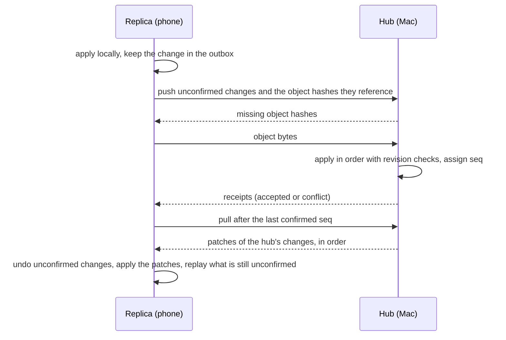
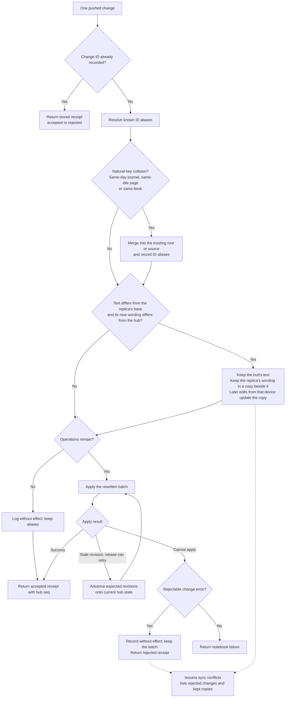

# Sync

Tessera syncs one person's notebook between devices they own: the Mac, the Android phone and later other machines on their tailnet. Collaboration and end-to-end encryption are not built. The rules below keep both possible without a rewrite.

## Shape

One notebook is the hub and puts every change in order. The others are replicas. A replica holds the whole outline and the library's text, fetches original book files when they are opened or pinned for offline reading, and keeps unconfirmed changes in a durable outbox.

The first hub is the Mac's service. The phone syncs while the Mac is awake and reachable on the tailnet. The hub is the same `tessera-service` binary, so it can move to an always-on machine later and the Mac becomes a replica.

This is the editor's existing outbox model with a durable replica behind it. Row-level merging (one last-writer-wins value per row) is ruled out because it breaks unique titles, journal dates, citation keys and the tree rules. A document CRDT is ruled out because it would make SQLite a materialized view and replace `tessera-core`.

## Protocol

### Clone

The hub registers the device and copies its database while holding the notebook. After releasing it, the hub strips its own state (patches, other replicas, import jobs, agent records, pins) and compacts the copy. The new device writes the streamed file to disk as it arrives.

### Push

A replica sends at most 200 unconfirmed changes per request. Each carries its change ID, origin device, stamp time, batch and base text: what each edited or split block contained before the change.

The hub applies the rules below, preserving every `tessera-core` rule. An already-applied change ID returns its stored receipt.

### Patches

While any active replica is registered, the hub records each commit as a SQLite session changeset of every applied table. It retains patches until every active replica acknowledges them.

Pulling patches makes replica rows match the hub exactly, including hub-decided merges and conflicts. A patch that cannot apply cleanly signals divergence: the replica aborts and requests a new clone rather than guessing.

### Retirement

After 30 days without contact, the hub retires a replica so a phone left in a drawer cannot retain every patch. Retired replicas can still push without losing changes, but pulling requests a new clone.

`tessera sync reclone` works in place:

1. Sends changes the hub has not seen.
2. Downloads a new clone.
3. Tells the hub to retire the old device ID.

Pins and fetched files remain; the old database stays beside the new one.

### Pull

A replica pulls after its last confirmed seq, in pages of at most 500 changes or 8 MiB of patches. It fetches each page's snapshots and applies the page before requesting another, acknowledging only the seq applied. Catch-up holds one page in memory; interruptions resume after the last applied page.

### Rebase

A replica records each local commit's patch with the change. When it pulls, it:

1. Undoes unconfirmed changes through their inverted patches, in reverse order.
2. Applies the pulled patches.
3. Drops changes the hub confirmed.
4. Replays the rest through the hub's rules.

Two differences from a patch do not signal divergence:

- Columns mirroring state outside the log: `sources.last_read_at`, `citations.resurface_muted_at`.
- Surfacing references to citations created by unconfirmed changes.

Foreign keys are checked after every patch is in. Those surfacings return when their citation is replayed.

### How the hub applies a change

The hub resolves aliases and natural-key collisions, keeps divergent text as a copy, then applies the batch. A stale revision advances onto the hub's state and retries; a rejected change is kept without effect.

### Conflicts

Revision checks rebase rather than fail. A stale operation's expected revision advances by the revisions the resource gained elsewhere, so moves, deletes, properties and capabilities take the later change.

Text keeps both versions. If block text differs from the replica's base, the hub keeps its text and places the replica's wording in a copy immediately after it. Later edits from that device update the copy rather than add more.

A change that still cannot apply, such as an edit to a hub-deleted block, is recorded without effect and retains its batch. `sync_conflicts` lists copies and rejected changes on every device.

### Natural-key collisions

Devices can create the same thing offline:

| Collision | Resolution |
|---|---|
| Page title matches another live page, or journal day already exists | Use the existing root. New children follow its children; later references to the new ID are rewritten through `id_aliases`. |
| Field name already exists | Use the existing field and retain its kind. |
| New type resolves to one with fields | Drop the change's field list for that type, so a first import on a second device cannot undo the Book type's setup. |
| Duplicate citation key | Add a suffix. |

### Library content

Snapshot rows, passages and resource lists travel as data, never re-extracted on receipt. Extractor changes between builds therefore cannot make devices disagree:

- Push first uploads referenced snapshots the hub lacks.
- Pull names referenced snapshots for the replica to fetch.
- Both transfer about 8 MiB of passage text per piece, splitting longer books between passages.
- Pieces are stored as they arrive. Partly stored snapshots count as missing until complete.

Snapshot IDs derive from the file's SHA-256. Every replica starts as a hub clone, so the same file has the same snapshot ID everywhere; each device retains its own staging time.

A book imported offline on two devices becomes one source. If a new source's match key or snapshot belongs to an existing source:

- Its page resolves to the existing page.
- Its imported children are dropped.
- A snapshot the existing source lacks is attached to it.
- Highlights under the new page follow through `id_aliases`.

A change with nothing left to do is still logged so its aliases hold.

### Objects

Original files, images and uploaded covers are content-addressed files. The hub keeps every file. Before pushing, a replica uploads missing files for snapshots its changes attach or cite, and the covers they link to.

After pulling, a replica fetches every cover plus original files and images for pinned sources (`tessera sync pin`). Other files arrive when used: an image request to a replica's service fetches a missing image from the hub, checks its hash and keeps it.

Files are never evicted. Missing hub files are reported rather than failing sync.

### State outside the log

Reading positions and highlight surfacings are written outside the change log. Each row carries:

- A hybrid logical clock in milliseconds, ahead of every clock the notebook has seen.
- The writing device.
- Its position in the notebook's arrival order.

A replica sends its rows written since the last push immediately after pushing changes, before pulling. After applying pulled changes, it receives hub rows that arrived since its last pull.

The later clock wins a reading position or surfacing action; the device breaks ties. A surfacing either device showed is kept. `sources.last_read_at` follows the latest position across the source's snapshots; a muted surfacing mutes its citation.

### Sequence columns

`review_events.change_seq`, `citations.created_seq` and other `*_seq` columns hold sequence numbers. Confirmed rows arrive as patches with hub numbering; unconfirmed changes receive new local numbers on replay.

Open pages follow a local arrival journal (`editor_events`), not `changes.seq`, because a rebase renumbers and replaces unconfirmed changes. Each commit, pulled change and replayed change adds an entry with a new cursor; sync entries carry the `sync` actor and mark every page they touch as restructured, so the page reloads even when a block's revision did not grow. Editor routes acknowledge commits with this cursor. Core sync receipts and agent undo still use log sequences. The migration starts the journal above the highest existing sequence, and pairing and recloning carry it forward, so saved cursors stay valid.

## Identity and determinism

Every device must reach the same state from the same changes, so applying a change depends only on the batch, its stamp and the current state.

- Each change has a global ID (a ULID) and an origin device, stored in `changes.change_id` and `changes.origin`. Its stamp time is `changes.created_at` and becomes every `created_at`/`updated_at` the change writes. `seq` stays the local order.
- Each notebook directory has a device ID in the `replica` table. Cloning a notebook for a new device must mint a new one; a backup restored on the same device keeps it.
- Clients choose the IDs of what they create (blocks, citations, sessions, events, views) and send them in operations, as they do now.
- IDs that `apply` itself creates are derived, never random:

| Created during apply | ID derived from |
|---|---|
| Deletion event | change ID, operation index, deleted block |
| Type page created by a tag | change ID, title key |
| Card unit | source block, card key (its unique identity) |
| Reset event recorded with a grade | the grade's event ID |
| Conflict copy of a block's text | change ID, block |
| Record of a rejected change | change ID |

- Library content IDs come from content. A snapshot's ID derives from its SHA-256, which is already unique per snapshot. A passage's ID derives from its snapshot and its locator, which is unique within the snapshot.
- Writes at open time (the notebook row and the Fields page) happen before a notebook is cloned, and the clone copies them.

`replication::TABLES` in `tessera-core` classifies every table by how a replica gets it. A test fails when a migration adds a table without a class.

| Class | Tables | A replica gets them by |
|---|---|---|
| Identity | `notebook` | cloning |
| Applied | blocks, capabilities, the change log, links, field values, views, settings, cards, review and work history, ID aliases, sync conflicts | patches of the hub's changes |
| Indexed | full-text search indexes | triggers, as rows arrive |
| Content | snapshots, passages, snapshot resources, browser objects | fetching by content hash |
| Unlogged | reading positions, highlight surfacings | last-writer-wins rows |
| Local | the device ID, ingestion jobs, agent undo records | never; they stay on the device |

The `vim` setting describes a keyboard, not a notebook. It becomes local to the device before replicas exist; `time_zone` stays notebook-wide.

## Transport

Editor routes stay on loopback and keep rejecting other hosts and origins. They still carry the hub routes for replicas on the same Mac, such as `tessera sync clone http://127.0.0.1:4318`, with no key.

Other devices reach the hub through a second listener on loopback, at the editor's port plus one (4319 for the installed app; `tessera serve --sync-port`). It serves only the hub routes and pairing, and every request except pairing carries `Authorization: Bearer <key>`. A request that names a device must name one that key cloned. Settings › Devices publishes this listener with `tailscale serve --bg --https=4319` and withdraws it with `tailscale serve --https=4319 off`; Tailscale supplies the certificate for the Mac's `ts.net` name. The hub touches no other Serve port.

Pairing starts on the Mac with a QR code for `tessera://pair?hub=<url>&code=<code>` and the same eight-character code to type. Codes live only in the running service, work once, expire after five minutes and are cancelled by five wrong tries.

The phone sends the code and its name, receiving a random key. The hub stores its SHA-256 in `sync_devices` and records which device cloned each replica.

Forget deletes the device row, revoking its key and retiring its replicas. The forgotten phone reports `unpaired` and offers Pair again. Its new key registers a temporary replica that sends only the phone's outbox and unlogged rows, never its log received from the hub. The phone then clones the hub again.

One HTTP client serves the command line and Android app. It uses rustls with bundled webpki roots, which accept Tailscale's Let's Encrypt certificates, and permits plain HTTP only to loopback.

The service runner syncs one replica at a time:

- At startup.
- Three seconds after a local commit.
- Every three minutes.
- On Sync now.

Network errors trigger backoff from five seconds to five minutes. While on screen, the app also syncs:

- When opened or returning from the background, even after failure.
- When the last sync is half a minute old, unless the last attempt failed; backoff then handles retries.

Android freezes background apps, so a closed phone waits until opened. Each local step takes the notebook lock separately; no network request holds it. The phone stays editable while waiting for the Mac.

The runner logs counts for each sync that moved changes, files or rows, and logs every failure. The hub logs each push's device and accepted/rejected change counts.

Every sync request carries the replica's schema, version and build in `x-tessera-schema`, `x-tessera-version` and `x-tessera-build`, and every hub response carries the hub's. The hub checks the key before the schema, so it knows which paired device it refuses. A refusal is a 409 `schema_mismatch` with both schemas in its details.

Both sides keep a short health record in memory, lost when the service restarts, so recording it needs no migration:

- The hub keeps, per paired device, the version it last reported, its last attempt, the refusal it is under (reason, since when, how many attempts) until a request succeeds, and its last 20 attempts. Attempts in a row with the same outcome count as one entry, so a sync's several requests read as one. `/api/sync/devices` returns them.
- A replica keeps the hub's last reported version, when its current run of failures started (`failing_since`) and its last 20 attempts, coalesced the same way. `/api/sync/state` returns them with this device's version.

While a service owns a replica, commands use its routes instead of opening the notebook:

| Command | Route |
|---|---|
| `tessera sync` | `/api/sync/run` |
| `sync status` | `/api/sync/state` |
| `sync conflicts` | `/api/sync/conflicts` |

A phone with its own notebook sends the hub its whole change log with empty text bases, plus snapshots, files, reading positions and surfacings. It then clones the hub and swaps the clone in place.

As with any push, matching page titles and journal dates resolve to the hub's root; changes the hub cannot apply remain in `sync_conflicts`. The Fields page predates the log and has different IDs in each notebook, so import first sends its creation for the hub to resolve by title.

The old database stays beside the new one as `notebook.db.before-pairing-<unix seconds>`. Two independent histories are never merged.

## Later: end-to-end encryption and collaboration

The hub reads changes only to validate them. Once applying a change is deterministic everywhere and a stale operation resolves to the same outcome on every device instead of being rejected, the hub can become a blind sequencer: it numbers and stores encrypted batches it cannot read, and every device decrypts and applies them in order. The resolution rules above (revision rebase, text copies, aliases) are already deterministic; session patches are a convenience a blind hub would give up, with every device running those rules itself. The notebook key would be wrapped once per device key. A shared subtree would be a second log with its own key and members.

Text edits replace a block's whole text. That is enough for one person's conflicts. Live collaboration would replace it with a text CRDT per block, so the block stays the unit of text and the outline model does not change.

## Stages

1. **Determinism and identity.** Done: change IDs and origins, a device ID, stamped apply, derived IDs inside apply, content-derived library IDs, table classes, and a test that two copies of a notebook reach identical state from the same changes.
2. **Replica protocol on loopback.** Done: clone with a new device ID, push, pull as session patches, rebase with inverted patches, text conflict copies, rejected changes, natural-key aliases, library text both ways, and `tessera sync` against a running hub. The browser build does not sync.
3. **Objects and library.** Done: files by hash with covers kept eagerly, other files fetched when opened, pinning, last-writer-wins reading positions and surfacings with a hybrid logical clock, and one source and one set of fields for books imported on two devices offline.
4. **Tailnet and Android.** Done: the sync listener behind Tailscale Serve, pairing, the in-process replica runner and the Android client. Interface, chosen from mockups (`~/Documents/tessera-design/sync-devices-mock/`):
   - **Devices** is a Settings section after Backups. On the Mac: the tailnet sharing switch and address, Pair a phone, each device with its last sync and Forget, and how much the hub keeps for devices that have not caught up. On the phone: the Mac it copies, Sync now and offline books, or Use my Mac's notebook.
   - **Pairing.** A new phone first chooses between the Mac's notebook and a separate one of its own, then scans the Mac's QR code or types the Mac's address and its short code. A code is used once and expires after five minutes.
   - **Status.** The third round, approved 2026-10-12, replaces the rail's mono line with a bare mark beside the Tessera wordmark (`wm-*` mockups in `~/Documents/tessera-design/sync-indicator-2026-10-12/`). A filled `--status-done` dot means synced or sending; a hollow `--warning` ring means unreachable or needs review; a `--danger` diamond means version mismatch, forgotten or retired. Shape and colour always agree. Pointer hover after 350 ms or keyboard focus shows the state and a short hint in a slip; click or tap opens the short summary under the mark, with the fixing action and a link to Settings › Devices. Touch opens a bottom sheet without a slip. The cover screen has no rail, so a row above the bottom nav shows only waiting or action states, with the same glyph, label and detail.
   - **Devices detail.** Each device in Settings › Devices expands into both sides' versions, the fix, the refusal or failure with its attempts, and a ledger of recent attempts. Needs review lists kept copies and rejected changes with their page and words.
   - **Rejected changes.** Copy the text back adds a rejected change's words as new blocks at the end of its page, or of today's journal when the page is gone, and settles it; Dismiss settles it alone (`settle_sync_rejection`, which hides it on every device). Each is one undoable step.
   - **Kept copies.** A copy kept beside a block is set off with the device's name and offers Use this (replace the block's text with it), Discard (delete it) and Keep both (`settle_sync_copy`, which makes it an ordinary block on every device). Each is one undoable step. Use this works only while the original is on the same page.

Exit test: offline, highlight a book on the phone while editing today's journal on the Mac; reconnect, and both devices show the highlights and the journal. When both edited the same block, both versions are shown.
