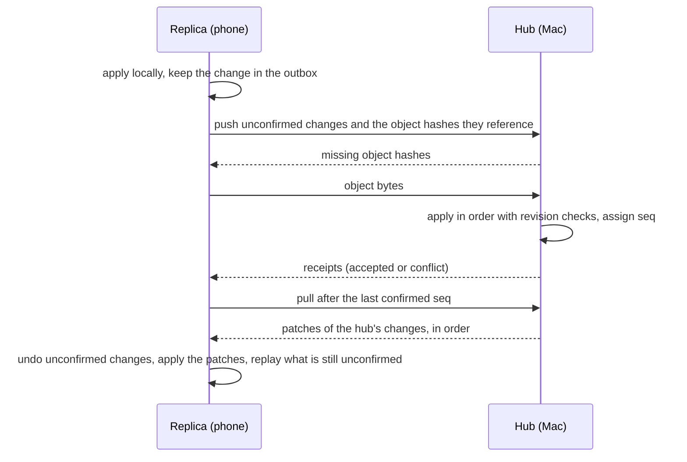

# Sync

Tessera syncs one person's notebook between devices they own: the Mac, the Android phone and later other machines on their tailnet. Collaboration and end-to-end encryption are not built. The rules below keep both possible without a rewrite.

## Shape

One notebook is the hub and puts every change in order. The others are replicas. A replica holds the whole outline and the library's text, fetches original book files when they are opened or pinned for offline reading, and keeps unconfirmed changes in a durable outbox.

The first hub is the Mac's service. The phone syncs while the Mac is awake and reachable on the tailnet. The hub is the same `tessera-service` binary, so it can move to an always-on machine later and the Mac becomes a replica.

This is the editor's existing outbox model with a durable replica behind it. Row-level merging (one last-writer-wins value per row) is ruled out because it breaks unique titles, journal dates, citation keys and the tree rules. A document CRDT is ruled out because it would make SQLite a materialized view and replace `tessera-core`.

## Protocol

- **Clone.** The hub registers the new device and copies its database while it holds the notebook. Removing its own state (patches, other replicas, import jobs, agent records, pins) and compacting the copy happen after it lets go, and the file is streamed to the new device, which writes it to disk as it arrives.
- **Push.** A replica sends each unconfirmed change with its change ID, origin device, stamp time, batch, and the text each edited or split block had before the change (its base), 200 changes per request. The hub applies it with the rules below, so every rule in `tessera-core` still holds. A change ID the hub has already applied returns the stored receipt.
- **Patches.** While any active replica is registered, the hub records each commit as a SQLite session changeset of every applied table and keeps it until every active replica has acknowledged it. A pull returns these patches, so a replica's rows become exactly the hub's rows, including outcomes the hub decided such as merges and conflicts. A patch that does not apply cleanly means the replica has diverged; it aborts and asks for a new clone instead of guessing.
- **Retirement.** A replica the hub has not heard from for 30 days is retired, so a phone left in a drawer does not make the hub keep every patch. A retired replica can still push, so nothing it changed is lost, but its pull asks for a new clone. `tessera sync reclone` does that in place: it sends what the hub has not seen, downloads a new clone, tells the hub to retire the old device ID, and keeps pins and fetched files. The old database stays beside the new one.
- **Pull.** A replica pulls in pages of at most 500 changes or 8 MiB of patches after its last confirmed seq. It fetches each page's snapshots and applies the page before asking for the next, and acknowledges only the seq it has applied, so a long catch-up holds one page in memory and an interrupted one resumes after the last page applied.
- **Rebase.** A replica records each local commit's patch with the change. Before applying pulled patches it undoes its unconfirmed changes by applying their inverted patches in reverse order. It then drops the ones the hub confirmed and replays the rest through the same rules the hub uses. Two things may differ from a patch without the replica having diverged: the columns that mirror state outside the log (`sources.last_read_at`, `citations.resurface_muted_at`), and references from surfacings to a citation an unconfirmed change created. Foreign keys are checked once every patch is in, and those surfacings come back when their citation is replayed.
- **Conflicts.** Revision checks rebase instead of failing: a stale operation's expected revision moves forward by the revisions the resource gained elsewhere, so moves, deletes, properties and capabilities take the later change. Text keeps both versions. When a block's text differs from the base the replica edited, the hub keeps its text and puts the replica's wording in a copy right after the block. Later edits from the same device update that copy rather than adding more. A change that still cannot apply, such as an edit to a block the hub deleted, is recorded without effect and its batch is kept. `sync_conflicts` lists copies and rejected changes on every device.
- **Natural-key collisions.** Two devices can create the same thing offline. A new page whose title another live page already has, or a journal day that already exists, resolves to the existing root. The change's children follow that root's children, and later changes that name the new ID are rewritten through `id_aliases`. A new field with the name of an existing field resolves to it and keeps the existing kind. When a new type resolves to one that already has fields, the change's field list for it is dropped, so a first import on a second device does not undo how the Book type was set up. A duplicate citation key gets a suffix.
- **Library content.** Snapshot rows, passages and resource lists travel as data and are never extracted again on the receiving device, so extractor changes between app builds cannot make devices disagree. A push first uploads the snapshots its changes reference that the hub lacks, and a pull names the snapshots its changes reference so the replica can fetch them. Either way content moves in pieces of about 8 MiB of passage text, splitting a longer book between passages; each piece is stored as it arrives, and a snapshot stored partway counts as missing until the rest arrives. Snapshot IDs derive from the file's SHA-256 and every replica starts as a clone of the hub, so the same file has the same snapshot ID everywhere; each device keeps its own staging time. The same book imported on two devices offline is one source: when a change creates a source whose match key or snapshot belongs to an existing source, the new source page resolves to the existing one, what the import put under it is dropped, and a snapshot the existing source lacks is attached to it. Highlights made under the new page follow through `id_aliases`. A change left with nothing to do is still logged, so its aliases hold.
- **Objects.** Original files, images and uploaded covers are content-addressed files. The hub keeps every file: before pushing, a replica uploads the files of the snapshots its changes attach or cite and the covers they link to, if the hub lacks them. After pulling, a replica fetches every cover, and the original files and images of pinned sources (`tessera sync pin`). Other files arrive when used: a replica's service that is asked for an image it lacks fetches it from the hub, checks its hash and keeps it. Files are never evicted. A file the hub does not have is reported rather than failing the sync.
- **State outside the log.** Reading positions and highlight surfacings are written outside the change log. Each row carries a hybrid logical clock (milliseconds, kept ahead of every clock the notebook has seen), the device that wrote it, and its place in the notebook's own arrival order. A replica sends the rows it wrote since its last push right after pushing its changes, before pulling, and receives the hub's rows that arrived since its last pull once the pulled changes are applied. The later clock wins a reading position and a surfacing's action, with the device as the tie-break; a surfacing either device showed is kept. `sources.last_read_at` follows the latest position of the source's snapshots, and a muted surfacing mutes its citation.
- **Sequence columns.** `review_events.change_seq`, `citations.created_seq` and the other `*_seq` columns hold sequence numbers. Confirmed changes carry the hub's numbering because their rows arrive as patches; unconfirmed changes take new local numbers when they replay.

## Identity and determinism

Every device must reach the same state from the same changes, so applying a change depends only on the batch, its stamp and the current state.

- Each change has a global ID (a ULID) and an origin device, stored in `changes.change_id` and `changes.origin`. Its stamp time is `changes.created_at` and becomes every `created_at`/`updated_at` the change writes. `seq` stays the local order.
- Each notebook directory has a device ID in the `replica` table. Cloning a notebook for a new device must mint a new one; a backup restored on the same device keeps it.
- Clients choose the IDs of what they create (blocks, citations, sessions, events, views) and send them in operations, as they do now.
- IDs that `apply` itself creates are derived, never random:

| Created during apply | ID derived from |
|---|---|
| Deletion event | change ID, operation index, deleted block |
| Type page created by a tag | change ID, title key |
| Card unit | source block, card key (its unique identity) |
| Reset event recorded with a grade | the grade's event ID |
| Conflict copy of a block's text | change ID, block |
| Record of a rejected change | change ID |

- Library content IDs come from content. A snapshot's ID derives from its SHA-256, which is already unique per snapshot. A passage's ID derives from its snapshot and its locator, which is unique within the snapshot.
- Writes at open time (the notebook row and the Fields page) happen before a notebook is cloned, and the clone copies them.

`replication::TABLES` in `tessera-core` classifies every table by how a replica gets it. A test fails when a migration adds a table without a class.

| Class | Tables | A replica gets them by |
|---|---|---|
| Identity | `notebook` | cloning |
| Applied | blocks, capabilities, the change log, links, field values, views, settings, cards, review and work history, ID aliases, sync conflicts | patches of the hub's changes |
| Indexed | full-text search indexes | triggers, as rows arrive |
| Content | snapshots, passages, snapshot resources, browser objects | fetching by content hash |
| Unlogged | reading positions, highlight surfacings | last-writer-wins rows |
| Local | the device ID, ingestion jobs, agent undo records | never; they stay on the device |

The `vim` setting describes a keyboard, not a notebook. It becomes local to the device before replicas exist; `time_zone` stays notebook-wide.

## Transport

Editor routes stay on loopback and keep rejecting other hosts and origins. For now the hub routes (`/api/sync/clone`, `push`, `pull`, `rows` and the snapshot and object routes) sit on the editor's loopback listener, and every request carries the client's schema version; the hub refuses a different one. `tessera sync clone <url>` turns a new notebook directory into a replica, `tessera sync` pushes and pulls, and `tessera sync pin` marks a source to keep. The command opens the replica directly and refuses while a service owns it.

Later, sync gets its own listener with only push, pull and object routes, published on the tailnet through Tailscale Serve, which supplies the TLS certificate and the caller's tailnet identity. Each device also holds a key enrolled by pairing with a QR code shown by the hub.

On Android, `reqwest`'s platform TLS verifier is not initialized. The sync client uses rustls with bundled roots, which accept the Let's Encrypt certificates Tailscale issues for `ts.net` names, or the app sets up the verifier, which would also enable article URLs.

A phone that already has its own notebook imports its phone-only content into the hub once, then clones from the hub. Two independent histories are never merged.

## Later: end-to-end encryption and collaboration

The hub reads changes only to validate them. Once applying a change is deterministic everywhere and a stale operation resolves to the same outcome on every device instead of being rejected, the hub can become a blind sequencer: it numbers and stores encrypted batches it cannot read, and every device decrypts and applies them in order. The resolution rules above (revision rebase, text copies, aliases) are already deterministic; session patches are a convenience a blind hub would give up, with every device running those rules itself. The notebook key would be wrapped once per device key. A shared subtree would be a second log with its own key and members.

Text edits replace a block's whole text. That is enough for one person's conflicts. Live collaboration would replace it with a text CRDT per block, so the block stays the unit of text and the outline model does not change.

## Stages

1. **Determinism and identity.** Done: change IDs and origins, a device ID, stamped apply, derived IDs inside apply, content-derived library IDs, table classes, and a test that two copies of a notebook reach identical state from the same changes.
2. **Replica protocol on loopback.** Done: clone with a new device ID, push, pull as session patches, rebase with inverted patches, text conflict copies, rejected changes, natural-key aliases, library text both ways, and `tessera sync` against a running hub. The browser build does not sync.
3. **Objects and library.** Done: files by hash with covers kept eagerly, other files fetched when opened, pinning, last-writer-wins reading positions and surfacings with a hybrid logical clock, and one source and one set of fields for books imported on two devices offline.
4. **Tailnet and Android.** The sync listener behind Tailscale Serve, pairing, and the Android client.

Exit test: offline, highlight a book on the phone while editing today's journal on the Mac; reconnect, and both devices show the highlights and the journal. When both edited the same block, both versions are shown.
